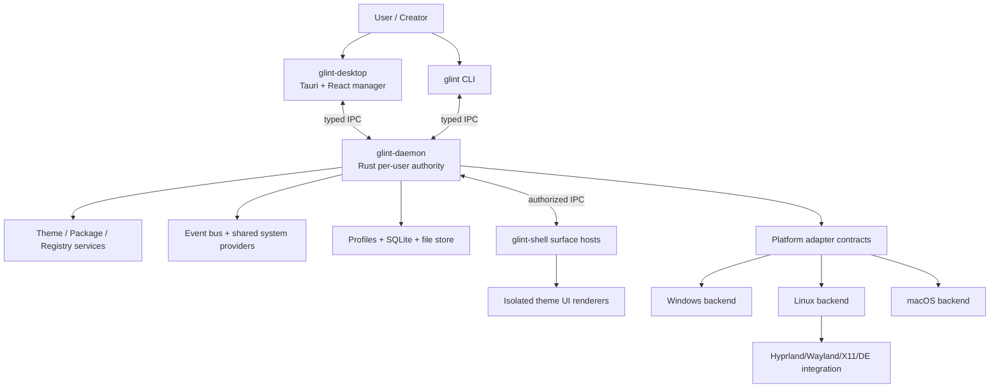

# System architecture — shared engine, multiple OS hosts

**Status:** RECOMMENDED reference architecture for Glint. The user-approved constraints are Rust direction, multi-OS support, deep customization, official/public library and portable/independent themes.

## Fundamental rule

Glint fully owns **its own custom shell surfaces**, but only orchestrates **supported** native OS settings. A theme never gets raw native access; it requests operations through typed SDK APIs and capability-scoped platform adapters.

## Processes (recommended)

| Process | Role | Lifetime | Trust boundary |
|---|---|---|---|
| `glint-desktop` | Manager UI, gallery, inspector, theme customization | On demand | Trusted app UI, bounded commands |
| `glint-daemon` | Authoritative installed state, platform API access, event bus, service orchestration | User session/background | Trusted native core; no arbitrary theme exec |
| `glint-shell` | Native surface/window hosting, layout coordination and renderer supervision | User session, starts as needed | Must treat theme UI as untrusted |
| `glint` CLI | User commands and creator toolchain | Invocation | Talks to daemon, or offline build/package libs |
| `theme renderer` | Runs compiled JS/CSS and sends scoped SDK messages | Per trust group/surface | Strongly isolated from daemon/native APIs |

Not all platforms require identical process counts. Windows surface hosts may share one process with multiple webviews; Linux native layer shells may require a GTK event loop and careful process isolation; macOS WKWebView hosts may require main-thread AppKit. Keep process contracts stable despite implementation differences.

## Rust workspace responsibility map

- `glint-core`: lifecycle, feature orchestration and activation policy.
- `glint-platform`: traits/types shared by OS adapters; capability and error model.
- `glint-windows`, `glint-linux`, `glint-macos`: platform implementations.
- `glint-surfaces`: surface definitions, position, monitor mapping, focus, lifecycle.
- `glint-renderer`: script/webview hosting abstraction and renderer supervision.
- `glint-system`: shared data services (audio, battery, network, media, apps, monitors).
- `glint-events`: versioned internal events and subscription logic.
- `glint-theme`: theme parse/resolve/compose/application plan.
- `glint-package`: `.glint` archive read/build/validate.
- `glint-sources`: Git/local/file/download source adapters.
- `glint-registry`: repository indexes and cached metadata.
- `glint-installer`: installation state machine and rollback.
- `glint-storage`: SQLite/paths/config/profiles/manifest locks.
- `glint-permissions`: per-package grants, data boundaries and authorization checks.
- `glint-ipc`: typed request-response and event streaming.
- `glint-assets`: validated asset access, hashes, fonts, wallpapers, image caches.

## JS/TS workspace responsibility map

- `packages/sdk`: public `@glint/sdk` accessors/hooks and call interface.
- `packages/theme-runtime`: JS bootstrap, custom render entry, subscription bridge.
- `packages/ui`: optional Glint UI kit; not required for custom themes.
- `packages/types`: shared/generated TS types from Rust/schema definitions.
- `packages/theme-schema`: JSON Schema and TS validation helpers.
- `packages/create-glint-theme`: templates and scaffolding.

## Data flows

**Browse:** manager -> daemon.registry.list -> cached index or remote Git/index -> normalized package metadata -> gallery. No native theme settings change.

**Install:** source resolver -> staging -> archive/manifest/asset validation -> compatibility + permission presentation -> atomic local package placement + lockfile -> installed inventory.

**Apply:** composed profile -> capability reconciliation -> transaction plan -> snapshot -> create/update Glint surfaces -> supported native integration changes -> commit profile or restore.

**Runtime:** OS-specific watchers -> normalized event bus -> deduplicated subscription provider -> permission-filtered renderer event -> hook state re-render -> user action -> validation -> adapter -> acknowledgement.

## Guardrails

- Only one daemon owns writable profile/package state for a user session; use lock/IPC handoff.
- All state mutations are typed and journaled; renderer never directly edits daemon SQLite or native state.
- Renderer crashes must not crash daemon or take down native desktop.
- No mandatory cloud. Public Git is a distribution source, not a telemetry service.
- All platform methods expose `unsupported`, `permission-denied`, `unavailable`, `timeout` and real error distinctions.
- Every native change should define a compensating restore function where possible.

## Alternative designs reviewed

One combined process would simplify IPC and debugging but couples UI crashes, GTK/window loops and native capabilities. Three separate OS-specific products would optimize native integration but violate unified theme package objectives. A pure webview shell would reduce frontend complexity but is not sufficient for compositor layer placement and OS-owned system UI. See `01-product/vision-and-positioning.md`.
