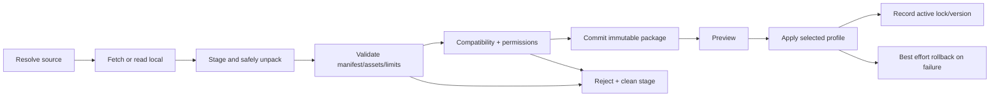

# Unified installer state machine, profiles and recovery

## State machine

## Resolver invariants

Input `ThemeSource` resolves to canonical `ThemePackage {manifest, contentRoot, origin, digest}`. The rest of the installer never cares if content came from official library, arbitrary Git repo or `.glint`. This is an essential portability constraint.

## Transaction steps

1. Normalize source and require explicit approval for remote downloads/permissions where UI rules require.
2. Download or read package to bounded staging with streaming hash and max size.
3. Reject path traversal, duplicate names, symlinks and archive bombs before touching active package dirs.
4. Validate `glint.json`, signatures if available, referenced assets/entrypoint files and all compatibility info.
5. Compare requested new grants with current grants and display privilege differences.
6. Atomically move package into content-addressed store; update DB record/lockfile; don't activate by default during CLI import unless explicitly requested.
7. Preview in safe mode; validate surface readiness and fallback.
8. Apply with snapshot + OS action journal; record active profile revision.
9. On failure, restore old Glint surfaces and best-effort prior OS settings. Show exact partial failures.
10. On uninstall, check profile references first; don't destroy active package while a surface uses it.

## Version/lock policy

`installed-themes.json` or SQLite tracks package version and digest; a profile lock pins exact identities. Keep old pinned versions until no profile needs them or user deliberately removes. Detect identity collisions and require explicit disambiguation for same ID from differing origins.

## Crash/recovery contract

- Background daemon restarts safely after crash and detects incomplete transaction journal.
- `glint safe-mode` runs default theme only; disable third-party renderer auto-start.
- `glint theme use default` and a manager recovery UI work even if all downloaded packages are broken.
- If native wallpaper/cursor update partially succeeded, show affected settings and whether rollback restored them.
- Never make the user unlock/login through a Glint-controlled UI.

## Update lifecycle

`check` -> version compare -> stage candidate -> verify -> inspect permission delta -> preview -> activate as new version -> retain rollback. Do not mutate installed files in place or overwrite the only known-good package.

## Error taxonomy

`source-not-found`, `auth-required`, `download-failed`, `hash-mismatch`, `invalid-archive`, `invalid-manifest`, `unsupported-platform`, `missing-capability`, `permission-denied`, `dependency-conflict`, `filesystem-full`, `renderer-start-failed`, `native-apply-failed`, `rollback-incomplete`. Every code maps to actionable CLI/GUI feedback and diagnostics.

## Acceptance tests

- Import same package twice is idempotent.
- Corrupt ZIP and absolute/traversal paths cannot escape staging.
- Installer interrupted before commit leaves active profile untouched.
- Remote repo cannot force code execution by including scripts or submodules.
- Invalid required capability blocks activation with old theme preserved.
- Update with increased permissions requires explicit approval.
- Offline installed theme still renders even if GitHub is unreachable.
