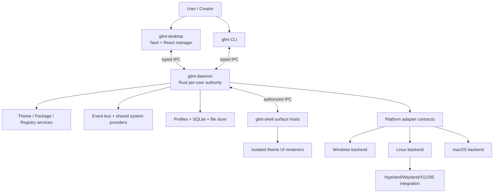
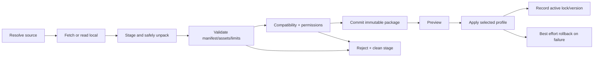

# GLINT — ALL-IN-ONE MASTER KNOWLEDGE DUMP

Snapshot: 2026-11-23. This is a single-file compilation of the standalone Markdown documents.
Sections below preserve their original file path so content can be found in the archive.
This is a structured reconstruction, not a verbatim past-chat export.

---


---

## SOURCE FILE: `README.md`

# Glint — master plan and complete project knowledge archive

**Snapshot:** 2026-11-23  |  **Status:** planning/reference package, not implemented software  |  **Target:** Windows, Linux, macOS

Glint is a **local-first, Rust-powered, cross-platform desktop experience and theme platform**. It lets someone apply an entire desktop aesthetic—wallpaper, typography, icons, desktop widgets, dock/panels, launchers, quick settings, notification surfaces and supported native integrations—from a portable theme. Theme creators can code whole Glint-managed screens using a programmable SDK, or create simpler declarative themes. Glint is not a new window manager or compositor and cannot universally replace OS-owned secure/native interfaces.

This archive consolidates the Glint discussions in the current conversation **and** the earlier *Assess Rust Theme App* discussion (November 2026), plus explicitly labeled implementation recommendations and research. It is an editable design dossier, **not** a verbatim export of every chat message, nor a claim that the referenced code has been built or tested.

## Read in this order

1. [`00-history/decisions-and-open-questions.md`](00-history/decisions-and-open-questions.md) — what the user explicitly decided vs what remains recommended.
2. [`01-product/vision-and-positioning.md`](01-product/vision-and-positioning.md) — product scope, goals and non-goals.
3. [`02-architecture/system-architecture.md`](02-architecture/system-architecture.md) — process boundaries, components and data flows.
4. [`03-platforms/compatibility-matrix.md`](03-platforms/compatibility-matrix.md) — practical OS guarantees and limits.
5. [`04-themes/theme-system-end-to-end.md`](04-themes/theme-system-end-to-end.md) — how a theme owns screens.
6. [`05-distribution/registry-and-glint-library.md`](05-distribution/registry-and-glint-library.md) — official library versus independent creators.
7. [`docs/superpowers/specs/2026-11-23-glint-platform-design.md`](docs/superpowers/specs/2026-11-23-glint-platform-design.md) — consolidated Superpowers-style design spec.
8. [`docs/superpowers/plans/2026-11-23-glint-foundation-plan.md`](docs/superpowers/plans/2026-11-23-glint-foundation-plan.md) — testable first implementation tasks.

## Directory map

| Directory | Purpose |
|---|---|
| `00-history` | discussion timeline, traceability, terminology and decisions |
| `01-product` | vision, detailed feature inventory, UX, branding, journeys |
| `02-architecture` | processes, IPC, state, renderer, surface abstraction, data and reliability |
| `03-platforms` | Windows, Linux/desktop environments, macOS and capability matrix |
| `04-themes` | authoring, SDK, manifests, `.glint`, composition, extensions, sandboxing |
| `05-distribution` | `glint-library`, Git repositories, package delivery and release workflows |
| `06-engineering` | monorepo, CLI, tests, roadmap, backlog, risks |
| `07-examples` | sample configuration, manifests, theme source and usage flows |
| `08-research` | verified prior art, official technical references and feasibility spikes |
| `docs/superpowers` | formal specs and executable implementation plans |

## Accuracy / decision labels

- **CONFIRMED:** explicitly requested or accepted in Glint discussions.
- **RECOMMENDED:** implementation design proposed in conversation or this document, not yet approved as a hard commitment.
- **RESEARCH REQUIRED:** behavior or platform feasibility must be prototyped and verified on actual systems.
- **NOT GUARANTEED:** OS-native surfaces/functions that Glint cannot unilaterally replace.

Do not silently turn a RECOMMENDED interface, concrete API signature, version, schedule or feature into a CONFIRMED requirement. This is a living specification.

## Product boundary in one sentence

**Glint fully controls Glint-managed UI, orchestrates supported desktop settings, and uses capability-aware OS adapters; themes never get unrestricted native OS access simply because they are installed.**

## Important naming

- `glint`: main application, daemon, CLI, SDK and UI runtime repository.
- `glint-library`: **official public theme library maintained by the Glint project**. It is not a mandatory hosting service and not a synonym for the entire ecosystem.
- Third parties may host their own Git repositories or publish portable `.glint` files, and user profiles may combine several installed themes.
- Glint Studio / Glint Hub are names considered in the earlier discussion, **not confirmed standalone products**.

## Release disclaimer

Examples in this archive illustrate future APIs such as `@glint/sdk`, `glint theme install`, and manifest `schemaVersion: 1`. They are **design examples**, not existing published packages or verified commands.


---

## SOURCE FILE: `00-history/discussion-timeline.md`

# Discussion timeline — how Glint evolved

This timeline summarizes recoverable decisions and proposals. It is a **concept-level conversation reconstruction**, not a transcript or proof of implementation.

## 2026-11-18 — Windows customization to an OS-wide platform

- The initial request: assess feasibility of a **Rust application** to edit the entire Windows appearance: taskbar, control panel, widgets, notifications, and the rest, with a **Nothing UI-inspired** identity.
- The direction shifted from one hardcoded Nothing-style Windows replacement toward a **general-purpose theme application**. The user considered publishing a Nothing-inspired theme in a marketplace rather than making every Glint installation look identical.
- **Caelestia Shell** was identified as a useful inspiration for desktop shell richness and customization, but Caelestia is a Linux/Hyprland-oriented shell rather than a cross-platform solution.
- The user explicitly expanded scope to **multiple operating systems, including Linux and Windows**, and later macOS; avoid any design that only handles Hyprland.
- Naming explored short/shell-style variants. The user rejected convoluted/generic names and unnecessary shell suffixes and selected the standalone project name **Glint**.
- Brand direction: **no green tones**; a monochrome graphite/chrome palette was accepted. See `01-product/brand-and-design-language.md`.

## 2026-11-23 — Architecture discussion

- Agreed goal: a customizable desktop *experience*, not just wallpaper/color toggles.
- Proposed three responsibilities: `glint-desktop` (settings), `glint-daemon` (per-user background state and OS adapters), `glint-shell` (Glint-controlled panels, widgets and overlays).
- Proposed Rust core, OS adapters, Tauri 2 + React/TypeScript settings UI, separate shell surface hosting, local-first state, theme and package management, and multi-monitor support.
- Critical constraint surfaced: **the operating systems do not expose equivalent theme/shell APIs**. Cross-platform means a unified UX with honest capability detection, not claiming every privileged screen can be replaced everywhere.

## 2026-11-23 — Library and installer discussion

- The user established a **separate `glint-library` repository**, publicly readable and owned by the project, as the default source of official themes.
- Glint itself should ship a default configuration that points to that repository. `glint theme` can browse/discover/install, and the installer fetches only what it needs when possible.
- The user explicitly corrected the model: **community authors must not be forced into `glint-library`**. They can publish an independent GitHub/Git repo, upload a package release, or share a `.glint` file. Direct `.glint` import and export must work offline.
- Proposed common packaging rule: every source resolves to the same validated internal package representation. Package tracking records version, origin, hashes and update strategy.

## 2026-11-23 — Fully programmable themes

- The user asked how **all themes** can work: who writes code for every screen, not just swaps colors.
- Proposed theme-owned **surfaces**: panel, dock, app launcher, control center, notification popup, notification center, clock/calendar, power menu, workspace switcher, window switcher, volume/brightness OSD and desktop/widgets.
- Proposed two author modes: declarative token/layout themes and **programmable React + TypeScript themes** compiled to packaged JS/CSS and run in managed, restricted renderers.
- Glint SDK supplies system hooks, events, state and scoped actions; native OS code stays in trusted adapters.
- Proposed per-surface composition: users can mix different themes for panel, dock, wallpaper, notification and control center, with default-theme fallback.
- The user reiterated **multiple OS support**, so both the theme ABI and adapters must carry capability information.

## Corrected or refined ideas

| Earlier framing | Corrected framing |
|---|---|
| “Full Windows theme editor” | Cross-platform desktop experience platform; Windows native-shell replacement is limited and optional. |
| “Nothing theme built into app” | Glint is a general platform; Nothing-like themes are examples, not the only design. |
| “Official repo is the theme source” | Official **default** repository **plus** arbitrary community Git repos and `.glint` packages. |
| “Theme = tokens and wallpaper” | Theme may implement complete Glint-managed UI surfaces and integrations. |
| “Same exact feature everywhere” | Shared APIs with capability discovery, graceful fallback and per-platform overrides. |
| “All screens are replaced” | Glint-managed surfaces can be replaced; native and secure OS UI cannot universally be overridden. |

## Related, distinct project context

A separate *Nothing UI component library* discussion included React/web/native packages, dotted icons and 13×13/25×25 glyph matrices. This is useful **design inspiration for a possible Glint theme**, but that package is **not automatically a Glint dependency or part of Glint's architecture**. See `01-product/brand-and-design-language.md`.


---

## SOURCE FILE: `00-history/decisions-and-open-questions.md`

# Decision register, proposal status, unresolved questions

## Confirmed by user discussion (binding product requirements)

| ID | Decision / constraint | Source context |
|---|---|---|
| D01 | Name of project is **Glint**. | Earlier naming discussion |
| D02 | Glint must target **multiple desktop OSes**, particularly Windows and Linux and also macOS. | Initial cross-platform correction and current discussion |
| D03 | Goal is deep theme/desktop customization: panels/taskbar-like surfaces, widgets, notification UI, controls, wallpaper, icons etc. | Original Rust customization request |
| D04 | Glint is a general theme platform, not permanently locked to a Nothing UI look. | Pivot from hardcoded design to marketplace/themes |
| D05 | `glint-library` is a **separate, publicly readable, project-owned official library repository**. | Registry discussion |
| D06 | Glint ships default configuration pointing at the official library. | Registry discussion |
| D07 | Third parties can host independent Git repos; official-library submission is optional. | User's explicit clarification |
| D08 | Standalone portable **`.glint` import/export** must work; no forced Git hosting. | User's explicit clarification |
| D09 | Theme designers must be able to customize **entire Glint-managed screens** rather than only colors or backgrounds. | “how ... write code for screens” |
| D10 | Multi-OS architecture and feature differences must be remembered in every design. | User's repeated reminder |
| D11 | Brand palette avoids green and is neutral, graphite, silver, white. | Earlier color decision |

## Recommended architecture (not yet explicitly locked)

- Rust core plus **per-user daemon**, settings application and independent shell surface hosts.
- `Tauri 2 + React + TypeScript` for management UI; React/TypeScript as **one supported programmable theme authoring mode**; avoid committing all surfaces to Tauri's window abstraction.
- Rust `wry` + platform-specific native window containers where embeddable webviews work; fallback to native surface renderers as needed.
- `@glint/sdk`, `@glint/theme-runtime`, `@glint/ui` (optional), `glint-package`, `glint-registry`, `glint-sources` etc.
- Manifest `glint.json`, `.glint` ZIP archive, format/schema versioning, Git sparse/partial fetching where beneficial.
- Explicit capability negotiation, permission gating, renderer isolation, default fallback theme and profile composition.
- Hyprland as an early *deep shell integration* target alongside a Windows appbar/overlay path, not as the exclusive supported OS.
- Local-first SQLite plus files; no mandatory backend, login or marketplace.
- Developer tool CLI `glint theme dev`, `build`, `pack`, `validate`, `import`, `use`.

## Open product decisions

| ID | Question | Working recommendation | Why it matters |
|---|---|---|---|
| O01 | Can authors target only certain OSes? | **Yes**; platform compatibility and required capabilities are explicit. | Avoid lowest-common-denominator themes. |
| O02 | Is React mandatory? | **No** for declarative themes; React/TS recommended for programmable v1. | Wider creator ecosystem. |
| O03 | Does the application modify native taskbars by default? | No; custom Glint panels first, native modifications only via supported adapters/opt-in. | Stability and user trust. |
| O04 | How are community themes trusted? | Data-only by default; sandboxed programmable themes with strict IPC permissions. | Supply-chain security. |
| O05 | Which Linux session first? | Hyprland Wayland deep support + portable desktop preview; add X11, KDE/GNOME in phases. | Reduce integration surface. |
| O06 | Which first Windows SKU? | Windows 11 initial target; Windows 10 support explicitly evaluated, not assumed. | API support and QA. |
| O07 | macOS minimum version? | Decide after native surface spike. | Deployment compatibility. |
| O08 | `.glint` as theme only or multi-kind? | One container format with `kind`: theme/widget/wallpaper/profile etc. | Extensible ecosystem. |
| O09 | What does “Glint Hub/Studio” mean? | Reserve names for possible UI areas, do not create new repos/products yet. | Scope control. |
| O10 | Theme author native extension API? | No arbitrary native binaries in v1; approved adapters and optional later WASM. | Security. |
| O11 | Which license? | Undecided; core, SDK, library and individual themes may have different licenses. | Community contributions. |
| O12 | Do themes style arbitrary third-party apps? | Only integrations with native, supported theme engines. | Cannot safely restyle every app. |

## Anti-goals / forbidden assumptions

- Do not claim that Windows Control Panel, Windows 11 taskbar, GNOME Shell, macOS Notification Center, login/UAC/Secure Desktop or every third-party application can be fully re-skinned through one universal API.
- Do not require a central theme server, GitHub account, paid marketplace, Node toolchain for users or an always-online connection to apply installed themes.
- Do not execute arbitrary shell scripts, native binaries, privileged code or theme-supplied system hooks from imported packages.
- Do not require a theme to ship Windows/Linux/macOS implementations if its metadata explicitly limits support.
- Do not make `glint-library` the only permitted repository.
- Do not clone the full multi-GB theme library just to list it or install one package.
- Do not use proprietary Nothing branding/assets in official themes without rights; visual inspiration != affiliation.

## Document maintenance contract

Any new decision should update this register and the dependent spec. Changes to public manifests, package IDs, SDK event payloads and capability semantics require an ADR/migration entry before release. Every recommendation that remains unapproved is explicitly labeled RECOMMENDED or RESEARCH REQUIRED elsewhere.


---

## SOURCE FILE: `00-history/glossary-and-concepts.md`

# Glint glossary and conceptual model

**Glint-managed surface:** Window/desktop UI region whose content and lifecycle are owned by Glint (panel, popup launcher, OSD, control-center, notification overlay, custom desktop area). Author controls its DOM/layout; Glint controls host placement, focus, input, and permissions.

**OS-owned surface:** UI managed by Windows Explorer/DWM, GNOME Shell, KDE Plasma, macOS Dock/Menu Bar/Notification Center, a login manager, or an arbitrary app. Glint can only influence it through documented/supported integrations; the theme runtime has no direct ownership.

**Theme:** Versioned package that specifies tokens, assets, surface implementations, layouts and optional supported integration requests.

**Declarative theme:** Data-only theme; modifies presets/tokens/layouts of shipped UI components. Requires no code compilation for the creator.

**Programmable theme:** Theme with prebuilt JS/CSS UI bundles (recommended v1: React/TypeScript source), running inside restricted renderers. Consumers need no Node toolchain.

**Widget:** Self-contained visual module mounted within a surface, e.g., a clock, weather card or music player. Several widgets may share one renderer.

**Surface host:** Native OS window/layer application managing position, z-order, display and input for theme-rendered UI. Can be multiple host processes or windows.

**Platform adapter:** Rust code implementing a specific OS or compositor capability: wallpaper, audio, brightness, workspaces, app enumeration, panels, notifications etc.

**Capability:** A runtime guarantee/degree of support for one operation; more precise than a single bool (supported, read-only, unavailable, needs permission, experimental, etc.).

**Permission:** A user-granted rule allowing a theme/extension access to approved SDK methods, data or external network/file resources.

**Profile:** User's saved set of chosen theme versions, surface overrides, widget layouts, monitor mappings and native adaptation settings; can mix themes.

**Official library (`glint-library`):** Project-maintained public Git repository holding official curated themes and an index. **Optional to use**.

**Registry:** Index of available themes and metadata. Official library is one registry; other registries may be independent.

**Theme source:** One of official/custom registry, direct Git URL/ref/subpath, local source directory, local `.glint`, or downloadable `.glint` artifact.

**`.glint` package:** Portable, versioned package envelope. Recommended v1: ZIP format, root `glint.json`, compiled assets and no implicit online dependencies.

**Provider:** Daemon-managed system data source (network, audio, workspaces, media) with a shared subscription/refcount rather than one native watcher per widget.

**Theme SDK:** Namespaced, permission-aware API accessible to JS UI components through a narrow IPC bridge.

**Snapshot / restore point:** Journal of previous Glint state and selected OS state, used for best-effort rollback. Does not imply an atomic OS transaction.

**Preview mode:** Restricted renderer with simulated system data, safe display-only surface and no native setting changes.

**Fallback:** Built-in default implementation used when a theme does not provide a surface or a host cannot safely realize it on that OS.

**Integration adapter:** An optional module that applies compatible native system theming (e.g., KDE global themes, gtk theme preference), distinct from executing theme code.

**Per-user daemon:** Background process bound to the logged-in user's desktop session, not a privileged machine-wide service by default.

**Nothing-inspired:** A visual reference: monochrome, sharp geometry, glyph/dot motifs. It is not a license to redistribute trademarks, licensed fonts, sounds or vendor system assets.


---

## SOURCE FILE: `00-history/conversation-knowledge-dump.md`

# Recovered conversation knowledge dump

This is the compact but broad record of **every Glint-specific idea and correction recoverable from the preceding conversation and the earlier project chat**. It deliberately separates original asks from assistant proposals. Not a verbatim chat export.

## Original intent

- A Rust application able to drastically theme a Windows desktop: “whole windows theme,” “widgets,” taskbar, control panel, notifications and other UI; Nothing OS-style look and feel.
- Evaluate whether it is technologically possible and practical, including marketplace publication of a themed experience instead of writing one hardcoded custom OS shell.
- Inspired by Caelestia Shell and potentially other rich desktop shell ecosystems.
- Scope broadened to all major desktop OSes; Windows-only or Linux-only architecture is unacceptable as the long-term product.
- Name exploration rejected complicated names, overly common names and unnecessary `shell` suffix. Selected `Glint`.
- Explicit brand constraint: **no green tones**. Chosen palette: Obsidian `#0B0C0F`, Graphite `#181A20`, Gunmetal `#2B2F38`, Titanium `#727A89`, Silver `#B9C0CC`, Chrome `#D7DBE3`, Frost `#F5F6F8`, White `#FFFFFF`, Muted `#9298A3`.

## Core and OS architecture discussion

- Rust as primary system engine and native integration language.
- Assistant recommended Tauri 2 + React + TS for desktop settings; Rust `Tokio` daemon, platform adapter traits, event bus, state/config/asset managers, layout engine, permissions, IPC and package installer.
- Process division: `glint-desktop` settings, `glint-daemon` state/service manager, `glint-shell` actual Glint-generated desktop surfaces, and `glint` CLI.
- Windows: wallpaper APIs, appbars, overlays, system controls, optional shell integration; no guarantee of replacing Explorer taskbar or system-owned UIs.
- Linux: Wayland/X11 plus compositor-specific bridges; Hyprland socket IPC, layer-shell for supporting compositors, GNOME Shell extensions/KDE Plasma integrations when appropriate.
- macOS: AppKit, status items, desktop overlays, wallpaper APIs; full native menu bar/Notification Center replacement unrealistic.
- Proposal that Glint should not build a new compositor/window manager. Theme code uses abstractions and capability detection rather than platform-specific syscalls.

## Public library and community distribution

- `glint-library` is a **second repository maintained by us**, publicly available, default set of themes. `glint` app ships a default config pointing to its repo.
- The `glint theme` command should browse/sync/install and fetch a selected theme. Optimize against cloning the entire library on every operation; reuse cache, index and sparse/partial Git fetching when appropriate.
- Crucial user correction: any user can create **their own GitHub/Git repo**, publish a packaged theme, or distribute a `.glint` file and directly import it into the application. Official-library inclusion is never required.
- Recommended concept: portable ZIP-based `.glint` package with one versioned manifest, local/offline import, compiled assets, no build tool required on consumers; registry metadata separate from theme manifest.
- Recommended CLI: `glint theme browse`, `search`, `install official/name`, `install <git-url>`, `import file.glint`, `use`, `list`, `update`, `create`, `build`, `validate`, `pack`, `export`; `glint registry add`, `sync`.
- Sources normalized through common staging, validation, compatibility checks, install and rollback pipeline. Track original source, version, commit and content hash.

## Full programmable screens / surfaces

- User explicitly rejected a mere “color tokens + wallpaper” theme system; wanted authors to **write screen code for all UI**.
- Proposed category name **surface** for a Glint-owned screen/region, distinct from widgets.
- Proposed surface identifiers: `panel`, `dock`, `launcher`, `control-center`, `notification`, `notification-center`, `desktop`, `calendar`, `power-menu`, `workspace-switcher`, `window-switcher`, `volume-osd`, `brightness-osd`, `media-overlay`, plus custom surfaces.
- Recommended React + TS, CSS for programmable theme source, compiled into static bundles. Illustrative hooks: `useClock()`, `useSystem()`, `useAudio()`, `useBrightness()`, `useNetwork()`, `useWorkspaces()`, `useCapabilities()`, `useGlint()`.
- Theme manifest maps surface IDs to entries, positions and sizes. Shell renderer creates OS-specific host and provides system data, event subscriptions and scoped actions.
- Declarative/no-code themes coexist with programmable themes, use same packaging/import pipeline.
- Built-in default theme fills missing surfaces; optional surface-by-surface overrides allow mix-and-match: base aesthetic from Mono, dock from Glass, notifications from another, wallpaper custom.
- Separate security boundaries for untrusted script content; no arbitrary native execution when a `.glint` is imported.

## Naming and repositories

- Main repo: `glint` containing `apps/desktop`, `apps/daemon`, `apps/shell`, `apps/cli`, Rust crates, SDK/packages, default theme, examples and docs.
- Official repo: `glint-library` containing `registry.json`, themes and previews, workflows and submission docs.
- Earlier speculation included Glint Studio, Glint Hub and Glint SDK naming; only main Glint name and separate library are binding.

## Visual and ecosystem inspiration

- Nothing-like styling: high contrast monochrome, modular/dot glyphs, bold typography, sharp visual geometry. **Glint itself is not locked to this style**; its settings brand may use selected monochrome palette while user themes can have any palette.
- Caelestia Shell shows polished dynamic Linux desktop UX; Quickshell demonstrates programmable Wayland shell concepts; KDE's native Global Theme system illustrates deep system styling via supported OS/desktop APIs.
- Separate Nothing UI component-library conversation explored 13×13 and 25×25 circular glyph matrices and dotted icons; treat as optional theme design inspiration, not an automatic Glint package requirement.

## Product qualities proposed

- Offline-installed themes, no central backend or required accounts, open theme format, custom Git registries.
- Theme preview before application; per-monitor settings; safe fallback and restore points.
- Asset dedup/cache, event-driven updates, subscription-based providers, native permissions, developer HMR, runtime logging and diagnostics.
- Future registry/creator economy possible without imposing one provider.

## Unanswered / not decided

- Mandatory React vs additional engines; exact renderer technology on Wayland; minimum versions, budget/time/team, final app UX, theme update policy defaults, license, package signing model, access control, which native OS modules ship when.
- These are tracked in `00-history/decisions-and-open-questions.md` and engineering risk docs; no invented approvals.


---

## SOURCE FILE: `01-product/vision-and-positioning.md`

# Product vision, goals, alternatives and boundaries

## One-line idea

**Glint is a cross-platform, local-first desktop experience platform: a common theme runtime, deep OS-aware integrations and an open ecosystem where anyone can code, share and install entire desktop designs.**

## Why this exists

Existing theme ecosystems are generally tied to a compositor (Quickshell/Caelestia), a desktop environment (KDE Global Themes), an OS-specific widget framework, or simple wallpaper/icon preferences. Users wanting an intentional *whole-desktop look* often combine manual configuration, fragmented tools and fragile workarounds. Glint aims to provide a single creator-to-consumer lifecycle across Windows, Linux and macOS while preserving native limitations.

## Primary audiences

1. **Desktop enthusiasts:** install a cohesive desktop quickly; preview, customize and revert it.
2. **Theme creators:** code complete panels/launchers and distribute them without seeking approval from an app store.
3. **Widget designers:** ship isolated widgets/data visualizations reusable across themes.
4. **Power users/ricers:** configure per-monitor surfaces, shortcuts, icons, wallpaper, compositor-specific extras and mixed profiles.
5. **Developers of OS adaptations:** improve Glint adapters and capability coverage without changing author UI code.

## Outcomes

- A downloaded `.glint` file can be imported offline and immediately previewed.
- A theme creator can build a React/TypeScript top bar and control center without writing Win32, GTK or AppKit code.
- The same theme bundle can run on two operating systems when its required capabilities are available; missing capabilities are surfaced clearly.
- The theme package may target only Linux, only Windows, or only macOS. OS coverage is **optional per package**, but Glint itself targets all three.
- Users can compose a base theme + per-surface overrides and revert an unwanted change.
- Community theme publication is independent of the official `glint-library`.

## Full scope categories

1. Appearance (color, fonts, spacing, radius, shadows, blur, motion).
2. Wallpaper and dynamic/interactive backgrounds via safe supported providers.
3. Glint shell surfaces (panel, dock, launcher, control center, notifications, overlays, widgets).
4. Desktop data/actions (audio, battery, network, Bluetooth, media, applications, workspaces, window information, monitors).
5. Asset packs (wallpaper, icons, cursor themes, sounds) and supported native theming bridges.
6. Layout/workspace/profile saving and restoration.
7. Author tooling (CLI, HMR, simulator, manifest validator, packer).
8. Distribution (default public repo, third-party Git, portable files, optional custom indexes).
9. Creator discoverability (previews, browsing, tagged categories, curated recommendations).

## Non-goals (especially for v1)

- Become a fully independent operating system, display server or compositor.
- Replace Explorer, the Windows kernel shell, macOS Dock/Menu Bar/Notification Center, GNOME Shell, UAC, lock/login/authentication screens universally.
- Inject CSS/JS into arbitrary proprietary third-party applications.
- Run arbitrary theme-supplied native plugins or installation shell scripts.
- Operate a required cloud platform, authentication system or payment marketplace.
- Ship every desktop integration simultaneously on day one.
- Guarantee pixel-identical rendering across different native WebViews without a compatibility layer and QA.

## Product alternatives (Superpowers brainstorming tradeoffs)

**Approach A — Native OS-specific theme managers.** Three tightly integrated clients: strongest native feel but maximum implementation and maintenance cost; inconsistent package model. Rejected as primary architecture because cross-platform themes are a core requirement.

**Approach B — One webview app controlling only wallpapers/widgets.** Quick to ship with near-uniform UI; insufficient support for desktop-layer panels, workspaces and platform-level theming. Too shallow for stated vision.

**Approach C — Shared Rust runtime + managed surfaces + per-OS adapters (recommended).** A common SDK/package format plus OS-specific hosts and bridges. Harder engineering up front, but protects creator ergonomics and accommodates OS constraints without false parity.

**Choice status:** Approach C is the recurring proposal in chat, not an explicitly signed-off ADR. It is the reference architecture for these documents.

## Success criteria

- Time-to-first-theme: from install to preview/activation without running developer tools.
- Repeatability: import the same theme twice => same version/assets and idempotent installed state.
- Safety: untrusted themes cannot directly read arbitrary files or invoke privileged commands.
- Resilience: bad theme launch cannot strand user in a blank desktop; default Glint shell/recovery always available.
- Platform honesty: unsupported features are detected, explained and either omitted/fallbacked or require explicit acceptance.
- Community interoperability: theme author can host an ordinary public Git repo and export a `.glint` archive.


---

## SOURCE FILE: `01-product/feature-inventory.md`

# Complete feature inventory with priority and platform caveats

Priorities: **P0** basic shippable foundation, **P1** early product, **P2** expansion, **P3** experimental. They are recommendations, not commitments.

| Area | Feature | Pri | Notes |
|---|---|---:|---|
| Themes | Browse official library and installed list | P0 | Cached registry metadata |
| Themes | Install from arbitrary Git URL | P0 | Pin commit/ref, verify content |
| Themes | Import/export `.glint` archive | P0 | Offline, self-contained |
| Themes | Manifest schema and compatibility validator | P0 | Strict paths and capabilities |
| Themes | Preview without applying native settings | P0 | Simulated system data |
| Themes | Activate/disable/revert to default | P0 | Crash-safe recovery |
| Themes | Base theme + per-surface overrides | P1 | Stable resolution rules |
| Themes | Per-monitor and per-workspace profiles | P1 | Monitor ID mapping |
| Themes | Versioned updates, pinning and rollback | P1 | No silent upgrades by default |
| Appearance | Color palette, semantic tokens | P0 | Theme-owned colors separate from Glint product branding |
| Appearance | Fonts, spacing, radius, border, blur | P0 | Ship compatible font licenses |
| Appearance | Light/dark variants, adaptive tokens | P1 | Accessibility/contrast controls |
| Appearance | Motion/transition profiles | P1 | Reduced motion preference |
| Wallpaper | Static image, scaling, per-monitor | P0 | OS adapters and restore points |
| Wallpaper | Slideshow, schedule | P1 | Event-driven not constant polling |
| Wallpaper | Animated/live wallpaper | P2 | Rendering/power budget |
| Wallpaper | Cursor-reactive wallpaper, shader effects | P3 | Platform-specific desktop/background surface |
| Shell | Top/side/bottom panel | P0 | Glint-owned surface; native behavior varies |
| Shell | App launcher/search | P0 | App enumeration and launch permissions |
| Shell | Dock/taskbar-like surface | P1 | Does not necessarily remove native taskbar |
| Shell | Control center | P1 | Backend capabilities for toggles |
| Shell | System tray | P1 | OS-specific bridging protocols |
| Shell | Notification popups | P1 | Own notifications before replacing native history |
| Shell | Notification history center | P2 | Requires provider integration/consent |
| Shell | Volume/brightness OSD | P1 | Avoid double OSD where native appears |
| Shell | Workspace/window switcher | P2 | Some OSes limit enumerating/controlling windows |
| Shell | Power menu | P2 | Confirmations and privileged OS calls |
| Widgets | Clock/date/calendar | P0 | First reference widget |
| Widgets | Media playback | P1 | System provider bridge |
| Widgets | Audio, network, battery, Bluetooth | P1 | Read-only fallback where needed |
| Widgets | CPU/memory/storage graph | P1 | Rate limits and permissions |
| Widgets | Weather | P2 | Internet permission/data provider |
| Widgets | Glyph/dot-matrix visualizations | P2 | Nothing-inspired theme example |
| Widgets | Third-party widgets | P2 | Permission-scoped sandbox |
| System | App list/window focus/workspace | P1 | Capability-specific |
| System | Brightness/volume/notifications | P1 | Permission checks; absent on some hardware |
| System | Keyboard shortcuts / gestures | P2 | OS-reserved shortcuts excluded |
| System | OS theme bridges | P2 | KDE/GTK/cursor/system accent when possible |
| Native | Windows appbar, overlays | P1 | Win32 integration, not Explorer replacement |
| Native | Linux layer shell + Hyprland IPC | P1 | Verified supported compositor |
| Native | macOS desktop overlay/status item | P1 | AppKit, not macOS menu replacement |
| Creator | `create`, `dev`, `build`, `pack`, `validate` | P0 | TSX and declarative templates |
| Creator | Hot module replacement | P1 | Isolated dev renderer |
| Creator | SDK hooks/events/commands | P0 | Stable versioned API |
| Creator | Theme composition inspector | P2 | Debug cascade, deps, perms |
| Distribution | Official index + source abstraction | P0 | Public `glint-library` by default |
| Distribution | Custom registries + URL install | P0 | No central account |
| Distribution | Theme catalog filters/rating/popularity | P2 | Only if ethically sourced and hosted |
| Distribution | Marketplace purchase/payment | P3 | Optional separate strategy |
| Reliability | Default theme fallback, safe mode | P0 | Desktop still operable without Glint |
| Reliability | Package validation / journal / rollback | P0 | Avoid partial modification |
| Reliability | Diagnostics, debug logs | P0 | Redact secrets |
| Accessibility | Keyboard navigation/focus | P0 | Every Glint UI surface |
| Accessibility | Contrast/reduced motion/scaling | P1 | WCAG-influenced goals |
| Security | Untrusted JS isolation | P0 for programmable | Do not rely on manifest `permissions` alone |

## Product scope warning

“Controls” and “notifications” can mean either **Glint-rendered replacements/overlays** or **OS-managed system UI**. Only the first is under universal Glint control. A theme may *request* native integration, which the adapter may deny. Document this clearly in any marketplace listing to avoid misleading installers.


---

## SOURCE FILE: `01-product/brand-and-design-language.md`

# Glint product branding and design language

## Origin

The project began as a Nothing-inspired customization concept and evolved into a general-purpose theme platform. **The Glint app's own visual identity may use monochrome metallic tones; installed themes may be any style/color.** Do not hardcode product brand colors into public theme SDK semantics.

## Accepted palette from earlier discussion

| Token / name | Hex | Suggested role |
|---|---|---|
| Obsidian | `#0B0C0F` | Deep app background |
| Graphite | `#181A20` | Primary elevated surface |
| Gunmetal | `#2B2F38` | Borders, rails, muted panels |
| Titanium | `#727A89` | Secondary icon/text |
| Silver | `#B9C0CC` | Primary secondary content |
| Chrome | `#D7DBE3` | Brighter text / outlines |
| Frost | `#F5F6F8` | High-contrast light surfaces |
| White | `#FFFFFF` | Highest contrast |
| Muted | `#9298A3` | Supporting text and metadata |

**Hard user preference: no green accents** for Glint's brand palette. Alternate theme authors are free to use any palette; the global Glint app itself retains this brand identity.

## Visual properties (recommended)

- Neutral dark-first manager UI, high typography hierarchy, crisp panels and restrained use of rounding.
- Clear surfaces, material-like contrasts, hairline borders and occasional chrome/silver emphasis rather than neon green.
- Purposeful animation and transitions; accessibility control can reduce/disable motion.
- Zero privileged branding assumptions: no “Nothing” trademarks, unlicensed dot fonts, proprietary glyph packs or commercial artwork shipped by default without rights.
- Theme gallery: big preview composition, surfaces supported, platforms supported, creator and import source, permissions, size and version.

## Glint app areas (recommended)

1. **Discover** — official and custom registries; filters and previews.
2. **Installed** — themes, packages, updates, pinning.
3. **Customize** — token editor, surface assignments, layout/monitor workspace.
4. **Preview** — simulated safe desktop with capability emulation.
5. **Integrations** — OS-specific features and diagnostics.
6. **Developer** — active local theme, HMR, manifest diagnostics (can live under Settings).
7. **Settings** — app boot/autostart, permissions, cache, profiles, backups.

## Earlier related Nothing UI concept (do not merge by accident)

Another project explored a modular web/native Nothing-inspired component library and its own dotted icons and glyph-matrix components with 13×13 and 25×25 circular grids. A Glint theme could consume such a library **at build time** if licenses, bundling and compatibility allow. Glint should not depend on that separate package or force its visual style on all themes.

## Style system versus platform style

Public theme tokens should use **semantic** names (`background.default`, `text.primary`, `surface.raised`, `focus.ring`, `panel.height`), not Glint brand constants like `Obsidian`. The SDK defines a stable token contract; the active theme supplies values, and platform modules apply safe corresponding native colors where supported.

## Legal/brand consideration

“Inspired by Nothing OS” describes aesthetic intent. Official gallery should not imply affiliation, redistribute third-party icons/fonts/sounds without licenses, or advertise pixel-identical duplication of proprietary system screens. See security/trust and OSS review docs.


---

## SOURCE FILE: `01-product/user-journeys-and-screen-map.md`

# User journeys, Glint manager UI and surface catalog

## Journey A: New user applies a theme

1. Install Glint and launch the manager. Setup detects OS, display server/compositor, monitors and capabilities.
2. Show preinstalled safe default theme so the application works offline.
3. Official `glint-library` index is available when internet is permitted; browse screenshots + feature capability badges.
4. Select a theme and preview it with representative clock/network/media/workspace mock data.
5. Review **supported/unsupported** surface behavior on the current OS; request individual permissions for relevant controls.
6. Stage/install package, select whole-profile or chosen surfaces, and apply.
7. Observe shell rendering and any OS preference changes. Provide “Revert” and “Restore previous profile” paths.
8. Closing manager leaves Glint daemon/shell active; disabling Glint should leave the native desktop usable.

## Journey B: Creator publishes a themed control center

1. `glint theme create nova --template react`, choose display label/ID.
2. Implement `src/surfaces/control-center.tsx` with `useAudio`, `useNetwork`, `useCapabilities` SDK calls.
3. `glint theme dev` runs sandboxed preview with fake system state; can opt into actual read-only data and explicit action permission.
4. `glint theme validate` checks schema, surfaces, import paths, assets, accessibility, compatibility declarations and package limits.
5. `glint theme build`, `glint theme pack` produce self-contained `nova.glint`.
6. Share the file, publish a Git repo/Release, or submit it as a PR to the official `glint-library`.
7. Any user can import; gallery displays author and required permissions; installs offline with no build tooling.

## Journey C: Mix-and-match

- Install `official/mono`, `community/glassdock` and a private `my-notifications.glint`.
- Base appearance from Mono; override `dock` with Glassdock; override `notification` with own theme; use a custom wallpaper asset.
- Profile editor shows resolution order, exact package versions and missing fallback items.
- Theme updates do not silently overwrite the profile; apply version migration only after preview.

## Journey D: Multiple monitors

- Monitor A: dock bottom, panel top, desktop clock top-right.
- Monitor B: smaller panel, no dock, media widget on desktop.
- When docking/undocking changes monitor IDs, map by stable identity and fall back to primary display; never spawn invisible unreachable dialogs.
- Surface preferences resolve in logical coordinates and adjust for fractional scaling, rotation and work areas.

## Glint manager screen map (recommended)

| Screen | Main functions |
|---|---|
| Home | Active theme/profile, compatibility, quick preview, recent actions |
| Discover | Official registry, additional indexes, categories, filter by OS/capabilities |
| Theme detail | Screenshots, manifest, publisher source, version, sizes, permissions, changelog |
| Installed | Installed packages, updates, origins, pin/remove/export |
| Theme editor | Semantic tokens, assets, surface assignments |
| Layout editor | Drag/resize widgets, monitor selector, snapping, layers, safe bounds |
| Preview | Virtual desktop and simulated system state, compare revisions |
| Profiles | Create/duplicate/export/activate/restore |
| Integrations | OS features, required permissions, broken adapter diagnostics |
| Settings | Startup, telemetry opt-in, sources, cache, recovery, debug |

## Theming surfaces vs app screens

The manager screen map above is Glint's **own application UI**. A theme's programmable **shell surfaces** are separate and include:

`panel`, `dock`, `launcher`, `control-center`, `notification`, `notification-center`, `desktop`, `calendar`, `power-menu`, `workspace-switcher`, `window-switcher`, `volume-osd`, `brightness-osd`, `media-overlay` and custom namespaced surfaces. The native host may not support all on every OS.

## Empty/error states

- Registry inaccessible: show cached list and local import option.
- Incompatible theme: explain which required capability is missing and preview with fallback if allowed.
- Broken JS: kill that renderer, restore known-good surface; recovery shortcut always accessible.
- Permission denied: specific control disabled with an explanation; do not pretend toggle succeeded.
- Package invalid: retain previous theme, clean staging, offer diagnostic export.


---

## SOURCE FILE: `02-architecture/system-architecture.md`

# System architecture — shared engine, multiple OS hosts

**Status:** RECOMMENDED reference architecture for Glint. The user-approved constraints are Rust direction, multi-OS support, deep customization, official/public library and portable/independent themes.

## Fundamental rule

Glint fully owns **its own custom shell surfaces**, but only orchestrates **supported** native OS settings. A theme never gets raw native access; it requests operations through typed SDK APIs and capability-scoped platform adapters.



## Processes (recommended)

| Process | Role | Lifetime | Trust boundary |
|---|---|---|---|
| `glint-desktop` | Manager UI, gallery, inspector, theme customization | On demand | Trusted app UI, bounded commands |
| `glint-daemon` | Authoritative installed state, platform API access, event bus, service orchestration | User session/background | Trusted native core; no arbitrary theme exec |
| `glint-shell` | Native surface/window hosting, layout coordination and renderer supervision | User session, starts as needed | Must treat theme UI as untrusted |
| `glint` CLI | User commands and creator toolchain | Invocation | Talks to daemon, or offline build/package libs |
| `theme renderer` | Runs compiled JS/CSS and sends scoped SDK messages | Per trust group/surface | Strongly isolated from daemon/native APIs |

Not all platforms require identical process counts. Windows surface hosts may share one process with multiple webviews; Linux native layer shells may require a GTK event loop and careful process isolation; macOS WKWebView hosts may require main-thread AppKit. Keep process contracts stable despite implementation differences.

## Rust workspace responsibility map

- `glint-core`: lifecycle, feature orchestration and activation policy.
- `glint-platform`: traits/types shared by OS adapters; capability and error model.
- `glint-windows`, `glint-linux`, `glint-macos`: platform implementations.
- `glint-surfaces`: surface definitions, position, monitor mapping, focus, lifecycle.
- `glint-renderer`: script/webview hosting abstraction and renderer supervision.
- `glint-system`: shared data services (audio, battery, network, media, apps, monitors).
- `glint-events`: versioned internal events and subscription logic.
- `glint-theme`: theme parse/resolve/compose/application plan.
- `glint-package`: `.glint` archive read/build/validate.
- `glint-sources`: Git/local/file/download source adapters.
- `glint-registry`: repository indexes and cached metadata.
- `glint-installer`: installation state machine and rollback.
- `glint-storage`: SQLite/paths/config/profiles/manifest locks.
- `glint-permissions`: per-package grants, data boundaries and authorization checks.
- `glint-ipc`: typed request-response and event streaming.
- `glint-assets`: validated asset access, hashes, fonts, wallpapers, image caches.

## JS/TS workspace responsibility map

- `packages/sdk`: public `@glint/sdk` accessors/hooks and call interface.
- `packages/theme-runtime`: JS bootstrap, custom render entry, subscription bridge.
- `packages/ui`: optional Glint UI kit; not required for custom themes.
- `packages/types`: shared/generated TS types from Rust/schema definitions.
- `packages/theme-schema`: JSON Schema and TS validation helpers.
- `packages/create-glint-theme`: templates and scaffolding.

## Data flows

**Browse:** manager -> daemon.registry.list -> cached index or remote Git/index -> normalized package metadata -> gallery. No native theme settings change.

**Install:** source resolver -> staging -> archive/manifest/asset validation -> compatibility + permission presentation -> atomic local package placement + lockfile -> installed inventory.

**Apply:** composed profile -> capability reconciliation -> transaction plan -> snapshot -> create/update Glint surfaces -> supported native integration changes -> commit profile or restore.

**Runtime:** OS-specific watchers -> normalized event bus -> deduplicated subscription provider -> permission-filtered renderer event -> hook state re-render -> user action -> validation -> adapter -> acknowledgement.

## Guardrails

- Only one daemon owns writable profile/package state for a user session; use lock/IPC handoff.
- All state mutations are typed and journaled; renderer never directly edits daemon SQLite or native state.
- Renderer crashes must not crash daemon or take down native desktop.
- No mandatory cloud. Public Git is a distribution source, not a telemetry service.
- All platform methods expose `unsupported`, `permission-denied`, `unavailable`, `timeout` and real error distinctions.
- Every native change should define a compensating restore function where possible.

## Alternative designs reviewed

One combined process would simplify IPC and debugging but couples UI crashes, GTK/window loops and native capabilities. Three separate OS-specific products would optimize native integration but violate unified theme package objectives. A pure webview shell would reduce frontend complexity but is not sufficient for compositor layer placement and OS-owned system UI. See `01-product/vision-and-positioning.md`.


---

## SOURCE FILE: `02-architecture/process-model-and-ipc.md`

# Daemon, shell, IPC, event bus and concurrency

## Session boot sequence

1. Autostart launches Glint daemon in the current user session (not as elevated privileged OS service).
2. Daemon acquires per-user single-instance lock; initializes storage and reads merged config.
3. Runs adapter discovery: OS, session type (Wayland/X11), compositor, DE, displays, permissions and available system providers.
4. Loads last known-good profile and validates installed theme package locks/hashes.
5. Starts surface host(s) appropriate to OS/session, with restricted token and IPC socket/pipe.
6. Hosts register capabilities; daemon provides resolved surface definitions, allowed SDK scope and tokenized asset roots.
7. Glint shell displays core surfaces; failures return to built-in fallback and leave native desktop intact.
8. Settings app/CLI can connect/disconnect independently.

## IPC design

Use typed messages, explicitly versioned. Candidate transport: Unix domain sockets for Linux/macOS and named pipes or equivalent local IPC for Windows. Tauri commands may handle manager -> daemon forwarding, but do not expose daemon privileges to imported theme webviews.

```rust
// Illustrative API contract, not production code.
#[derive(Serialize, Deserialize)]
#[serde(tag = "type", content = "payload")]
pub enum GlintRequest {
    GetCapabilities,
    ListThemes,
    PreviewTheme { package_id: String },
    ApplyProfile { profile_id: String, expected_revision: u64 },
    SetVolume { percent: u8 },
    ShowSurface { name: String },
}

pub struct ResponseEnvelope<T> {
    pub request_id: String,
    pub api_version: u32,
    pub result: Result<T, GlintError>,
}
```

Responses should be bounded and timeout-aware. Distinguish a failed request from `permission-denied` and unsupported OS operation. Avoid accepting arbitrary command names or shell invocations through IPC.

## Theme SDK access bridge

- Renderer gets a short-lived capability token scoped to package ID/version, surface instance and explicitly allowed API methods.
- `glint://assets/...` or a strict local custom protocol serves **only** validated immutable package assets.
- SDK invokes a small allowlisted message protocol, not all Tauri commands.
- Core rechecks every request against current grants, platform capabilities, surface identity and rate limits.
- Token rotation/invalidations occur on theme unload/update/revocation.
- Use no broad `fs.read`, `exec`, `shell`, `http.fetch` by default. Any network capability is separate and scoped.

## Event model

Normalized events such as:

| Event | Payload | Producer | Handling |
|---|---|---|---|
| `audio.volume.changed` | percent, mute state | Audio adapter | Debounced updates |
| `display.topology.changed` | monitor list | Display backend | Recalculate layout |
| `network.state.changed` | connectivity, label (if allowed) | Network provider | Privacy filtering |
| `workspaces.changed` | workspace list, active ID | Compositor adapter | Capability-scoped |
| `theme.profile.changed` | active profile revision | Daemon | Reload affected surfaces |
| `theme.permission.revoked` | package and grant | Permission manager | Tear down subscriptions |
| `renderer.crashed` | surface, reason | Host supervisor | Fallback/report |

Events carry monotonic sequence IDs and current snapshots so clients can recover after reconnect without assuming all intermediate events are delivered. Providers are **shared** across widgets and active only while subscribed.

## Concurrency and performance

- Tokio async IO for file/network/IPC and providers where appropriate; native UI threads remain controlled by native event loops.
- Limit blocking/COM work to appropriate threads; GTK/AppKit operations to their main threads as needed.
- Bound queue sizes, coalesce high-frequency system events and stop polling when a panel is hidden.
- Avoid one webview per clock/CPU widget; one renderer per panel or bounded group is preferable.
- Distinguish *instant UI actions* from *slow OS transitions*. UI should optimistically show a pending spinner only when safe, then confirm after the daemon acknowledges.

## Protocol evolution

- Version `apiVersion` and SDK semver. `glint.json` format version independent of SDK version.
- Prefer additive changes with feature negotiation; old themes receive stable shims or clean incompatibility warnings.
- Maintain golden JSON fixtures and generated types from one source of truth.
- Include diagnostics: request trace ID, package, surface, platform, capability and error code; redact Wi-Fi SSIDs or other user data where necessary.


---

## SOURCE FILE: `02-architecture/capabilities-permissions-and-errors.md`

# Capability model — precise contracts instead of “works everywhere”

## Why booleans aren't enough

An OS can provide only read access to a value, require permission, permit only a custom overlay, or rely on experimental third-party integration. A simple `supportsControlCenter=true` is misleading because Glint **can** render a control center even when it **cannot** replace the OS's native control center.

## Proposed capability representation

```rust
#[derive(Debug, Clone, Serialize, Deserialize)]
pub enum Availability {
    Supported,
    ReadOnly,
    PermissionRequired,
    Experimental,
    Unavailable { reason: String },
}

pub struct Capability {
    pub id: String,
    pub availability: Availability,
    pub scope: Option<String>, // e.g. compositor or hardware-dependent detail
}
```

A distinct `IntegrationEffect` should convey whether the action affects **Glint-owned UI** versus an **OS-managed setting**. Package authors can declare `requiredCapabilities` and `optionalCapabilities`.

## Capability namespaces

- `surface.panel`, `surface.launcher`, `surface.notification-overlay`, `surface.desktop-widget`.
- `system.audio.read`, `system.audio.write`, `system.brightness.read`, `system.brightness.write`.
- `system.network.read`, `system.network.toggle`, `system.bluetooth.read`, `system.bluetooth.toggle`.
- `system.power.sleep`, `system.power.shutdown`, `system.media.read`, `system.media.control`.
- `desktop.windows.list`, `desktop.windows.focus`, `desktop.workspaces.read`, `desktop.workspaces.switch`.
- `native.wallpaper.set`, `native.system-theme.apply`, `native.taskbar.modify`, `native.status-item.create`.
- `host.layer-shell`, `host.appbar`, `host.desktop-layer`, `host.transparent-overlay`, `host.global-hotkey`.

## Capability negotiation flow

1. Adapter discovery returns host capabilities and per-action authorization requirements.
2. Theme declares mandatory and optional abilities in manifest.
3. Installer validates and presents exact unavailable/permission-gated actions.
4. Profile resolver selects viable surfaces and disables unsupported interactive controls.
5. Runtime SDK exposes `capabilities.get('system.audio.write')`, normalized feature status and error hints.
6. If capability vanishes (monitor unplug, Bluetooth gone, OS permission revoked), emit change event and update UI.

## Capability errors

| Code | Example | UI guidance |
|---|---|---|
| `unsupported-platform` | macOS native notification center replacement | Fall back to Glint overlay |
| `unsupported-session` | layer shell not advertised by compositor | Choose ordinary window mode or disable panel |
| `permission-required` | application accessibility API not approved | Explain native OS permission flow |
| `hardware-unavailable` | brightness unavailable on external display | Render disabled control |
| `temporary-unavailable` | network manager restarting | Retry after event/reconnect |
| `conflict` | existing appbar occupies requested edge | Alternate placement/ask user |
| `theme-incompatible` | minimum SDK version higher than installed Glint | Block activation, keep current theme |
| `invalid-state` | switching workspace after it was removed | Refresh workspace list |

## Semantics for “theme supports all OSes”

A manifest claiming `windows`, `linux`, `macos` **only claims compatible theme content and a viable fallback for required features**. It cannot imply identical native taskbar integrations. The gallery displays per-surface support and honors optional packages targeting one or two OSes.

## User trust

- Display permissions before installing executable UI packages.
- Separate read data from actions; never grant full access for display-only widgets.
- Allow revocation without uninstalling the theme.
- Keep sensitive properties (SSID, foreground application names, window titles, calendar content, external network requests) behind appropriate scoping or privacy controls.
- A package's capability declarations do not themselves grant permission. Runtime enforcement is required.


---

## SOURCE FILE: `02-architecture/surfaces-and-layout-engine.md`

# Glint surfaces, placement engine, desktop composition

## Surface contract

A **surface** is a Glint-controlled region or window with a declared role, host strategy, content entrypoint and geometry policy. A **widget** is a child UI module hosted within an existing surface. Themes can implement standard and custom surfaces.

| ID | Role and lifecycle | Default input/position considerations |
|---|---|---|
| `panel` | Pinned desktop toolbar | Edge anchor; can reserve work area where supported |
| `dock` | Running/pinned apps | Edge/floating; may need accessibility/window data |
| `launcher` | Searchable app picker | Toggle + keyboard focus + dismissal |
| `control-center` | Quick settings | Overlay/popover; no native control center replacement |
| `notification` | Toasts for Glint-visible events | Short-lived, stacking, avoids focus steal |
| `notification-center` | History inside Glint | Persistent flyout; provider-dependent capture |
| `desktop` | Background canvas + widgets | Below windows where host permits; click-through regions |
| `calendar` | Date/time popup | Anchored to trigger, multi-monitor aware |
| `power-menu` | Sleep/shutdown options | Confirmation and OS permission gating |
| `workspace-switcher` | Workspace UI | Only controls supported workspaces |
| `window-switcher` | Window selection overlay | Cannot guarantee native Alt-Tab interception |
| `volume-osd` | Volume visual feedback | Auto-hide; avoid duplicates where possible |
| `brightness-osd` | Brightness visual feedback | Hardware support-dependent |
| `media-overlay` | Track metadata/playback | Shared MPRIS/OS provider |
| `custom:creator.id` | Author-defined window | Namespaced; requires declared placement/focus policy |

## Surface definition (illustrative)

```json
{
  "id": "panel.primary",
  "kind": "panel",
  "entry": "surfaces/panel/index.html",
  "monitor": "primary",
  "placement": {"anchor": "top", "height": 44, "margin": 0},
  "behavior": {"reserveWorkArea": true, "focus": "non-activating"},
  "requiredCapabilities": ["surface.panel"]
}
```

Using HTML entrypoints per surface is recommended over raw JS filenames: bundlers can emit HTML+JS+CSS chunk graphs, and hosts know the exact local document to load. Manifests must never point to arbitrary `file://` or remote pages.

## Layout pipeline

1. Load theme defaults and profile user overrides.
2. Choose target monitors and work areas from adapter.
3. Resolve edges, anchors, max/min sizes, density and safe areas.
4. Account for scale factor, rotation, taskbar/dock/notch, reservation conflicts.
5. Resolve z-layer and click/focus behavior supported by host.
6. Mount renderer; notify it of logical size and safe bounds.
7. Store actual geometry and monitor mapping; recalc on topology changes.

## Per-monitor model

Monitor ID should use stable OS identity when possible and tolerate renaming/reconnection. Unknown monitors receive primary-display fallback, not an off-screen last-known coordinate. User configuration may override auto placement by screen name/EDID-like stable key (privacy-safe display metadata as available).

## Placement semantics

- `edge`: top/bottom/left/right; optionally reserve workspace.
- `floating`: point, relative anchor, snapping; respects safe bounds.
- `desktop`: render below normal windows only on supported compositor/OS technique.
- `overlay`: above normal windows as allowed; focusable or non-focusable.
- `popup`: anchored to trigger, closes on Escape/outside click as platform allows.

Do not promise exact z-order on every compositor; use capability flags and screenshots/QA.

## Conflict policy

- Never hide the OS taskbar automatically without explicit, reversible user permission.
- If a top bar reservation conflicts with another toolbar, offer overlay or relocated mode.
- If fullscreen gaming/video requires no overlays, allow per-app/per-workspace suppression and a panic-disable shortcut.
- One package may create several surfaces, but it must declare them and cannot spawn unbounded windows.

## Fallback rules

Surface requested but not supplied -> default theme surface. Surface supplied but incompatible -> compatible default (or safely absent if optional). Surface renderer crash -> unmount and recover default; diagnostic event. Package requiring a missing **hard** capability should fail activation before any OS state change, unless user explicitly chose partial application mode.

## Accessibility

Keyboard reachability, focus trap rules, screen reader labels and predictable Escape semantics are required in built-in surface contracts. Programmable themes can customize visuals but must pass basic lint/a11y checks for official library acceptance.


---

## SOURCE FILE: `02-architecture/renderer-and-state.md`

# Theme renderer, persistence, profiles and rollback

## Renderer architecture

Recommended v1: programmable theme author compiles a static React/TS application into per-surface HTML/CSS/JS entrypoints. Glint loads the compiled content from an internal trusted asset origin into **isolated, restricted webview hosts**. OS window/layer creation remains native.

- Windows: native Win32 windows/appbars and WebView2.
- macOS: AppKit NSWindow/panels and WKWebView.
- Linux: GTK/WebKitGTK embedding on a compositor-compatible host if feasible; **must prototype GTK layer-shell + WebKitGTK/`wry` event-loop compatibility** before treating as solved. Native or alternate renderer backends may be needed.

Tauri 2 is recommended for the management app, not automatically every shell surface. The `wry` library supports embedded webviews but Wayland requires a GTK container approach; a plain child-window setup may be X11-only. See research links.

## Renderer isolation and asset origin

- Each untrusted theme gets an origin/scheme with no direct access to local OS files, app-private stores or arbitrary remote sites.
- Theme static files are copied into immutable content-addressed package store and served only through a path-normalized Glint resource handler.
- CSP blocks unintended remote script, cross-origin data exfiltration, insecure mixed content, and `eval` wherever possible.
- If WebView's security model cannot enforce the desired origin/IPC isolation, migrate untrusted JS to a sandboxed subprocess and narrow data bridge; do not compromise permissions to retain rendering choice.
- Reuse renderers per panel/surface group rather than spawning separate webviews for each widget.

## State stores

| Store | Examples | Update model |
|---|---|---|
| Shipped defaults | Official registry URL, safe default theme | Read-only app resources |
| User configuration | Registries, auto-start, theme update policy | Config file overrides defaults |
| SQLite DB | Package index, grants, profile metadata, install locks, migrations | Daemon only |
| Package files | Immutable installed `.glint` contents | Atomic install/remove |
| User assets | Custom wallpaper, screenshots, imports | Explicit file locations |
| Cache | Git clones, index thumbnails, downloaded artifacts | Evictable |
| Runtime state | Provider subscriptions, surface handles, live geometry | In memory, reconstructable |

## Suggested configuration locations

- Linux: `$XDG_CONFIG_HOME/glint/config.toml`, `$XDG_DATA_HOME/glint/`, `$XDG_CACHE_HOME/glint/` (with XDG defaults).
- Windows: `%APPDATA%\Glint\config.toml`, `%LOCALAPPDATA%\Glint\data` and `cache`.
- macOS: `~/Library/Application Support/Glint/config.toml`, appropriate `Caches/Glint`.

These should be resolved with a tested platform-aware path library, not hardcoded username paths.

## Profile resolution / composition

Snapshot includes base theme, surface overrides, widget instances and positions, package version locks, environment capability digest, optional native integrations, user token overrides, monitor mappings and authorization references. Profile sync through files is possible but **no account/cloud is required**.

Precedence (recommended): built-in default -> selected base theme -> surface-specific theme -> user token/layout overrides -> per-monitor overrides -> runtime accessibility restrictions. Never import executable source from a theme simply because an override names it.

## Apply transaction

1. Validate all installed packages and availability of required capabilities.
2. Create a **desired-state plan**, including native mutations; ask approval for changed OS preferences.
3. Record current Glint state and every native preference the adapter plans to alter.
4. Stage surfaces and resources; do not tear down all known-good UI first.
5. Apply native changes with action-specific confirmation/rollback callbacks.
6. Commit new active profile only if mandatory steps succeed; otherwise revert affected settings best-effort and re-open old surfaces.
7. Persist transaction journal and expose recovery on next startup after crash.

Not all OS preference changes are atomic or fully reversible. Mark adapters with explicit `canSnapshot/canRestore` semantics and present risks.

## Reliability targets (proposed to validate)

- No blank OS desktop when a theme crashes: Glint crashes leave the OS compositor/Explorer/Dock running.
- Cold launch and theme activation performance budgets to be measured after spikes (not arbitrary hard promises).
- Bound memory/CPU of theme renderers; suspend hidden surfaces; lazy-load gallery images.
- Single source of truth in daemon; UI reconnect restores subscription snapshots.
- Always preserve a recovery shortcut and CLI `glint safe-mode`/`glint theme use default`.


---

## SOURCE FILE: `03-platforms/compatibility-matrix.md`

# Cross-platform feature matrix and product contract

**Critical rule:** This is a **design feasibility matrix, not a verified shipping support matrix**. Every green/checkmark equivalent needs an executable integration test on a named OS/DE/compositor release. “Glint-managed” is distinct from “replaces native OS UI”.

Legend: **G** = generally achievable with own app/window; **I** = integration-dependent; **E** = experimental/restricted; **N** = not a universal supported claim.

| Capability | Windows | Linux/Hyprland | Linux/KDE | Linux/GNOME | macOS |
|---|---|---|---|---|---|
| App settings / theme browser | G | G | G | G | G |
| Import `.glint` / Git source | G | G | G | G | G |
| Static wallpaper set | G | I | I | I | G |
| Own widget windows | G | G/I | G/I | G/I | G |
| Own floating launcher | G | G | G | G/I | G |
| Own control-center popup | G | G | G | G/I | G |
| Edge-attached Glint panel | I (appbar) | G (layer-shell) | I | I/N | I (overlay) |
| Desktop-layer widgets | I | G/I | I | I | I |
| Replace native taskbar/panel | E/N | I (custom compositor config) | I (Plasma extensions) | I (Shell extension) | N |
| Modify OS-native notification UI | N | I (daemon/provider) | I | I (Shell extension) | N |
| Read audio/battery/network | I | I | I | I | I |
| Write volume/brightness | I | I | I | I | I |
| Workspaces read/switch | I | G via IPC | I | I/restricted | E |
| Third-party application window styling | N | I via GTK/KDE theme bridges | I | I | N |
| OS login/UAC/auth screens | N | N as generic theme | N as generic theme | N | N |

## Shared guarantees Glint should be able to keep

1. **Portable package format** and manifest parse/validation.
2. **Manager UI** and local theme browsing/installed list.
3. **Themes render Glint-owned content** in an appropriate host even if placement degrades to ordinary window/overlay.
4. **Capability introspection** and precise unsupported feedback.
5. **Safe mode, fallback theme and local package export/import**.
6. **Multi-monitor-aware layout** to the extent native APIs report displays.
7. **No need for account or cloud** after package installation.

## Things that will vary by OS

Native panel replacement, system tray semantics, notification interception, taskbar docking, window/global shortcuts, deep icon/cursor modifications, controlling brightness on all monitors, Bluetooth toggling, shell workspaces, third-party application GTK/Qt styling, login/lock-screen integration. Developers must not infer these from target OS name alone.

## Packaging cross-platform themes

Allow `compatibility.platforms` to list a subset. An author can provide shared React UI and optional platform-specific `integrations`. `requiredCapabilities` are hard blockers unless an explicitly defined fallback is included; `optionalCapabilities` are runtime-gated. The gallery labels supported OSes **and** specific integration limits. A theme with a Windows-specific panel hack is not automatically “works on macOS”.

## Test environment policy

Pin OS version, compositor/DE build, display server, hardware (internal/external displays), multi-monitor setup, scale factor, power conditions and session permissions. A compatibility claim is attached to a tested matrix row, not to an entire OS family forever.

## Current research grounding

- Windows supports custom **application desktop toolbars** via `SHAppBarMessage`; not identical to replacing Explorer taskbar.
- Hyprland provides IPC event sockets; layer-shell supports compositor-managed desktop layers when advertised.
- KDE provides Global Theme/plugin systems; GNOME customization is generally mediated by Shell extensions.
- Apple documents status bar items and desktop wallpaper APIs; no universal external API for replacing its system-wide UI.

Source URLs are in `08-research/official-references.md`.


---

## SOURCE FILE: `03-platforms/windows-architecture.md`

# Windows backend — native integration without fragile shell assumptions

## Target and boundary

Start with **Windows 11** as recommended test baseline (Windows 10 compatibility must be researched separately). Use standard user-level APIs wherever possible; avoid replacing Explorer, editing undocumented taskbar implementation details or modifying protected system files as normal Glint behavior.

## Candidate native components

- `windows` Rust crate for Win32, COM, shell, display and supported system APIs.
- `IDesktopWallpaper` for monitor-aware wallpaper management, slideshow and background options.
- `SHAppBarMessage`/application desktop toolbar integration for a Glint-owned docked panel that reserves desktop space. This is **not** rewriting Explorer's taskbar.
- Windows App SDK/WinRT or Win32 for application enumeration and safe launching, where applicable.
- Core Audio APIs for endpoint volume; appropriate interfaces for devices/network/power.
- WebView2 for rendering programmable surfaces hosted inside native windows.
- Standard notification API integration where available, but **not** promise intercepting/replacing the native Windows Notification Center.

## Proposed adapter structure

```text
crates/glint-windows/
├── src/lib.rs
├── src/capabilities.rs
├── src/wallpaper.rs
├── src/monitors.rs
├── src/appbar.rs
├── src/overlay.rs
├── src/audio.rs
├── src/power.rs
├── src/network.rs
├── src/applications.rs
├── src/windows.rs
├── src/hotkeys.rs
└── tests/windows_integration.rs
```

## Surface-host behavior

1. Create owned borderless window with correct DPI awareness and monitor coordinates.
2. For appbar mode, register with Windows appbar APIs, negotiate work area, and handle taskbar/work-area events.
3. For floating popups, use ordinary top-level windows with focus rules and positioning; do not steal focus on notifications.
4. Use WebView2 in restricted contexts to display themed UI; restrict navigation and external code.
5. Shell host should not crash Explorer or leave it hidden on exit.

## Features needing special care

- Explorer taskbar can coexist with a Glint panel. Hiding native taskbar is **opt-in**, reversible and cannot be assumed robust after OS updates.
- Control Panel and Settings app appearance generally cannot be redesigned through the Glint SDK. A Glint control-center can offer its own buttons that call approved system APIs.
- System tray forwarding is complex and OS-version sensitive; treat native tray emulation as research/P2, and support Glint-provided indicators from system providers first.
- Brightness APIs depend on hardware, display connection and privileges; external monitor control may need DDC/CI and should not be a core assumption.
- Native Alt-Tab, secure input and login UIs are not replaced.
- Wallpapers may be per-monitor; record previous values before applying profile.

## Example feature status

| Feature | Target stage | Condition |
|---|---|---|
| Set wallpaper | P0 | `IDesktopWallpaper` permissions/support |
| Custom floating launcher | P1 | Standard owned window |
| Edge appbar panel | P1 | Appbar registration/work area negotiation |
| Glint control center | P1 | Glint popup; actions capability-gated |
| Notification overlay | P1 | Own overlay, not native history replacement |
| Explorer taskbar replacement | Research only | Not a required milestone |
| Deep file explorer skins | Out of scope | Different target/product/security risk |

## Test cases

- Single/multi-monitor, mixed DPI, rotations and taskbar alignment.
- Shell restart / Explorer restart while Glint is running.
- Windows update changes appbar/work area behavior.
- Fullscreen game and screen recording; overlays should not trap focus.
- Rapid sleep/resume, login/logoff, monitor hot-plug.
- Failure mid-apply restores native wallpaper and doesn't leave invisible click-blocking window.

## Grounded docs

- Appbars: https://learn.microsoft.com/en-us/windows/win32/shell/application-desktop-toolbars
- SHAppBarMessage: https://learn.microsoft.com/en-us/windows/win32/api/shellapi/nf-shellapi-shappbarmessage
- IDesktopWallpaper: https://learn.microsoft.com/en-us/windows/win32/api/shobjidl_core/nn-shobjidl_core-idesktopwallpaper


---

## SOURCE FILE: `03-platforms/linux-architecture.md`

# Linux backend — Wayland/X11 plus compositor/desktop adapters

## Why “Linux support” is not one API

Linux has multiple layers: hardware/system services (D-Bus, PipeWire, NetworkManager, UPower etc.), display protocol (Wayland/X11), compositor (Hyprland, Sway, Niri, KWin etc.) and desktop environment (KDE Plasma, GNOME, others). Glint should detect **session and compositor**, not just `target_os=linux`.

## Proposed modules

```text
crates/glint-linux/
├── src/session.rs            # Wayland/X11, desktop and compositor detection
├── src/providers/            # audio, power, network, Bluetooth, media
├── src/wayland/              # surface protocol support
├── src/x11/                  # X11 window/desktop behavior
├── src/compositors/
│   ├── hyprland.rs
│   ├── sway.rs
│   ├── niri.rs
│   └── generic.rs
├── src/desktops/
│   ├── plasma.rs
│   └── gnome.rs
└── src/theme_integration/     # GTK, cursor, wallpapers, Plasma bridges
```

## Layer-shell / native surface hosting

`wlr-layer-shell` gives supporting Wayland compositors a mechanism for top/bottom/background/overlay layers, anchors, exclusive zones and keyboard interactivity. **Do not assume all compositors advertise it.** It is notably different from generic Wayland xdg-toplevel surfaces. Glint must negotiate the protocol and gracefully degrade or refuse a placement when absent.

For deep Linux shell UX, research `gtk4-layer-shell` with GTK4 and a compatible WebKitGTK embedding mechanism. The existence of `wry` on Linux does **not** prove it works in arbitrary layer-shell topologies. Validate event loop, transparency, input regions, rendering, scaling and GPU behavior in a test spike.

## Hyprland reference implementation

Hyprland exposes a command socket and an events socket (`.socket2.sock`); use the native async client with safe framing/reconnect. On reconnect query authoritative state, then stream events to Glint providers.

System capabilities include workspaces, focused monitor, windows, compositor-specific operations and window events. User-visible actions use typed commands instead of shelling out unvalidated `hyprctl` command strings.

## KDE Plasma integration

Plasma is a **first-class independent desktop environment** with existing widgets, native icon packs, panel layout templates and Global Themes. Use documented Plasma packaging/integration APIs or user-visible external theme application workflows. Avoid treating KWin as Hyprland, and do not replace native Plasma components without a tested approach and opt-in.

## GNOME integration

GNOME Shell's top bar, overview and message tray are owned by GNOME Shell. Deeper changes often require GNOME Shell extensions, which have version-specific APIs/lifecycle and security implications. Glint can still run ordinary windows/overlays and managed widgets. A GNOME extension should be separately versioned and tested, not installed implicitly by a random `.glint` theme.

## X11 integration

Use X11/EWMH/ICCCM where suitable for window enumeration, desktop layers, docks and work areas, but verify each window manager's actual behavior. X11 global desktop capabilities are not equivalent to Wayland. Treat access control and privacy differences explicitly.

## Shared system providers

Use D-Bus clients where supported for NetworkManager/BlueZ/UPower; PipeWire/PulseAudio integration for audio; MPRIS for media; freedesktop notifications/status notifier where present. Services may be absent or replaced, so capabilities must be probed rather than assumed by distro.

## Linux install realities

- GTK/WebKitGTK and other system libraries depend on distro packaging; installer must verify ABI and dependencies.
- Different Wayland compositors have different layer-shell protocol versions, focus and screenshot behavior.
- Packaging targets should be phased (e.g., Arch/AUR first for Hyprland users, then distro native packages/Flatpak subject to sandbox constraints).
- Flatpak sandbox can limit control over compositor IPC or host settings; do not promise identical behavior under every packaging mode.

## Matrix to test

Arch + Hyprland Wayland; Sway and Niri; KDE Plasma Wayland; GNOME Wayland; an X11 session. Each test needs compositor/DE release, scaling, monitor layout, notification and network/audio provider variants.

## Grounded docs

- Hyprland IPC: https://wiki.hypr.land/ipc/
- Layer shell: https://wayland.app/protocols/wlr-layer-shell-unstable-v1
- KDE: https://develop.kde.org/docs/plasma/
- GNOME Shell extensions: https://extensions.gnome.org/about/
- Wayle: https://wayle.app/guide/getting-started


---

## SOURCE FILE: `03-platforms/macos-architecture.md`

# macOS backend — AppKit-controlled content and native limits

## Boundary

Glint's own manager, widgets, floating launchers and supported overlay surfaces can run on macOS. Glint **cannot claim to replace** the system menu bar, Dock, Notification Center, lock/login screen or arbitrary app UIs. These are OS-owned and often protected by sandbox, entitlement and privacy rules.

## Candidate native frameworks

- AppKit for NSWindow, NSScreen, NSStatusBar/NSStatusItem, input/focus behavior and desktop app lifecycle.
- `NSWorkspace.setDesktopImageURL(_:for:options:)` for wallpaper per screen when permitted.
- WKWebView for Glint programmable React/TS UI in owned windows.
- CoreGraphics/display APIs for screen geometry and available display information.
- Scoped media/power/audio interfaces only where documented or permitted; do not expect all control center toggles to be accessible.
- Accessibility APIs where user explicitly grants permission for window/app interactions; no guaranteed arbitrary app control.

## Modules

```text
crates/glint-macos/
├── src/lib.rs
├── src/appkit.rs
├── src/status_bar.rs
├── src/windows.rs
├── src/wallpaper.rs
├── src/displays.rs
├── src/audio.rs
├── src/apps.rs
├── src/power.rs
├── src/capabilities.rs
└── tests/macos_integration.rs
```

## Surface behavior

- A Glint panel is likely an ordinary overlay/window or app-controlled status bar item, not a shell-level reserve-work-area taskbar equivalent.
- Interactive desktop widgets need careful window-level behavior, Mission Control/Spaces tests, multiple monitors and click-through input regions.
- Notches and menu bar safe areas matter; layout engine should use platform-reported screen visible frame and geometry.
- Permission-denied Accessibility/Automation controls return clear errors without trapping users in repeated permission prompts.
- AppKit UI work happens on the main thread; IPC data flow from Tokio must marshal safely.

## Packaging

Use native `.app` with signing/notarization where applicable for distribution. A packaged `.glint` theme cannot itself be a mechanism to bypass Gatekeeper or dynamically load unrestricted native code. Examine Mac App Store rules before promising that distribution channel; standalone signed distribution may be more practical for deep customization.

## Testing

- Intel vs Apple Silicon; screen notch and external monitor variants.
- Multi-Space and fullscreen transitions; Desktop/Stage Manager if relevant.
- Permissions before/after denial, status bar hidden/overflowed.
- Renderer crash with safe native app fallback.
- macOS version differences in WKWebView/NSWindow levels.

## Grounded docs

- NSStatusBar: https://developer.apple.com/documentation/appkit/nsstatusbar
- NSWorkspace wallpaper: https://developer.apple.com/documentation/appkit/nsworkspace/setdesktopimageurl%28_%3Afor%3Aoptions%3A%29
- Tauri WebView engines: https://tauri.app/reference/webview-versions/

## Scope choice

A first macOS build should at least support the settings UI, theme import, safe preview, wallpaper, user-owned widgets and an application launcher; more invasive OS controls should be behind measured R&D and explicit user consent.


---

## SOURCE FILE: `04-themes/theme-system-end-to-end.md`

# Full theme system — how an author writes entire desktop screens

## Concept

A Glint theme is not one big CSS file. It is a versioned package containing **design tokens, assets, layout definitions, surface entrypoints, capability requests, optional native integration preferences and metadata**. Themes range from data-only palette/preset changes to a completely programmable Glint-controlled desktop UI.

## Two theme authoring modes

**Declarative:** `glint.json` + tokens + layouts + wallpaper/assets. No author-side build step needed. Glint renders its default surface implementations using declared tokens and widget placements. Best for a broad low-code community; safer default.

**Programmable:** React/TypeScript source (recommended first toolchain), CSS, assets, `glint.json` and a build config. Build output contains static HTML/CSS/JS entrypoints for each declared surface. Glint loads the compiled output into isolated view hosts. A developer may build an extremely different visual system from the default. A package may mix declarative surfaces and programmable surfaces.

## Author's conceptual tree

```text
my-theme/
├── glint.json
├── package.json
├── src/
│   ├── surfaces/
│   │   ├── panel.tsx
│   │   ├── dock.tsx
│   │   ├── launcher.tsx
│   │   ├── control-center.tsx
│   │   └── notification.tsx
│   ├── widgets/
│   │   ├── clock.tsx
│   │   ├── media-player.tsx
│   │   └── glyph-matrix.tsx
│   ├── components/
│   ├── styles/
│   └── main.ts
├── assets/
│   ├── wallpaper.png
│   ├── icons/
│   └── fonts/
├── layouts/default.json
├── preview.png
└── dist/                    # compiled artifacts, generated by toolchain
```

One physical repo can contain a single theme or many packages. The official library is a multi-theme repo; ordinary creator repos may keep one manifest at root.

## Standard surface categories

**Persistent:** `panel`, `dock`, `desktop` and desktop widgets. **On demand:** `launcher`, `control-center`, `calendar`, `power-menu`, `notification-center`, `workspace-switcher`, `window-switcher`. **Transient:** `notification`, `volume-osd`, `brightness-osd`, `media-overlay`. **Custom:** `custom:*` namespaced surfaces.

The author controls the rendered DOM/tree, animation, layout within host bounds, assets and styling. Glint handles permissions, monitor/placement, focus and accessibility expectations, process lifecycle, native resource limits, event subscriptions and native actions.

## Example: control center request

1. A user clicks a custom button in their panel.
2. Theme calls `glint.surfaces.toggle('control-center')` through SDK.
3. Renderer bridge sends typed authorized request with surface identity to daemon.
4. Daemon checks theme grants, installed profile mapping and host capability.
5. Shell host shows control-center surface anchored to correct monitor/trigger if possible.
6. Renderer loads package-local entrypoint, subscribes to volume/network/brightness providers.
7. A slider change sends `system.audio.setVolume`, daemon checks capability, routes to OS adapter and acknowledges.
8. SDK updates view model; on hide it unsubscribes/may suspend renderer. Closing UI must not change OS settings unless user acted.

## Build and consumption

- `glint theme create ... --template react` -> scaffold.
- `glint theme dev` -> preview with fake/system data; HMR.
- `glint theme validate` -> manifest, imports/assets, baseline keyboard/a11y checks, declared OS compatibility, forbidden APIs.
- `glint theme build` -> static entrypoints, fingerprinted bundles and manifest references.
- `glint theme pack` -> `.glint` ZIP with compiled runtime, no `node_modules` or source build tooling required.
- `glint theme import /path/theme.glint` -> verify, install; preview before applying.

## OS-aware rendering

The *same* React component may render on Windows/macOS/Linux because it only accesses Glint SDK. However, the **host** (e.g. layer-shell panel vs appbar vs ordinary macOS overlay) varies. A theme may have platform-specific surface implementations or style tweaks when desired; its compatibility declaration controls where a package can run.

## Edge cases

- Theme has `launcher` only -> default panel, control center, notifications remain in use.
- Theme requests `workspace-switcher` on a platform without workspace management -> disabled/fallback, never fake success.
- A bundled widget depends on network -> runtime permission request, offline state.
- Theme missing required surface entrypoint -> reject package.
- Theme built with newer SDK -> fail cleanly, suggest compatible Glint upgrade, keep existing active profile.
- Theme crashes -> supervisor shows default surface and files diagnostic, not a blank native desktop.

## Not the same as OS-wide skinning

This theme runtime can fully redesign **Glint-managed UI**. To style GTK/KDE system widgets, cursor themes, wallpapers, OS accent and supported window styles, the theme supplies *declarative integration requests* that trusted platform adapters may apply after approval. Theme JavaScript does not directly modify native UI.


---

## SOURCE FILE: `04-themes/manifest-and-glint-package-spec.md`

# `.glint` package specification — proposed v1

**Status:** RECOMMENDED, not a frozen published standard. Goal: one portable import/export format that works offline and independent of any Git registry.

## Envelope

- Extension: `.glint`.
- Physical container: ZIP archive with regular file entries, UTF-8 paths and a root `glint.json`.
- `schemaVersion: 1`; `kind` value e.g. `theme`, with future potential `widget`, `icon-pack`, `wallpaper-pack`, `profile`.
- Distinct `id` (recommended reverse-DNS or URL-safe namespace), semantic `version`, `name`, `author`, license, compatible Glint SDK/version and compatible operating systems.
- All referenced runtime assets must exist **inside archive**. Installation must not require network. Original repository URL may be stored as metadata but is not required to run package.
- A built programmable theme ships **compiled static assets**. Node/npm are author tools only, not consumer prerequisites.

## Example root manifest

```json
{
  "schemaVersion": 1,
  "kind": "theme",
  "id": "dev.example.midnight",
  "name": "Midnight",
  "version": "1.0.0",
  "author": { "name": "Example Developer" },
  "description": "Monochrome Glint desktop theme",
  "license": "MIT",
  "compatibility": {
    "glint": ">=0.1.0",
    "sdk": "^0.1.0",
    "platforms": ["windows", "linux", "macos"]
  },
  "renderer": { "kind": "glint-web", "entrypointVersion": 1 },
  "requiredCapabilities": ["surface.launcher"],
  "optionalCapabilities": ["desktop.workspaces.read", "system.audio.write"],
  "tokens": "theme/tokens.json",
  "assets": { "wallpaper": "assets/wallpaper.png", "preview": "preview.png" },
  "layouts": { "default": "layouts/default.json" },
  "surfaces": {
    "panel": { "entry": "dist/panel/index.html", "placement": { "anchor": "top", "height": 48 } },
    "launcher": { "entry": "dist/launcher/index.html", "placement": { "kind": "floating", "position": "center" } },
    "control-center": { "entry": "dist/control-center/index.html", "placement": { "kind": "popup", "anchor": "top-right" } }
  }
}
```

The `renderer`, `surfaces` and `compatibility` schema shown is a proposal. Future JSON Schema should forbid unknown security-sensitive fields and clearly specify forward-compatibility handling.

## Package directory

```text
midnight.glint [ZIP]
├── glint.json
├── theme/tokens.json
├── dist/
│   ├── panel/index.html, assets/*
│   ├── launcher/index.html, assets/*
│   └── control-center/index.html, assets/*
├── layouts/default.json
├── assets/wallpaper.png
├── preview.png
├── LICENSE
└── package-integrity.json    # optional integrity metadata
```

## Manifest validation rules

1. Root `glint.json` must parse under supported schema version and have required fields.
2. Paths must be relative, normalized and remain inside package root. Reject `..`, absolute paths, UNC/device paths, symlinks/hardlinks unless verified as inert and safe (recommended: disallow v1).
3. Limit compressed/uncompressed size, file count, entry size, duplicate file names, compression ratio and path depth. Defend against ZIP bombs and namespace collisions/case folding.
4. Verify every entry referenced by manifest and disallow external script dependencies in compiled UI entrypoints by default.
5. Check content hashes and expected count; optionally verify signed publisher provenance in a later trust model.
6. Validate `compatibility`, required features, permissions and surface entrypoint contract before enabling.
7. Reject installation shell scripts and native executables; treat themes as **data and sandboxed UI** only.
8. Include all fonts/icons/images legally licensed for redistribution; official library CI can lint licenses.

## Package identifiers

- Package identity: (`kind`, `id`); version is separate.
- One `id` may have multiple installed versions, only one active in a profile.
- Different registry sources claiming same ID do **not** automatically become equivalent/trusted; provenance and author identity must be tracked. Potential policy: source-prefixed install alias vs global immutable ID; decide in an ADR.
- Hash lock makes installs repeatable even if Git branch updates.

## Import behavior

1. Identify archive by magic bytes, not `.glint` extension alone.
2. Stage in temp directory with safe extraction.
3. Verify manifest/schema and integrity; run static content restrictions.
4. Present author/origin/permissions/compatibility; do not activate silently.
5. Persist immutable package and installation metadata atomically.
6. Open preview or allow applying to current profile.

## Export behavior

Export selected installed theme version with bundled dependencies/assets, stripping local/private tokens, user files or credentials. Optionally export a **profile** as a separate `kind: profile` package that references/embeds themes only with licensing and consent. Standard default export should not capture private state.

## Evolution/versioning

Keep package format `schemaVersion` and runtime `entrypointVersion` independent. Add migrations only when semantics are well defined. Never auto-run a “migration script” from an untrusted package. Maintain fixtures for invalid archives and backward compatibility across Glint versions.


---

## SOURCE FILE: `04-themes/sdk-and-react-authoring.md`

# Glint SDK / React authoring specification

**Recommended authoring language:** TypeScript + React for programmable themes; optional `@glint/ui` primitives. The SDK is a **proposed API**. No names below imply published modules today.

## SDK principles

- Pure presentation code may run in isolated webviews; it never imports Rust OS adapters.
- System queries and actions use a **typed, permission-scoped async bridge**.
- Hooks support loading, unavailable, read-only and permission-denied states; don't return fake values.
- Data subscriptions are reference-counted by daemon providers; hidden surfaces suspend expensive work.
- APIs are versioned; TypeScript declarations generated from canonical schema/Rust types where practical.
- Package can style DOM using any library/CSS, so UI kit is optional.

## Proposed namespaces

```text
@glint/sdk
├── system.audio / brightness / battery / network / bluetooth / power
├── system.media / system.stats / system.clock
├── desktop.applications / windows / workspaces / monitors / wallpapers
├── surfaces.open / close / toggle / focus
├── notifications / assets / theme / settings
├── events.subscribe / events.snapshot
├── permissions.request / capabilities.get
└── diagnostics.log
```

## Example public TypeScript contract

```ts
export type Availability =
  | { state: 'supported' }
  | { state: 'read-only' }
  | { state: 'permission-required'; permission: string }
  | { state: 'experimental'; detail: string }
  | { state: 'unavailable'; reason: string };

export type CapabilityId =
  | 'system.audio.read'
  | 'system.audio.write'
  | 'desktop.workspaces.read'
  | 'desktop.workspaces.switch'
  | 'surface.panel'
  | 'surface.launcher'; // generated union expands as backend grows

export interface AudioState {
  volume: number; // 0..100
  muted: boolean;
}

export interface GlintApi {
  capabilities: { get(id: CapabilityId): Promise<Availability> };
  audio: {
    get(): Promise<AudioState>;
    setVolume(percent: number): Promise<void>;
  };
  surfaces: { toggle(id: string): Promise<void> };
}
```

Actual React hook `useAudio()` returns `{state, capability, setVolume, error}` rather than assuming permission or device presence. `useWorkspaces()` returns `Unavailable` state on sessions without workspace APIs.

## Example panel code

```tsx
import { useClock, useWorkspaces, useGlint } from '@glint/sdk/react';
import './panel.css';

export default function Panel() {
  const clock = useClock({ format: 'HH:mm' });
  const spaces = useWorkspaces();
  const glint = useGlint();
  return (
    <nav className="panel" aria-label="Desktop panel">
      <div className="workspace-list">
        {spaces.state === 'ready' && spaces.items.map(ws => (
          <button key={ws.id} aria-current={ws.active ? 'page' : undefined}
            onClick={() => spaces.switchTo(ws.id)}>{ws.label}</button>
        ))}
      </div>
      <time>{clock.text}</time>
      <button onClick={() => glint.surfaces.toggle('control-center')}>
        Controls
      </button>
    </nav>
  );
}
```

This example assumes an API to be implemented. It is a **reference shape**, not tested against a published SDK.

## Example safe control center

```tsx
import { useAudio, useCapabilities } from '@glint/sdk/react';

export function ControlCenter() {
  const audio = useAudio();
  const caps = useCapabilities();
  const canWrite = caps.isWritable('system.audio.write');
  return (
    <section aria-label="Quick settings">
      <label htmlFor="vol">Volume</label>
      <input id="vol" type="range" min={0} max={100}
        disabled={!canWrite || audio.state !== 'ready'}
        value={audio.value?.volume ?? 0}
        onChange={event => audio.setVolume(Number(event.target.value))}/>
    </section>
  );
}
```

SDK implementation should avoid blasting a native audio request on every micro-step; use throttling/coalescing and confirm final OS state.

## Theme-owned shared state

- `theme.storage` for small settings **namespaced to package ID**; not unrestricted filesystem.
- `theme.tokens` for active semantic tokens.
- `events` subscriptions for updates and lifetime cleanup.
- Cross-surface state via daemon-backed namespaced key-value store or event channels; never global JS access across arbitrary origins.
- Runtime context: platform family, monitor size, scale, host bounds, reduced-motion, localization, accessible contrast, grants.

## Third-party dependencies

Theme author can import any build-time JS/React packages subject to license and static bundling, but the packaged runtime may not fetch remote executable JS. Native addons are out of scope. App developer should document supported browser language/feature baseline across WebView2/WKWebView/WebKitGTK.

## API documentation requirements

Every method: input/output, capability, permission, OS variations, error codes, subscription rate, examples, privacy notes and fallbacks. Provide simulated SDK dev host fixtures for offline previews.


---

## SOURCE FILE: `04-themes/theme-composition-layout-and-variants.md`

# Profiles, theme mixing, variants and native integration requests

## Why composition matters

A user may want a Monochrome palette from one theme, a glass dock from another, and a handmade notification renderer. Glint should support **surface-level composition** without treating every mix as a new standalone theme release.

## Proposed resolution order

1. Built-in **default safe theme** with required core surfaces.
2. Selected base theme contributes tokens, wallpaper and any surface implementations.
3. Profile's surface override packages replace only named surfaces.
4. User semantic token overrides and widget/layout choices apply to selected surfaces that opt into those tokens.
5. Per-monitor or workspace overrides refine geometry, visibility and widget instances.
6. Host accessibility and safety restrictions always win: reduced motion, safe areas, permission/capability enforcement.

This is *not* a CSS cascade over all native OS apps. It only applies to Glint's internal layout model and supported integration requests.

## Profile example

```json
{
  "schemaVersion": 1,
  "id": "profile.custom-mix",
  "name": "Custom Mix",
  "baseTheme": {"id": "official.mono", "version": "1.0.0"},
  "surfaces": {
    "dock": {"theme": "community.glassdock", "version": "1.1.0"},
    "notification": {"theme": "me.minimal-notifs", "version": "0.4.0"}
  },
  "wallpaper": {"path": "user-assets/wallpaper.png"},
  "monitors": {
    "primary": {"panel": {"edge": "top", "height": 44}},
    "secondary": {"dock": {"visible": false}}
  },
  "tokenOverrides": {"background.default": "#0B0C0F"}
}
```

Profile-specific private asset references are local-only; when exporting, Glint copies explicitly selected assets and removes any private paths/identifiers.

## Variants

A theme may ship light, dark, compact, touch, high-contrast, reduce-motion and platform variants. Do not add every combination as separate package IDs; model them as named manifest variants with selective overrides. Platform-specific CSS is author-supplied. Variant changes should not silently grant more permissions.

## Dependencies

Widgets/themes may depend on a Glint SDK minimum version or non-executable asset packages. Dependency resolution must detect cycles, incompatible versions and missing assets. For first MVP, simplify: **no executable cross-package dynamic imports**, just bundled compiled assets. Later registries can manage immutable shared packages with strict locks and provenance.

## Native integration requests

A theme may declare an integration intent such as:

```json
{
  "integrations": {
    "windows": {"wallpaper": "assets/wallpaper.png"},
    "linux": {"gtkColorScheme": "dark", "kdeColorScheme": "Monochrome"},
    "macos": {"wallpaper": "assets/wallpaper.png"}
  }
}
```

This declaration **does not execute system commands**. A trusted adapter checks whether intent is recognized, safe, reversible and supported; user consents to affecting native preferences. Unrecognized keys are ignored with diagnostics or rejected by strict schema (policy to decide), not blindly forwarded to a shell.

## Update conflicts

When base or override themes update, retain a `profile.lock` of package versions; preview new resolved layout before switching. If a deleted theme is referenced, retain installed locked version until user migrates or offer fallback. If incompatible version removes a surface, use default implementation and inform user.

## Resolution diagnostics

Profile inspector should explain each surface: `source: official/mono@1.0.0`, `override: glassdock@1.1.0`, `host: windows.appbar`, `capability: supported`, `permissions: system.audio.read`, and `fallback: none`. This makes cross-platform discrepancies diagnosable.


---

## SOURCE FILE: `04-themes/widgets-extensions-and-safe-execution.md`

# Widgets, extensions and sandboxing strategy

## Widget model

A widget is a configurable unit displayed inside a surface. Examples: clocks/calendars, battery, system graphs, network indicators, weather, media, a 13x13 glyph grid or larger 25x25 dot-matrix widget. Multiple widgets on one desktop surface should share rendering resources and system subscriptions.

## Built-in widgets

- Clock/date, calendar, system stat strip, application launcher grid, audio slider and media control.
- These use trusted SDK provider APIs rather than making independent OS-specific calls.
- Widgets expose schema-driven settings so the manager can generate a properties inspector.
- A widget's responsiveness and accessibility remain the responsibility of Glint runtime + package author.

## Third-party widgets

Supported as separately packaged `kind: widget` or bundled in a theme. A widget package declares exposed component entrypoints and configuration schema, required capabilities and optional permissions. Widget code runs in the same restricted class of renderer as programmable themes; trust may require isolated process per untrusted publisher, but renderer count must be controlled.

## Extension tiers

1. **Data-only** tokens, asset packs and layouts — no dynamic execution; safest.
2. **Sandboxed UI** compiled JS/CSS using approved SDK operations — programmable themes/widgets, explicit permissions.
3. **Sandboxed WASM logic (future)** for more involved computation; WASM alone does not solve resource or permission sandboxing; host calls still restricted.
4. **Native integrations** — project-maintained signed/trusted platform code installed through Glint updates, **not** arbitrary theme-provided binaries.

## Security design review

Potential hazards: JS running with unintended local file/native IPC access; archive path traversal; Git history/symlink tricks; remote script injection; manipulated registry metadata; malicious CSS visual spoofing; overlay phishing/lockscreen imitation; infinite render loops/CPU miners; API request floods; native integration abuse; stored credentials in exported profiles.

Recommended mitigations:

- Isolated renderer process or per-publisher trust group; sandbox host according to OS.
- Strict `glint://` asset protocol and CSP; disable navigation/external remote script by default.
- Distinct IPC security tokens per renderer/surface and a narrow action allowlist.
- Permission categories bound to package ID/version and user profile; re-request after privilege expansion.
- Timeouts, memory/process limits, rate limits, crash counters and safe-mode.
- No arbitrary `process`, shell, file, registry edit, HTTP access or native addon bridge.
- Validate archive symlinks, path canonicalization, duplicates, size and compression ratios before extracting.
- Official gallery code review/automated scanning is additional defense, never a substitute for runtime sandbox.

## Notification/lock screen spoofing

Avoid giving ordinary themes full-screen secure-looking prompts on OS login layers or capturing credentials. Distinguish Glint-owned overlays from trusted OS dialogs visually/through permissions. Require explicit opt-in for always-on-top and keyboard capture, with an OS-wide recovery shortcut.

## Permissions UI

During install/activation show: publisher, provenance, local/network/OS control permissions, reasons for each, supported OS, signed/unsigned status, how to revoke. Do not claim that `official` is cryptographically verified until a signing infrastructure actually exists.


---

## SOURCE FILE: `05-distribution/registry-and-glint-library.md`

# `glint-library` — official public repository, not a gatekeeper

## Confirmed design

Glint consists of at least **two independent repositories**:

1. `glint` — application, daemon, shell/runtime, platform adapters, SDK, packer and CLI.
2. `glint-library` — **public official theme library** curated and operated by the Glint maintainers. It is configured as the default registry source. It is *not* where everyone must publish.

Independent creators are free to host themes on their own GitHub or other Git hosts and distribute `.glint` releases without submitting to `glint-library`.

## Suggested `glint-library` layout

```text
glint-library/
├── registry.json
├── themes/
│   ├── mono/
│   │   ├── glint.json
│   │   ├── dist/
│   │   ├── assets/
│   │   └── preview.png
│   └── carbon/
├── collections/
│   ├── featured.json
│   └── minimal.json
├── previews/
├── schemas/
├── scripts/
├── .github/workflows/
│   ├── validate-themes.yml
│   └── build-registry.yml
├── CONTRIBUTING.md
├── LICENSE
└── README.md
```

If the official library grows large, **recommend** publishing prebuilt `.glint` release assets or sharded registries to avoid bloating Git history. Do not bind the package format to this repo's internal tree structure.

## Registry metadata example

```json
{
  "schemaVersion": 1,
  "registryId": "official",
  "name": "Glint Official Library",
  "packages": [
    {
      "id": "official.mono",
      "kind": "theme",
      "name": "Mono",
      "version": "1.0.0",
      "path": "themes/mono",
      "preview": "themes/mono/preview.png",
      "platforms": ["windows", "linux", "macos"],
      "integrity": "sha256:<generated-by-CI>"
    }
  ]
}
```

Registry metadata is an **index**, not a source of runtime truth. The installed package's `glint.json` must independently validate. CI should generate index fields from manifests to prevent staleness and enforce required artifact hashes.

## Default config in Glint

```toml
[registry]
default = "official"
auto_sync = true
cache_ttl = "24h"

[registries.official]
type = "git"
url = "https://github.com/<your-org>/glint-library.git"
branch = "main"

[themes]
auto_update = false
allow_external_git = true
allow_local_packages = true
```

`<your-org>` is a placeholder because the actual organization was not specified in this conversation. Glint should ship this as a **read-only bundled default**; user overrides go in a user-level config, not into installed app resources.

## Library management governance

- Public READ access to metadata and packages; community PR contributions via review.
- Require semantic versioning, manifest validation, screenshot/license checks, size limits and no install scripts.
- `featured`/`official`/`verified` have **defined meanings**; do not misrepresent a contributed theme as created by the team.
- Process removals for malicious/infringing themes; installed local packages should keep functioning offline unless users revoke them.
- README teaches independent publication too, to avoid a de facto gatekeeper.
- Use signed tags/checksums where possible, but don't rely on GitHub stars as an author security signal.

## Cache and browsing

Glint can fetch a small `registry.json` and previews without a full clone. Direct Git access may use sparse checkout/partial clone; Git hosting and credentials vary. Keep a source abstraction and fallback HTTP/download mechanisms. Metadata refresh is not the same as automatic theme upgrading.

## API for custom registries

`glint registry add my-themes https://github.com/user/collection.git` adds a discoverable index. A plain Git repo with only a root `glint.json` is a **theme source**, not automatically a multi-theme registry. Support explicit branch/ref and optional subpath when needed.

## Unresolved

- True repo URL/name for the Glint official org.
- Whether `glint-library` stores fully built theme assets or only manifests plus release URLs.
- Registry index signing/trust revocation.
- License for official themes and contribution agreement.


---

## SOURCE FILE: `05-distribution/sources-and-download-strategies.md`

# Sources, install URL rules, Git strategy and offline packages

## Source types

```rust
pub enum ThemeSource {
    Registry { name: String, package: String, version: Option<String> },
    Git { url: String, reference: Option<String>, subpath: Option<String> },
    LocalArchive { path: PathBuf },
    LocalDirectory { path: PathBuf },
    ArtifactUrl { url: String, sha256: Option<String> },
}
```

These values are illustrative; in production `url` parsing must restrict schemes and refuse dangerous local protocol tricks. `git+https` and `https` artifact links should remain unambiguous.

## Theme source URL examples

- `official/mono` — resolve via bundled official registry.
- `community/carbon@1.4.2` — resolve via registered custom index.
- `https://github.com/user/glint-midnight.git` — root theme Git repository.
- `https://github.com/user/themes.git#v1.0.0:themes/midnight` — proposed ref/subpath syntax, **not final public syntax**.
- `~/Downloads/midnight.glint` — offline archive.
- `./my-theme/` — local developer directory; should not auto-run build in normal user mode.
- `https://example.org/midnight.glint` — optional direct artifact install, verify content before unpacking.

## Git download approach

**Discovery:** fetch only small index or manifest metadata. Use Git host raw/content/archive endpoints where appropriate, with caching and ETag/Last-Modified as available. **Installation:** sparse/partial clone of a chosen theme directory where repo is large; pin requested commit, resolve Git LFS assets deliberately and verify file hashes. **Caching:** reuse a per-source bare/object cache or sparse checkout with locks and cleanup. Avoid one clone per installed theme if Git history is large.

Conceptual command for an official multi-theme Git repo:

```sh
git clone --depth 1 --filter=blob:none --sparse \
  https://github.com/YOUR_ORG/glint-library.git glint-library-cache
cd glint-library-cache
git sparse-checkout set themes/mono
```

This needs a local Git tool or linked Git implementation if used directly. The recommended **consumer experience must not require Git CLI**; Glint can vendor/ship an implementation or use downloadable prebuilt archives. Partial clone optimization depends on server support; fall back safely.

## Offline import/export

- ZIP-based `.glint` is self-contained and independently usable.
- Exported package includes every referenced asset/compiled surface but excludes personal local config, private credentials, auth tokens and unlicensed external assets.
- Import from filesystem, drag/drop GUI, double-click association, and CLI.
- No network lookup needed to preview or apply the file. Remote `updateUrl` may be used for optional update checks later.

## Source provenance

Store source kind, source URL, Git commit SHA or artifact digest, registry identifier, package ID/version, download time, verified archive digest, signing status and local install path. Never assume identical package IDs from different origins are trustworthy duplicates.

## Update policy

- Default recommended: **manual or opt-in updates**, no silent remote code replacement.
- Registry installations: compare index versions, lock digest and fetch new version to staging.
- Git installations: pin commit; checking branch head != changing installed version.
- Local files: no upstream by default, even if manifest contains an author URL.
- On upgrade, show new permissions and compatibility differences, allow preview and rollback.

## Network/privacy

Avoid sending an exhaustive installed-theme list to external registries. Requests only necessary for source metadata or downloads. Support offline mode, private Git credentials through system credential manager (never embed in `.glint`) and origin-specific network access.


---

## SOURCE FILE: `05-distribution/installer-lifecycle-and-updates.md`

# Unified installer state machine, profiles and recovery

## State machine



## Resolver invariants

Input `ThemeSource` resolves to canonical `ThemePackage {manifest, contentRoot, origin, digest}`. The rest of the installer never cares if content came from official library, arbitrary Git repo or `.glint`. This is an essential portability constraint.

## Transaction steps

1. Normalize source and require explicit approval for remote downloads/permissions where UI rules require.
2. Download or read package to bounded staging with streaming hash and max size.
3. Reject path traversal, duplicate names, symlinks and archive bombs before touching active package dirs.
4. Validate `glint.json`, signatures if available, referenced assets/entrypoint files and all compatibility info.
5. Compare requested new grants with current grants and display privilege differences.
6. Atomically move package into content-addressed store; update DB record/lockfile; don't activate by default during CLI import unless explicitly requested.
7. Preview in safe mode; validate surface readiness and fallback.
8. Apply with snapshot + OS action journal; record active profile revision.
9. On failure, restore old Glint surfaces and best-effort prior OS settings. Show exact partial failures.
10. On uninstall, check profile references first; don't destroy active package while a surface uses it.

## Version/lock policy

`installed-themes.json` or SQLite tracks package version and digest; a profile lock pins exact identities. Keep old pinned versions until no profile needs them or user deliberately removes. Detect identity collisions and require explicit disambiguation for same ID from differing origins.

## Crash/recovery contract

- Background daemon restarts safely after crash and detects incomplete transaction journal.
- `glint safe-mode` runs default theme only; disable third-party renderer auto-start.
- `glint theme use default` and a manager recovery UI work even if all downloaded packages are broken.
- If native wallpaper/cursor update partially succeeded, show affected settings and whether rollback restored them.
- Never make the user unlock/login through a Glint-controlled UI.

## Update lifecycle

`check` -> version compare -> stage candidate -> verify -> inspect permission delta -> preview -> activate as new version -> retain rollback. Do not mutate installed files in place or overwrite the only known-good package.

## Error taxonomy

`source-not-found`, `auth-required`, `download-failed`, `hash-mismatch`, `invalid-archive`, `invalid-manifest`, `unsupported-platform`, `missing-capability`, `permission-denied`, `dependency-conflict`, `filesystem-full`, `renderer-start-failed`, `native-apply-failed`, `rollback-incomplete`. Every code maps to actionable CLI/GUI feedback and diagnostics.

## Acceptance tests

- Import same package twice is idempotent.
- Corrupt ZIP and absolute/traversal paths cannot escape staging.
- Installer interrupted before commit leaves active profile untouched.
- Remote repo cannot force code execution by including scripts or submodules.
- Invalid required capability blocks activation with old theme preserved.
- Update with increased permissions requires explicit approval.
- Offline installed theme still renders even if GitHub is unreachable.


---

## SOURCE FILE: `05-distribution/community-theme-publishing.md`

# Theme publishing workflow and creator ecosystem

## Independent publishing is a first-class feature

No Glint-owned account, approval process or GitHub organization membership is needed to publish. Authors choose:

1. **Single-theme Git repository:** put `glint.json` and compiled output at repo root; users install directly from URL/ref.
2. **Multi-theme custom registry:** use `registry.json` plus theme subfolders; users add the registry to Glint.
3. **Portable `.glint` file:** release on any site, send peer-to-peer, install offline.
4. **Official `glint-library` submission:** optional PR for discovery and curation.

These are **distribution formats**, not separate runtime types.

## Creator checklist

- Unique package ID/semver and explicit author/license.
- Every published surface entrypoint built and locally tested.
- `requiredCapabilities` / optional features accurately declared.
- Windows/Linux/macOS claims reflect actual tests or clearly documented fallbacks.
- All runtime assets bundled; package functions offline by default.
- No arbitrary installation scripts or network-loaded executable JS.
- Screenshots show actual running Glint surface, not misleading OS-native screenshots.
- Accessibility checks: keyboard, labels, contrast, reduced motion.
- Include changelog, known limitations, update origin, rollback guidance.
- Sign Git tags or packages when a supported signing scheme exists.

## Official library PR checks

- Validate manifests with supported schema versions.
- Build React theme in clean CI, then ensure emitted package is deterministic enough to compare digests.
- Static audit for restricted APIs and remote script references.
- Inspect images/fonts licenses and total package size.
- Render preview with mocked data across requested viewport sizes.
- Manual reviewer checks theme quality, security concerns and misleading claims.
- Generated index sorted/versioned, package digest updated.

## Creator ergonomics

A `create-glint-theme` scaffold should produce sensible defaults and a working panel/launcher demo. Documentation should include complete recipes for multi-monitor, no-audio hardware, capability failure, custom widgets, system stats, animations, packaged fonts, localization and creating an archive without maintaining a Git repo.

## Marketplace (future, optional)

A commercial “Hub”/marketplace is not necessary for MVP and **must not become a requirement** for independent themes. If introduced, it may be an additional index and purchasing channel, with clear trust/publisher policies and no lock-in to Glint's official library.


---

## SOURCE FILE: `06-engineering/monorepo-and-module-boundaries.md`

# `glint` monorepo layout and package contracts

## Reference repository structure

```text
glint/
├── apps/
│   ├── desktop/                 # Tauri 2 manager, React/TS frontend
│   ├── daemon/                  # per-user Rust background service binary
│   ├── shell/                   # native surface hosts/renderer supervisors
│   └── cli/                     # glint CLI; consumer and creator commands
├── crates/
│   ├── glint-core/
│   ├── glint-platform/          # traits, normalized capabilities/errors
│   ├── glint-windows/
│   ├── glint-linux/
│   ├── glint-macos/
│   ├── glint-surfaces/
│   ├── glint-renderer/
│   ├── glint-theme/
│   ├── glint-package/
│   ├── glint-sources/
│   ├── glint-registry/
│   ├── glint-installer/
│   ├── glint-storage/
│   ├── glint-system/
│   ├── glint-events/
│   ├── glint-permissions/
│   ├── glint-ipc/
│   ├── glint-assets/
│   └── glint-schema/
├── packages/
│   ├── sdk/                     # @glint/sdk and React hooks
│   ├── theme-runtime/           # host bridge and bootstrap
│   ├── theme-schema/            # JSON schema/TS helpers
│   ├── ui/                      # optional component library
│   ├── types/                   # generated contracts
│   └── create-glint-theme/      # creator template package
├── platform/
│   ├── windows/                # packaging, native assets, OS scripts
│   ├── linux/                  # desktop files, layer/DE assets, packaging
│   └── macos/                  # plist, entitlement, app bundle assets
├── themes/
│   └── default/                # bundled fallback theme
├── examples/
│   ├── declarative-theme/
│   ├── react-theme/
│   └── widget/
├── schemas/
├── docs/
│   └── superpowers/
│       ├── specs/
│       └── plans/
├── scripts/
├── tests/
│   ├── integration/
│   ├── package-fixtures/
│   └── e2e/
├── Cargo.toml
├── pnpm-workspace.yaml
└── README.md
```

## Separation of responsibilities

`crates/` contains compiled Rust source. `platform/` contains integration resources, packaging and scripts—not a duplicate implementation of `glint-{windows,linux,macos}`. `packages/` contains JS/TS workspace modules and build templates, not platform-native trusted operations. `apps/` contains binaries and their very thin bootstrap. `themes/default` is a proper package using the public SDK where feasible, forcing Glint to dogfood its own extension APIs.

## Rust trait contracts

- `PlatformAdapter`: discovery and access to capability-specific traits; no giant method bag.
- `WallpaperBackend`: get/set/restore wallpaper per display, with clear restore capability.
- `SurfaceBackend`: create/show/hide/destroy native surface; exposes placement support.
- `AudioBackend`, `NetworkBackend`, `WorkspaceBackend`, `ApplicationBackend`: read/actions and watcher subscriptions with error semantics.
- `PackageSource`: resolve/download/read package into staging with source/provenance.
- `PackageValidator`: archive + manifest integrity and compatibility.
- `ProfileResolver`: produce a desired composition plan independent of OS.

## CI/repository policy

- Rust format/lint/test; TypeScript typecheck/lint/test; schema generation consistency.
- Feature-gated platform compilation and matrix builds on Windows/macOS/Linux.
- No platform-specific crates referenced from platform-independent core modules.
- Golden fixture tests shared between Rust package parser and TypeScript schema.
- Lock dependencies, check SBOM/license compatibility and sign release artifacts when project is production-ready.

## Example end-to-end component chain

`glint-desktop` UI calls `glint-ipc` -> `glint-core.apply_profile()` -> `glint-theme.resolve()` -> `glint-platform` capabilities -> `glint-surfaces` host registry -> `glint-renderer` with `@glint/sdk` bridge. Source management happens via `glint-sources` / `glint-package` / `glint-installer`, not from React.

## Repo boundaries

Separate repo `glint-library` is a distribution dataset, not a Git submodule dependency. Glint should compile/run with its built-in default theme even if `glint-library` is offline or deleted. Registry config is a default URL, not a hardcoded installer assumption.


---

## SOURCE FILE: `06-engineering/cli-and-developer-experience.md`

# Glint CLI contract and developer experience

## User CLI (proposed)

```sh
glint --version
glint doctor
glint status
glint safe-mode
glint theme                   # interactive chooser when TTY
glint theme browse
glint theme search "mono"
glint theme info official/mono
glint theme install official/mono
glint theme install https://github.com/user/my-theme.git
glint theme import ~/Downloads/midnight.glint
glint theme use dev.example.midnight
glint theme list
glint theme update dev.example.midnight
glint theme export dev.example.midnight -o midnight.glint
glint theme remove dev.example.midnight
glint theme revert
glint profile list
glint profile use custom-mix
glint registry list
glint registry add custom https://github.com/user/my-library.git
glint registry sync
glint permissions list
```

All flag names are proposed. Interactive mode is only for terminals; JSON stdout with stable schemas (`--json`) should be available for scripts. Clear nonzero exit codes for unsupported operation, invalid package, insufficient permission and missing daemon.

## Creator CLI

```sh
glint theme create my-theme --template react
cd my-theme
glint theme dev
glint theme build
glint theme validate
glint theme pack
```

Suggested scaffold presets: `declarative`, `react-basic`, `react-full-shell`, `widget`. Explicit React template need not be the only future renderer. No GitHub login in creator commands.

## Dev server

1. Watches manifest, compiled bundles and theme assets.
2. Starts a sandboxed preview host with mock or read-only system data, no OS mutation by default.
3. Supports HMR at surface entrypoint level and preserves widget state where practical.
4. Shows panel/launcher/control center in virtual monitor layouts, DPI scaling and different OS capability profiles.
5. Offers inspector for package ID, surface mapping, host size, active grants and provider events.
6. Warns if theme needs capabilities absent from target OS profile.

## SDK version negotiation

`glint theme validate` compares `compatibility.glint`, `compatibility.sdk`, `entrypointVersion` and manifest version; labels future/unsupported syntax precisely. Build output should include predictable hashed chunk filenames and a generated manifest of entrypoints that package validation can check.

## Diagnostics

`glint doctor` should display OS/session/compositor, app version, daemon/shell state, system providers, renderer backend, Wayland protocol support, installed schema versions, active package locks and warnings. Provide `--redact` by default and opt-in verbose diagnostics. Never dump access tokens/SSIDs/window titles without explicit confirmation.

## GUI equivalence

Every consumer CLI operation should be accessible in manager UI (installed theme lists, source install, drag/drop import, export, update, revert), though creator build/debug tools may remain CLI-centric. GUI and CLI use the same daemon APIs for consistent state.

## Developer docs examples

Maintain runnable examples for: basic clock widget; panel with workspaces; control center with read-only and writable fallback; Linux Hyprland-specific integration; macOS-safe launcher; Windows appbar; local `.glint` import; multi-registry install; offline export; installing signed/unsigned packages with permission displays.


---

## SOURCE FILE: `06-engineering/testing-and-quality-gates.md`

# Testing strategy, cross-platform QA and measurable acceptance

## Test pyramid

**Pure unit:** manifest parser/schema, path checks, package hash, profile composition, capability negotiation, permission engine, source URL parsing, asset lookup, layout calculations.

**Component/integration:** package installer staging + SQLite, Git resolver fixtures, IPC serialization/reconnection, system provider mock backends, renderer permission denial, surface host lifecycle and snapshot/rollback.

**Actual OS integration:** Windows appbar/wallpaper/WebView2, Hyprland socket + Wayland layer-shell, KDE/GNOME specific behavior, macOS AppKit/WKWebView/status items/wallpaper.

**End-to-end:** install -> preview -> activate -> switch surface -> export -> import offline -> revert; renderer crash safe mode; multi-display hot-plug.

## Non-negotiable package security tests

- `../outside` file extraction rejected.
- Absolute POSIX/Windows paths, UNC paths and device paths rejected.
- Symlinks and ZIP extra attributes cannot escape extraction destination.
- Duplicate case-folding archive path conflicts rejected.
- Compression bomb and too-large extracted assets rejected.
- HTML entrypoints cannot load arbitrary remote scripts.
- Package with native executable/shell script never executes it on import.
- Invalid/corrupted manifest does not change live profile.
- Unknown capability cannot silently bypass checks.
- Untrusted renderer cannot call unauthorized daemon commands, even after UI tampering.

## Capability tests

Mock three states for every public SDK action: supported, denied and unavailable. Test transitions live (network disappearing, audio endpoint removed, workspace destroyed). Confirm hook and UI update appropriately. Treat Linux compositors as distinct test targets.

## OS matrix

| Platform | Environments (initial suggested) | Test focus |
|---|---|---|
| Windows | Windows 11, two display/DPI combinations | Appbar layout, taskbar coexistence, Explorer restart, WebView2 |
| Linux | Arch Hyprland Wayland | Layer-shell, IPC, widgets, workspaces |
| Linux | KDE Plasma Wayland | App surface behavior, theme bridge and work areas |
| Linux | GNOME Wayland | Overlay fallback, extension boundary |
| Linux | Sway/Niri | Protocol detection; compositor adapters |
| Linux | One X11 session | Window hints, desktop layers |
| macOS | Intel/Apple Silicon if available; several macOS versions | AppKit, wallpaper, status bar, Spaces |

Only claim an environment is supported after the actual test passes. Some matrix rows can remain pending for early releases; show “experimental” clearly.

## User experience quality gates

- No unbounded CPU consumption in a dormant clock-only theme; use event timers and subscriptions.
- UI responds to monitor hotplug and fractional scaling without invisible windows or truncated controls.
- Full keyboard navigation for manager and built-in surfaces; Escape dismisses popup; screen reader labels present.
- Offline import/export round-trip preserves package assets/hash and intended appearance.
- Theme crashes never take down Explorer/compositor or disable basic system access.
- System modifications revert or report exactly which native preference couldn't be restored.
- Missing permissions produce visible disabled states, never simulated “success”.

## Performance measurements to establish through spikes

Cold daemon start, first panel paint, theme switch time, memory per renderer, aggregate idle CPU, animation frame pacing on integrated GPU, battery impact, archive pack/install time, registry browse latency with 1k/10k themes. **Do not publish arbitrary SLA targets before baseline data**.

## Release checklist

Platform tests, security fixture suite, package backwards compatibility, clean signed installers, rollback smoke, manifest schema version test, offline boot, changelog, permission audit, accessibility pass, source integrity and license review.


---

## SOURCE FILE: `06-engineering/roadmap-milestones-and-success.md`

# Phased development roadmap — incremental working software

The roadmap is **sequenced by dependency and testability**, not invented calendar dates. Shipping on all three OSes is the overall goal; deep native parity is deliberately phased.

## Phase 0 — Feasibility spikes / proof points

- Native shell surface spike: create an edge panel with web-rendered content on **Hyprland Wayland**, especially GTK + WebKitGTK/`wry` integration and input transparency.
- Windows spike: Win32 appbar + WebView2 in multi-DPI setup, with safe coexistence with Explorer.
- macOS spike: NSWindow desktop-like overlay + WKWebView, Spaces and click-through.
- Git + `.glint` offline installer spike and package validation malicious fixture suite.
- Confirm whether same compiled React entrypoint can render with acceptable visuals across native WebViews.

**Exit:** a written feasibility decision for renderer and host backend, with limitations. No full implementation until these risks are understood.

## Phase 1 — Core + package + safe preview (first real deliverable)

- Rust workspace, manifest schema, `.glint` reader/packer/validator and built-in default theme.
- Per-user daemon, profile storage and typed IPC; CLI to list/import/activate/revert packages.
- Tauri manager with installed themes + local file import and safe preview.
- Mock capabilities/providers for all platforms; basic wallpaper OS adapter where supported.
- Default fallback and recovery mode; no native shell replacement required.

**Exit:** an offline `.glint` can install on Windows/Linux/macOS manager, preview, activate Glint-owned preview surfaces and export/reimport.

## Phase 2 — Programmable surface runtime

- Standardized surface manifest, renderer host, React SDK hooks and event bridge.
- Built-in panel, launcher, widget and control center UI in default theme.
- Permission/capability engine enforced at runtime.
- Creator scaffolding, HMR, build, validate and pack.

**Exit:** third party can create a coded launcher/panel theme and share it as `.glint`, with unsupported controls gracefully disabled.

## Phase 3 — Platform shell integration breadth

- Linux Hyprland layer-shell and workspaces, with additional compositor/DE adapters planned.
- Windows appbar/overlay and practical system providers.
- macOS overlays/status item, desktop widgets and practical system providers.
- Per-monitor geometry, native wallpaper and safe integration requests.

**Exit:** meaningful Glint-managed shell surfaces on all three OS families, with published capability matrix and tests.

## Phase 4 — Official library and open community

- `glint-library` official public Git registry, browsing UI, previews, PR validation.
- Arbitrary Git URL install and custom registries, robust caching, pinned versions/updates.
- Independent packaging/publishing docs, creator samples and community contribution policy.

**Exit:** author can publish on own Git repo or `.glint` and another user can install without a Glint account.

## Phase 5 — Power-user functionality

- Theme composition across surfaces, per-monitor/workspace profiles, advanced widgets.
- Additional Linux KDE/GNOME integration, X11 adapters, app theme/cursor packs.
- Performance/permission audits, plugin API evolution, optional secure WASM extensions.
- Discovery ecosystem/optional marketplace only after open package system stabilizes.

## MVP slice recommendation

If resources are constrained, prioritize **one complete vertical slice**: create a React clock+panel, package it to `.glint`, import offline, preview, display in a safe managed window, use mock/real time, persist across daemon restart, remove/revert safely. This proves format, SDK, IPC, renderer and profile lifecycle before building dozens of widgets.

## Measurement plan

| Signal | Why it matters |
|---|---|
| Install success and error distribution (locally observable) | Package interoperability |
| Time from scaffold to functional custom panel | Creator ergonomics |
| Crash-safe restore success | Trust and safety |
| Supported capability count per tested OS config | Honest portability |
| Idle memory, CPU and renderer count | Desktop performance |
| Offline import/export round-trip | Open distribution |

No telemetry collection should be enabled by default just to measure these. Manual benchmarks, opt-in diagnostics or local test data are sufficient early.


---

## SOURCE FILE: `06-engineering/work-breakdown-and-issue-backlog.md`

# GitHub issue-ready backlog by epics and testable slices

This document is a **proposed issue breakdown**. No GitHub issues have been created. Each item includes context, outcome and acceptance gate; map to issues/sub-issues later when a repository exists.

## Labels (recommended)

- `type/feature`, `type/research`, `type/bug`, `type/docs`, `type/security`, `type/test`
- `priority/p0`, `priority/p1`, `priority/p2`, `priority/p3`
- `area/core`, `area/platform`, `area/shell`, `area/renderer`, `area/sdk`, `area/theme`, `area/registry`, `area/packaging`, `area/ux`
- `platform/windows`, `platform/linux`, `platform/macos`, `platform/all`
- `size/s`, `size/m`, `size/l` (estimated after code exists)
- `status/blocked`, `status/needs-spike`, `status/ready`

## Epic A — Package standard and secure install [P0]

**A1 Schema and fixtures** — Define formal `glint.json` JSON Schema for theme metadata/surfaces/capabilities, with valid/invalid examples. _Accept:_ schema validator gives stable diagnostics; Rust and TS fixtures agree.

**A2 `.glint` pack/unpack** — ZIP builder/reader with path normalization and resource budgets. _Accept:_ deterministic-enough package round-trip; malicious fixture suite rejected.

**A3 Package origin/provenance** — Track source, digest and version in local lock state. _Accept:_ same ID from two origins doesn't silently overwrite.

**A4 Unified installer** — Read official/custom registry, Git and local archive via common staged package. _Accept:_ same manifest installed regardless of source type.

**A5 Rollback journal** — Atomic package state, apply snapshots. _Accept:_ injected interruption leaves previous theme active and intact.

## Epic B — Daemon/state/IPC [P0]

**B1 Rust workspace/bootstrap** — binaries, crates, CI and path handling. _Accept:_ builds on target OS runners, no hardcoded HOME paths.

**B2 Per-user daemon single instance** — lock/IPC, clean shutdown. _Accept:_ second invocation connects instead of corrupting DB.

**B3 Profile store and composition** — base + surface override resolution. _Accept:_ deterministic fixtures and missing-package fallback.

**B4 Versioned typed IPC** — request/response errors + subscription snapshots. _Accept:_ reconnect and denial tests.

**B5 Capability service** — dynamic availability/permission statuses. _Accept:_ generic mock adapter can exercise all cases.

## Epic C — Surface renderer and SDK [P0/P1]

**C1 Surface contract** — standard IDs, placement, focus, monitor attachment. _Accept:_ parse and normalize all standard surface definitions.

**C2 Safe preview host** — mock data, immutable asset origin, no native actions. _Accept:_ sample theme renders without system changes.

**C3 Native host spikes** — Windows appbar/WebView2, Linux layer-shell/WebKitGTK, macOS NSWindow/WKWebView. _Accept:_ screenshots, setup, code and pass/fail matrix in repo.

**C4 Permission-enforced bridge** — renderer cannot call unauthorized daemon method. _Accept:_ malicious JS fixture blocked at runtime.

**C5 SDK hooks** — clock, battery, volume, workspaces, capabilities. _Accept:_ React test renderer changes correctly on supported/denied/unavailable events.

**C6 Default safe theme** — panel, launcher and simple widget. _Accept:_ shipped renderer always falls back to these if user theme broken.

## Epic D — Platform adapters [P1]

**D1 Windows wallpaper + appbar** — default wallpaper restore; appbar work-area coexistence and scaling. _Accept:_ integration tests/multi-monitor screenshots.

**D2 Linux session/compositor detection** — supports Wayland/X11 distinction, layer-shell presence, Hyprland socket discovery. _Accept:_ correct matrix and reconnect after compositor restart.

**D3 Linux system providers** — audio/UPower/network/MPRIS as available. _Accept:_ mock and real provider tests, absent-service fallback.

**D4 macOS wallpaper and overlay** — AppKit main-thread host + wallpaper. _Accept:_ import and preview, non-activating overlay with manual tests.

**D5 KDE/GNOME scope research** — documented adapter options, version matrix, non-destructive prototype. _Accept:_ design review and opt-in plan; not all features promised.

## Epic E — Creator UX and library [P1]

**E1 `glint theme create/dev/build/validate/pack`** — scaffold and bundler. _Accept:_ clean sample theme builds/runs and has no network runtime dependency.

**E2 Manager gallery and file association** — list installed and drag/drop `.glint`. _Accept:_ import offline without CLI.

**E3 Official library index** — public repo, generated registry metadata, PR CI. _Accept:_ 2 sample themes discoverable and downloadable.

**E4 Arbitrary Git/custom registry** — Git URL and registry source support, caching. _Accept:_ test with nonofficial public repo and pinned commit.

**E5 Package update UX** — manual check, preview, permission diff and rollback. _Accept:_ old version preserved on rejection.

## Epic F — Quality/performance/accessibility [continuous]

**F1 Rendering budget audit** — counts webviews, idle CPU/memory and animation perf.

**F2 Cross-platform device matrix** — published tested versions and known limitations.

**F3 Keyboard/a11y controls** — focus, Escape, reduced motion, scaling.

**F4 Safe mode and diagnostics** — crashes, blocked permissions, source metadata and clean support bundle.

## Dependencies / critical path

A1 -> A2 -> A4 -> E3/E4. B1 -> B2/B4 -> C2/C4 -> C5/C6 -> D1/D2/D4. B3 + A3/A5 -> profile apply. C3 native spikes can run early and independently of full runtime; **this is a critical feasibility gate**.

## Definition of done per issue

One independently testable change, relevant unit/integration tests, observable behavior in documentation, no new privileged bypass, platform statement, recovery/rollback check for native changes, and code review. Don't close an issue based only on PR description; tests and actual code change are evidence.


---

## SOURCE FILE: `06-engineering/risks-feasibility-and-tradeoffs.md`

# Engineering risks, alternatives and explicit stop conditions

## Risk register

| Risk | Severity | Why it matters | Mitigation / decision gate |
|---|---|---|---|
| Linux layer-shell with embedded webview | Critical | GTK/WebKit event loops + layer surface semantics may conflict | Minimal spike before runtime selection; consider alternate native renderer |
| OS-native shell modification expectation | Critical | Users may expect Control Panel/Explorer/macOS UI restyled | Product copy separates owned surfaces from supported system integrations |
| Running untrusted JS with native bridge | Critical | Theme can steal data/execute actions if IPC too broad | Separate host origins, least-privilege bridge, per-package grants, malicious tests |
| Windows Explorer updates | High | Unofficial taskbar patching breaks easily | Do not use as P0 dependency; use documented appbars |
| GNOME/KDE variability | High | Each DE has unique lifecycle and permissions | Versioned adapters and test matrix; never advertise “all Linux” indiscriminately |
| Multi-monitor + fractional DPI | High | Wrong geometry leads to invisible/overlapping surfaces | Native display integration, visual regression, restore hotkey |
| Package supply chain | High | Malicious `.glint`/Git package | Strict extract/schema validation, signature roadmap, no scripts |
| Renderer memory/CPU footprint | High | Background desktop app must be efficient | Share providers and grouped webviews; monitor budgets |
| macOS permissions/signing | High | AppKit APIs and distribution restrictions | Standalone signed distribution research; early Mac spike |
| Inconsistent visual engines | Medium | WebView2/WebKitGTK/WKWebView differ | Define supported browser baseline; CI visual snapshots |
| Theme dependency churn | Medium | Version mismatches break UI | Pin locks, immutable packages and explicit SDK semver |
| Registry size/network outages | Medium | Massive clone unacceptable | Index-first, cache, partial/sparse clone or prebuilt artifacts |
| Licensing of assets/fonts | Medium | Rights/trade dress can block publishing | License metadata and official-library review |
| Incorrect system toggles | Medium | UI says “on” while native action failed | Await real acknowledgement; status/error UI |

## Stop conditions for any deep integration

Stop and redesign if it requires invasive kernel/root modifications, disabling OS security protections, injecting code into unrelated apps, breaking platform update paths, installing unreviewed native theme binaries, or using credentials collected by a Glint-themed login impersonator.

## Major architecture alternatives

**Pure native rendering:** GTK4/Relm4 on Linux, WinUI/Win32 on Windows, AppKit on macOS. Efficient/native but requires multiple UI code paths, weakening portable custom themes.

**Embedded webview renderer:** one React theme authoring language and compatible packaging; easier creator tools but memory/runtime and native layering complexity. **Recommended to prototype**, not blindly assume success on Linux Wayland.

**QtQuick/QML cross-platform:** attractive for shell-specific QML, Qt performance and Quickshell inspiration; would make React/TS theme API harder or require dual runtimes. Retain as fallback if webview shell spike fails.

**Custom Rust GPU renderer (wgpu):** maximal control and potential high performance but vastly more effort for text, browser-like widgets, accessibility and React compatibility. Not a pragmatic first phase.

**One process vs daemon+shell:** fewer binaries simplifies startup but combines trust/runtime failure domains. Separate daemon and untrusted renderer is safer.

## Open design choices requiring evidence

1. Which **Linux host/renderer** works on actual Hyprland+Wayland with transparency and input regions?
2. Do we support custom Linux GTK/Qt themes as first-class integration or compatibility plugin?
3. How to model source identity if two Git authors publish the same `id`?
4. Which permissions/capability names will be frozen for SDK v1?
5. Which macOS version and signing path can deliver overlay behavior reliably?
6. What counts as a platform-supported feature versus preview-only fallback?
7. Whether app surface composition may load UI from different publisher trust groups in one renderer process.
8. Whether Glint inherits users' independent installed apps themes or manages separate copies.

## Delivery risk rule

Never put a risky native-shell hack on the critical path for package portability or theme creation. The whole design should remain valuable if an OS can only support a Glint launcher, widget overlay, wallpaper and management app.


---

## SOURCE FILE: `08-research/official-references.md`

# Verified technical references and further reading

**Research check:** 2026-11-23. URLs point to primary docs or official project repositories where possible. These sources support feasibility discussions, not proof that Glint itself exists or that every integration works. Reverify before implementation because API versions change.

## Runtime / framework

1. Tauri WebView engines: https://tauri.app/reference/webview-versions/ — Windows WebView2, macOS WKWebView, Linux WebKitGTK.
2. Tauri 2 capabilities: https://v2.tauri.app/security/capabilities/ — webview permissions must be narrowly configured. Glint also needs its own per-theme permission boundary.
3. Rust `wry` documentation: https://docs.rs/wry/latest/wry/ — embedded webviews and Linux GTK usage; **Wayland requires GTK-specific path**, ordinary child windows may support only X11.
4. `wry` WebViewBuilder: https://docs.rs/wry/latest/wry/struct.WebViewBuilder.html — platform-specific constraints.

## Windows

5. Microsoft Application Desktop Toolbars: https://learn.microsoft.com/en-us/windows/win32/shell/application-desktop-toolbars — custom appbars reserve desktop space; not Explorer taskbar replacement.
6. SHAppBarMessage: https://learn.microsoft.com/en-us/windows/win32/api/shellapi/nf-shellapi-shappbarmessage — appbar registration/position/state.
7. IDesktopWallpaper: https://learn.microsoft.com/en-us/windows/win32/api/shobjidl_core/nn-shobjidl_core-idesktopwallpaper — get/set wallpaper per monitor and slideshow.

## Linux / Wayland / DEs

8. Hyprland IPC: https://wiki.hypr.land/ipc/ — control and live events UNIX sockets; ensure synchronous command socket connections are short-lived.
9. wlr-layer-shell protocol: https://wayland.app/protocols/wlr-layer-shell-unstable-v1 — desktop-layer role, anchors, exclusive zones and input semantics. **Compositor support varies**.
10. KDE Plasma development: https://develop.kde.org/docs/plasma/ — Plasma customization and global theme mechanisms.
11. KDE Global Theme user docs: https://docs.kde.org/stable_kf6/en/plasma-workspace/kcontrol/lookandfeel/ — scope of theme elements; verify current version when coding.
12. GNOME Shell Extensions: https://extensions.gnome.org/about/ — modifies GNOME Shell UI; extensions are platform/version specific.
13. Quickshell: https://quickshell.org/about/ — QtQuick/QML programmable shell toolkit with several system integrations.
14. Caelestia Shell: https://github.com/caelestia-dots/shell — polished Hyprland shell built around Quickshell; visual and interaction inspiration.
15. Wayle: https://wayle.app/guide/getting-started — Rust GTK4/Relm4 shell requiring supporting layer-shell compositor; useful native Rust comparison.

## macOS

16. Apple NSStatusBar: https://developer.apple.com/documentation/appkit/nsstatusbar — app-controlled menu bar items, not replacement of system menu bar.
17. Apple NSWorkspace wallpaper: https://developer.apple.com/documentation/appkit/nsworkspace/setdesktopimageurl%28_%3Afor%3Aoptions%3A%29 — wallpaper per NSScreen.

## Git / distribution

18. Git partial clone docs: https://git-scm.com/docs/partial-clone.html — avoid downloading every blob.
19. Git sparse checkout docs: https://git-scm.com/docs/git-sparse-checkout.html — materialize selected directories.

## Interpretation cautions

- A listed API's existence proves an integration *can be investigated*, not that it will work with Glint's chosen renderer or all OS versions.
- Official docs often omit compositor-specific quirks, sandbox rights and distribution restrictions; add physical-device tests.
- “System tray” and “notifications” mean different things under Windows, KDE, GNOME and macOS; do not present one generic promise.
- Source links were inspected during planning on 2026-11-23; ongoing maintenance must revisit them.


---

## SOURCE FILE: `08-research/prior-art-and-differentiation.md`

# Prior art: where Glint differs

## Caelestia Shell

Caelestia provides a fluid Linux/Hyprland shell with Quickshell/QtQuick/QML and a cohesive desktop experience. The earlier Glint discussion cited Caelestia as inspiration. It demonstrates the *quality bar* for a custom panel, launcher, control center and dynamic styling. But its reference configuration is primarily Linux/Hyprland-specific. **Glint differentiates on cross-platform packaging and portable theme authoring**, not by claiming Caelestia is inferior.

Source: https://github.com/caelestia-dots/shell

## Quickshell

Quickshell is a programmable toolkit for desktop shells with QML, integrated with Linux/Wayland/X11 concepts. It has fast iteration and shell-aware integrations. For Glint, it is a valuable model for surface lifecycle and data providers. Glint's recommended React TS theme authoring and Windows/macOS targets make it architecturally different.

Source: https://quickshell.org/about/

## Wayle

Wayle is a Rust + GTK4/Relm4 shell supporting top bar, notification center, OSD, wallpaper and device controls; a model for robust Rust/Linux native integration. Its dependence on compositor-advertised layer-shell demonstrates why Glint should test Linux native hosting early.

Source: https://wayle.app/guide/getting-started

## KDE Global Themes

KDE already supports panels/widgets/icon/cursor/wallpaper/app style/window decorations through a native theme ecosystem. Glint should **integrate where feasible** rather than overwrite the KDE experience, and its UI should explain that native KDE style coverage depends on KDE APIs, not generic React surfaces.

Source: https://develop.kde.org/docs/plasma/

## GNOME Shell Extensions

Extensions can alter GNOME Shell UI, but they are a distinctly privileged/version-specific mechanism compared with Glint packages. Glint shouldn't assume its `.glint` JS can be loaded as a GNOME extension or silently patch the Shell.

Source: https://extensions.gnome.org/about/

## OS-specific widget/theme projects

Many utilities deliver widgets, docks, live wallpaper, window overlays or taskbar changes on one OS. This is already a crowded capability set. Glint's core differentiator should be **author once, express compatibility, distribute freely, install safely, configure together** rather than “the first desktop customization app.”

## Product differentiation summary

| Dimension | Glint ambition |
|---|---|
| OS reach | Windows, Linux, macOS with actual capability matrix |
| Theme depth | Whole **Glint-owned** surface implementations, not only design tokens |
| Distribution | Official library + independent Git + offline `.glint` |
| Authoring | Declarative preset or programmable React/TS + SDK |
| Compatibility | Per-surface and per-action capability discovery |
| Trust | Sandboxed runtime, permission negotiation, rollback |
| Composition | Mix surface themes and profile/layout overrides |
| Cloud | Not required |

## Avoid misleading comparisons

Do not claim Glint universally replaces native taskbars/notifications everywhere or that it has all Quickshell/Wayle/KDE native integrations by virtue of using Rust. Deliverables must prove specific capabilities on named platforms.


---

## SOURCE FILE: `08-research/feasibility-spikes.md`

# Research spikes before committing to a renderer or compatibility claims

These experiments are *deliberately small throwaways*. They answer open architectural questions without building the whole app.

## Spike 1: Linux native surface hosting (highest priority)

**Question:** Can a Rust app host a local WebKitGTK/wry rendered React panel on a Wayland `wlr-layer-shell` surface with correct compositing, keyboard focus, input transparency and CPU usage?

**Experiment:** Arch Linux/Hyprland; 44px top panel, transparent rounded region; embedded JS showing a clock/workspace list; no privileged theme operations. Test on scale 1.0, 1.25 and dual monitors.

**Measurements:** stable event loop, frame pacing, memory, focus, click-through, exclusive zone reservation, app fullscreen behavior, repaint under compositing, clean exit.

**Pass condition:** The host is sufficiently robust for a real panel with a documented setup and no compositor crash. **Fail path:** prototype a GTK4 native shell renderer with a portable theme DOM alternative, or test Qt/QML renderer contract; do not promise React webviews on layer-shell until proven.

## Spike 2: Windows appbar + WebView2

Create one Win32 appbar registered with `SHAppBarMessage`, with a WebView2 child showing bundled HTML and a toggleable control-center window. Test DPI scale and Explorer restart, panel coexistence with taskbar, multiple monitors, fullscreen behavior, restore on crash.

## Spike 3: macOS overlay + WKWebView

Create simple AppKit NSWindow host with WKWebView and wallpaper setter; verify desktop layering, Spaces, focus, external monitors, status menu extras, app sandbox/signing implications. Document what is fundamentally unavailable.

## Spike 4: package security

Build `.glint` ZIP parser/validator against malicious fixtures: traversal, symlinks, giant compression ratios, duplicates, path case collisions, remote JS dependencies, unknown capabilities and permissions. Prove untrusted UI cannot reach direct privileged commands.

## Spike 5: portable theme rendering consistency

Build same `panel` React code for Windows WebView2, Linux WebKitGTK and macOS WKWebView; compare fonts/layout, translucency, CSS effects, animation, images, accessibility and memory. Identify lowest feasible browser feature baseline and fallback CSS.

## Spike 6: native provider adapters

Audio/network/battery/workspaces on at least one environment per OS. Return precise `supported`, `read-only`, `permission-required`, `unavailable` statuses. Simulate provider restart and stale subscriptions.

## Spike 7: registry performance

Construct synthetic official registry with 1k/10k theme metadata entries and large image assets, compare index-only search, sparse clone, Git archive and `.glint` artifact fetch. Count bytes/time for first list, first install and update; choose based on evidence.

## Decision outputs

Each spike writes `docs/research/spikes/<name>.md` with environment, exact library versions, code revision, screenshots/log snippets, measured results, pass/fail, blocker and recommended architecture decision. No one should merge a native host abstraction based solely on an API doc.


---

## SOURCE FILE: `07-examples/default-config-and-registry.md`

# Example default and user configuration

**Examples only:** these keys illustrate desired behavior and are not a shipped schema. Official repository URL remains a placeholder until organization is chosen.

## Shipped default: `config/default.toml`

```toml
[app]
startup = "user-session"
locale = "system"

[registry]
default = "official"
auto_sync = true
cache_ttl = "24h"

[registries.official]
type = "git"
url = "https://github.com/YOUR_ORG/glint-library.git"
branch = "main"

[theme]
active_profile = "default"
auto_update = false
preview_before_apply = true

[packages]
allow_external_git = true
allow_local_archives = true
verify_integrity = true
allow_native_scripts = false

[security]
confirm_new_permissions = true
untrusted_network_default = "deny"

[shell]
use_default_fallback = true
safe_mode_after_crashes = 3
```

## User override (optional)

```toml
[theme]
active_profile = "work-setup"

[registries.friends]
type = "git"
url = "https://github.com/example/glint-collection.git"
branch = "main"

[packages]
allow_external_git = true
```

The merge policy should be explicit: keys overridden by user config, named registries merged by key, security defaults cannot be made weaker by a theme manifest. Admin/enterprise-managed policy (if ever offered) would be another higher-authority configuration layer.

## Registry versus theme manifest

`registry.json` indexes *many* packages and is primarily discovery metadata. `glint.json` describes *one* self-contained package. `config.toml` configures the *application*. A user profile describes *installed/active composition*. Keep these schemas distinct to avoid “registry entry = executable theme” confusion.

## Example custom source

```sh
glint registry add personal \
  https://github.com/example/personal-glint-themes.git

glint registry sync personal
glint theme install personal/monochrome
```

## Example direct distribution without GitHub

```sh
glint theme import ./dist/midnight.glint
glint theme use dev.example.midnight
```

No account and no network necessary for the two local commands. An imported archive that needs network to load its CSS/JS is invalid under the recommended self-contained format.


---

## SOURCE FILE: `07-examples/full-programmable-theme-walkthrough.md`

# Worked example — a full Nothing-inspired Glint theme

This is a **conceptual design + starter snippets**, not a tested theme. The project may use a Nothing-inspired aesthetic while avoiding proprietary naming/asset redistribution. Use original glyphs and licensed fonts/icons.

## Experience

- Monochrome dark theme with circular dot-matrix clock, high-contrast icons and minimal chrome.
- Top panel: workspace markers on left, clock in middle, system state on right.
- App launcher: centered search, applications grid, pinned commands.
- Control center: big tactile Wi-Fi/Bluetooth tiles, volume/brightness sliders, media card.
- Notifications: black-background compact toasts and an expandable list.
- Desktop: animated abstract wallpaper and 13×13 glyph clock widget; 25×25 matrix is optional for larger hero widget.
- All screens are **Glint-managed**, not rewritten native Windows Settings or macOS Control Center.

## Layout

```text
NOTHING-MONO (example theme, not project core)
├── panel.top
│   ├── workspaces
│   ├── clock
│   └── network, battery, controls button
├── dock.bottom
│   ├── pinned apps
│   └── running app indicators
├── launcher.center
│   ├── search input
│   └── app grid
├── control-center.top-right
│   ├── system toggle tiles
│   ├── volume / brightness sliders
│   └── music player
├── notification.top-right
└── desktop
    ├── wallpaper
    └── GlyphMatrix13 clock widget
```

## Source structure

```text
nothing-mono/
├── glint.json
├── src/surfaces/panel.tsx
├── src/surfaces/dock.tsx
├── src/surfaces/launcher.tsx
├── src/surfaces/control-center.tsx
├── src/surfaces/notification.tsx
├── src/widgets/glyph-matrix.tsx
├── src/styles/variables.css
├── assets/wallpaper.png
├── assets/icons/
└── dist/ # generated
```

## Top panel UI

```tsx
import { useClock, useWorkspaces, useBattery, useGlint } from '@glint/sdk/react';

export default function Panel() {
  const { text } = useClock({ format: 'HH:mm' });
  const workspaces = useWorkspaces();
  const battery = useBattery();
  const glint = useGlint();
  return (
    <header className="mono-panel">
      <div className="workspace-dots" aria-label="Workspaces">
        {workspaces.state === 'ready' ? workspaces.items.map(w => (
          <button key={w.id} aria-label={w.label}
            aria-current={w.active ? 'page' : undefined}
            onClick={() => workspaces.switchTo(w.id)}>
            {w.active ? '●' : '○'}
          </button>
        )) : <span>•</span>}
      </div>
      <time>{text}</time>
      <div className="indicators">
        <span>{battery.state === 'ready' ? `${battery.value.percent}%` : '—'}</span>
        <button onClick={() => glint.surfaces.toggle('control-center')}>
          Controls
        </button>
      </div>
    </header>
  );
}
```

## CSS visual tokens

```css
:root {
  --mono-bg: #0b0c0f;
  --mono-surface: #181a20;
  --mono-text: #f5f6f8;
  --mono-secondary: #b9c0cc;
  --mono-outline: #2b2f38;
}
.mono-panel {
  display: grid; grid-template-columns: 1fr auto 1fr;
  align-items: center; height: 48px; padding: 0 16px;
  background: var(--mono-bg); color: var(--mono-text);
  border-bottom: 1px solid var(--mono-outline);
}
.workspace-dots { display: flex; gap: 8px; }
.indicators { justify-self: end; display: flex; gap: 12px; }
```

## Compatibility detail

- Linux/Hyprland: workspace names from compositor adapter; layer-shell host for panel if available.
- Windows: if no real equivalent for Hyprland workspace semantics, show taskbar app groups or omit dots using an explicit component fallback; appbar/overlay host can display panel.
- macOS: surface is app-controlled overlay; do not claim to replace global menu bar. If `battery` is unavailable (desktop hardware), hide it.

## Deliverable validation

`glint theme build` emits static `dist/<surface>/index.html` bundles, `glint theme pack` writes `nothing-mono.glint`, importing offline opens a safe preview, activating on each tested OS either shows supported surfaces or explained fallbacks. No user must install Node to consume package.


---

## SOURCE FILE: `07-examples/end-to-end-command-workflows.md`

# Practical workflows — consumer, creator, curator and support

All commands illustrative, pending CLI implementation.

## 1. User imports a theme without internet

```sh
glint theme import ~/Downloads/mono.glint
glint theme info dev.example.mono
glint theme use dev.example.mono
glint theme list
```

Expected: archive validated locally; permissions presented; theme preview available; chosen surfaces display; no Git or account required. If `system.network.read` is unavailable, relevant widgets render placeholder/disabled state.

## 2. User installs from arbitrary repository

```sh
glint theme install https://github.com/creator/glint-midnight.git
glint theme use dev.creator.midnight
```

Expected: source resolver handles Git, locates root `glint.json`, pins commit, validates package and tracks origin. No `glint-library` PR necessary.

## 3. User registers their own library

```sh
glint registry add custom https://github.com/creator/glint-collection.git
glint registry sync custom
glint theme search "midnight" --registry custom
glint theme install custom/midnight
```

Expected: custom `registry.json` indexed independently; remains distinct from official.

## 4. User mixes themes

```sh
glint profile create my-setup --base official/mono
glint profile set-surface my-setup dock community/glassdock
glint profile set-surface my-setup notification local/simple
glint profile use my-setup
```

Expected: profile resolver applies explicit precedence and locks versions, without changing unrelated surfaces; command syntax is proposed.

## 5. Developer creates React theme

```sh
glint theme create nova --template react
cd nova
glint theme dev            # sandbox and simulated data
glint theme build
glint theme validate
glint theme pack -o nova.glint
```

Expected: `nova.glint` is standalone and can be shared without GitHub.

## 6. Developer tests OS differences

```sh
glint doctor --json
glint theme preview ./nova.glint --platform windows
glint theme preview ./nova.glint --platform linux:hyprland
glint theme preview ./nova.glint --platform macos
```

Expected: previews emulate capabilities; actual support must still be tested on hardware/VMs. Rendering a mock does not certify native integration.

## 7. Recover after theme failure

```sh
glint safe-mode
glint theme use default
glint doctor --redact
```

Expected: disable third-party code, preserve native OS shell and re-open manager. On profile errors, restore journal state and report anything not reversible.

## 8. Curator contributes to official library

- Fork `glint-library`; add theme under `themes/<name>/`.
- Run `glint theme validate` and tests; include screenshots, author/license/permissions/OS support.
- Open PR; CI regenerates/checks `registry.json`, package checksums and manifests.
- Reviewer verifies claims; merge adds it to the **default public catalog**, not to exclusive distribution rights.


---

## SOURCE FILE: `docs/superpowers/specs/2026-11-23-glint-platform-design.md`

# Glint platform — full design specification

**Date:** 2026-11-23  
**State:** Proposed technical design based on user-confirmed product requirements; implementation approval not yet given.  
**Scope:** Multi-OS desktop experience framework + theme ecosystem + open, local-first package distribution.

## 1. Intent and why

Glint transforms desktop customization from disconnected scripts and OS-specific skinning into a documented, portable system. The user originally requested Rust-based deep Windows customization inspired by Nothing OS; the project deliberately grew into a **cross-platform desktop theme engine** with custom-coded screens, owned/public official theme library, independent distribution and offline `.glint` imports. Visual originality, creative freedom and openness matter as much as deep integration.

## 2. Product goals

- Ship an application and CLI across **Windows, Linux and macOS**.
- Use Rust for the shared native core, OS/system providers and package logic.
- Implement complete **Glint-controlled** desktop surfaces (panels, docks, launchers, notification surfaces, widgets, control center etc.), not merely palette changes.
- Give theme authors a documented programmable UI runtime and SDK (React/TS recommended first); support simpler declarative themes.
- Distribute via project-owned public `glint-library` default registry, **or** arbitrary user Git repos, **or** standalone `.glint` file imports/exports.
- Support capability-aware, versioned themes, per-surface composition, per-monitor layouts, offline operation, preview and rollback.
- Expose native theme integration **only** when actually supported and opted into.

## 3. Non-goals and anti-goals

- No new OS, compositor, window manager or mandatory Explorer replacement.
- No guarantee that Windows Settings, GNOME Shell, macOS Notification Center, UAC/login/lock screens, or every third-party app can be reskinned.
- No required cloud, marketplace account, remote themes at runtime or proprietary distribution lock-in.
- No arbitrary shell scripts/native binaries executed from `.glint` packages.
- No unconditional claims of identical visual capabilities across OS families.

## 4. User experience

First install includes a working default theme and local manager. The official catalog uses bundled registry config but is not required for operation. User can import a local `.glint` by drag-and-drop/CLI, see author/permissions/support, preview without native changes, activate full theme or individual surfaces, mix overrides, and revert. A creator scaffolds theme code, runs mocked preview, builds, validates, packs and shares it wherever desired.

## 5. Approaches considered

**A: three native apps/themes** — deepest native integration, expensive and no common programmable UI format.  
**B: one webview customization utility** — easy shared frontend but insufficient native panel/desktop layers.  
**C: shared Rust services + host/renderer adapters (reference recommendation)** — portable surface and package contracts with platform-specific window/integration code. Tradeoff: harder isolation/rendering and cross-OS QA, but best fits product's actual constraints.

**Status:** C is recommended based on discussion, not a claim that the user explicitly ratified an ADR.

## 6. System decomposition

- Trusted native session: `glint-daemon` (configuration, packages, profiles, system events, permissions, adapters).
- Manager: `glint-desktop` (Tauri 2 + React/TS proposed) is on-demand.
- Shell: `glint-shell` creates OS-appropriate native surface windows/layers, supervises renderer processes and handles keyboard/window lifecycle.
- Renderer: isolated, precompiled UI bundles, no broad native APIs; accesses allowed SDK bridge only.
- CLI: user and theme creator operations, using same daemon/format library.
- Storage: local SQLite for metadata/grants/locks; immutable package files and user settings; caches can be evicted.

## 7. Standard surface contract

Standard IDs: `panel`, `dock`, `launcher`, `control-center`, `notification`, `notification-center`, `desktop`, `calendar`, `power-menu`, `workspace-switcher`, `window-switcher`, `volume-osd`, `brightness-osd`, `media-overlay`. Custom namespaced IDs allowed. Each has an entrypoint, placement policy, focus/input rules, permissions/capabilities and fallback. The native host positions/draws the shell window; the author controls its UI content.

## 8. OS adaptation

- **Windows:** Win32/COM, WebView2, `IDesktopWallpaper`, application appbars and supported system controls. No generic Explorer taskbar replacement.
- **Linux:** identify Wayland/X11 and actual compositor/DE; use layer-shell where supported, Hyprland IPC, freedesktop system provider interfaces, KDE/GNOME-specific bridges. Wayland webview embedding must be spiked.
- **macOS:** AppKit/WKWebView, NSWorkspace wallpaper, NSStatusItem and owned overlays. No native menu bar or Notification Center replacement.
- All backends report capability state, not just OS name or vague true/false.

## 9. Theme/package contract

- `glint.json` versioned manifest with `kind`, ID, semver, author/license, compatibility, required/optional capabilities, tokens/assets, surface entrypoints and platform integration intents.
- `.glint` is a portable versioned ZIP, self-contained compiled assets; offline import/export, strict extraction limits and path checks.
- Source resolvers: official/custom registry, arbitrary Git repo/ref/subpath, local archive/directory, optionally artifact URL. Every source normalizes to staged `ThemePackage`; installer is source-agnostic.
- Profiles lock package version/hash, combine base and surface overrides, user preferences and per-monitor settings.
- Theme runtime is sandboxed; no arbitrary native execution, direct OS commands or unsanctioned network access.

## 10. Official and community ecosystem

`glint` is independent of `glint-library`; the latter is a public official catalog, configured by default and maintained by Glint's team. Creators need neither inclusion in that repo nor GitHub to publish their own Git or `.glint` packages. Registry metadata improves discovery but is not the security boundary or the only installer input.

## 11. Safety and reliability

- Validate before changing live state; preview uses simulated data and disabled native actions by default.
- Run untrusted JS in restricted renderers and authorize each bridge call against package grants and OS capabilities.
- Journal native mutations, preserve old profile/surfaces and attempt safe rollback; report non-atomic OS side effects.
- Ship always-available safe mode with built-in default theme and a recovery command.
- Test hostile ZIPs, malicious UI requests, permission revocation, multi-monitor hotplug and renderer crashes.

## 12. Identity, visual direction and licensing

Name: Glint. Brand direction accepted: monochrome Obsidian/Graphite/Gunmetal/Titanium/Silver/Chrome/Frost/White/Muted; **no green**. A Nothing-inspired sample theme is valid only with original or properly licensed icons/fonts/assets. Brand colors are not public theme constraints; authors can build any visual identity.

## 13. Acceptance criteria for a credible first release

- Can import a valid `.glint` offline on all initial supported OS installers, preview and safely remove it.
- Creator can build one React panel and one launcher, package them, and consumers can activate without Node/npm.
- Runtime respects capability denied/unavailable states and never reports fake action success.
- At least one custom Glint-owned surface actually displays on each target OS, with documented differences and tested builds.
- At least one native wallpaper integration works per tested platform; unsupported functions are clearly surfaced.
- Official library browsing plus direct Git/standalone archive installation are supported.
- Theme crash leaves native desktop usable and recovery returns to default.

## 14. Major open decisions

Exact Linux layer-shell renderer; minimum supported OS versions; SDK version/entrypoint schema details; signing/trust; package source identity collisions; optional store/marketplace scope; native integrations release order. These require prototypes/ADRs, not invented answers.

## 15. Specification references

See detailed docs: `01-product/`, `02-architecture/`, `03-platforms/`, `04-themes/`, `05-distribution/`, `06-engineering/`. Technical source URLs are collected in `08-research/official-references.md`.

## 16. Approval status

The user requested this **documentation archive**, not product implementation. No external repository, GitHub issue, binary, installation or API was changed. Treat this spec as a review draft; do not start executing code tasks until the user approves a plan.


---

## SOURCE FILE: `docs/superpowers/plans/2026-11-23-glint-foundation-plan.md`

# Glint Foundation Implementation Plan

> **For agentic workers:** REQUIRED SUB-SKILL: Use superpowers:subagent-driven-development (recommended) or superpowers:executing-plans to implement this plan task-by-task. Steps use checkbox (`- [ ]`) syntax for tracking.

**Goal:** Build an offline-first Glint skeleton that can validate/import/export a `.glint` package, track installed themes and recover from invalid state.

**Architecture:** Greenfield Rust workspace with source-independent package pipeline, per-user storage, versioned state and a thin CLI. No native shell replacement in this plan; create mock adapters to keep all three OSes compileable.

**Tech Stack:** Rust stable, Cargo workspace, Serde/serde_json, ZIP reader with safe validation, SQLite (`rusqlite` or SQLx selected before start), Tokio IPC, TS schema generation later.

**Spec:** `docs/superpowers/specs/2026-11-23-glint-platform-design.md`

## Global Constraints

- Must target Windows, Linux and macOS; no Linux-only assumptions in core crates.
- `.glint` portable, offline, self-contained; no installation scripts or native executable loading.
- `glint-library` is optional default source; direct Git/.glint installers are first class.
- User can restore default theme after any failed import; do not modify protected OS shell.
- `glint.json`/API formats are *proposed* and should be stabilized by tests before public distribution.

## Review Focus

- Archive entries containing `..`, absolute, Windows drive/UNC or symlink paths are rejected by package tests in Task 2.
- ZIP bombs/oversized uncompressed packages are rejected by package tests in Task 2.
- Duplicate theme ID from a different origin is not overwritten silently in Task 4.
- Corrupt previous SQLite migration/transaction causes safe recovery and no active-theme loss in Task 4.
- Feature unavailable/permission required never masquerades as success in Task 3.

---

### Task 1: Cargo workspace, paths and shared schema

**Files:** Create `Cargo.toml`, `apps/cli/Cargo.toml`, `apps/cli/src/main.rs`, `crates/glint-schema/Cargo.toml`, `crates/glint-schema/src/lib.rs`, `crates/glint-platform/src/capabilities.rs`, `schemas/glint-theme-v1.schema.json`, `tests/package-fixtures/valid-minimal/glint.json`.

**Interfaces:** Produces `ThemeManifest {schema_version, kind, id, version, compatibility, surfaces}` and `parse_theme_manifest(&str) -> Result<ThemeManifest, ManifestError>`. Produces `Availability` enum matching spec.

- [ ] **Step 1: Write failing parser tests** for minimal valid manifest, absent ID, unsupported schemaVersion and incorrect kind; tests in `crates/glint-schema/tests/manifest.rs`.
- [ ] **Step 2: Run** `cargo test -p glint-schema`; expect tests fail before implementation.
- [ ] **Step 3: Implement manifest types, parser and semantic validation** in `crates/glint-schema/src/lib.rs`; initialize workspace and CLI crate.
- [ ] **Step 4: Run** `cargo fmt --all --check && cargo test -p glint-schema`; expect pass.
- [ ] **Step 5: Commit** `feat(schema): establish v1 theme manifest and workspace`.

### Task 2: Strict `.glint` ZIP reader and packer

**Files:** Create `crates/glint-package/Cargo.toml`, `src/lib.rs`, `src/reader.rs`, `src/writer.rs`, `src/limits.rs`, `tests/security.rs` and hostile ZIP fixture generation in tests (do not commit giant bombs).

**Interfaces:** Consumes `ThemeManifest`; produces `PackageCandidate {manifest, extracted_root, sha256}`. Functions `inspect_archive(path: &Path, limits: &PackageLimits) -> Result<PackageCandidate, PackageError>` and `pack_directory(src: &Path, dest: &Path) -> Result<PackageDigest, PackageError>`.

- [ ] **Step 1: Write failing tests** for valid round-trip and rejection of absolute/traversal/symlink entries, duplicate case-folded paths, decompression ratio and entry count limits.
- [ ] **Step 2: Run** `cargo test -p glint-package`; expect fail.
- [ ] **Step 3: Implement bounded extract and deterministic-enough writer** with SHA256, normalized paths, immutable staging and manifest reference validation.
- [ ] **Step 4: Run** `cargo test -p glint-package`; verify no writes outside temporary package directory and passing fixtures.
- [ ] **Step 5: Commit** `feat(package): safely import and export glint archives`.

### Task 3: Capability and package-source model

**Files:** Create `crates/glint-platform/src/lib.rs`, `crates/glint-platform/src/error.rs`, `crates/glint-sources/src/lib.rs`, `crates/glint-sources/src/local.rs`, `crates/glint-sources/tests/local_source.rs`.

**Interfaces:** `Availability::{Supported,ReadOnly,PermissionRequired,Experimental,Unavailable}`; `CapabilityId`; `ThemeSource::{Registry,Git,LocalArchive,LocalDirectory,ArtifactUrl}`; `PackageSource::stage(...) -> Result<StagedPackage, SourceError>`.

- [ ] **Step 1: Test** local archive resolve, missing source and unsupported capability response (not a fake success).
- [ ] **Step 2: Run** `cargo test -p glint-platform -p glint-sources`; expect fail.
- [ ] **Step 3: Implement shared errors, local resolver, and mock capability provider**; defer Git/HTTP backend to library plan.
- [ ] **Step 4: Run** tests and ensure core crate has no OS-specific dependency.
- [ ] **Step 5: Commit** `feat(core): add source and capability contracts`.

### Task 4: Installer store, provenance and rollback

**Files:** Create `crates/glint-storage/src/lib.rs`, `src/migrations/001_init.sql`, `crates/glint-installer/src/lib.rs`, `src/install.rs`, `src/rollback.rs`, `tests/transaction.rs`; use OS-resolved config/data/cache paths.

**Interfaces:** `Installer::install(candidate: PackageCandidate, origin: SourceOrigin) -> Result<InstalledPackage, InstallError>`, `Installer::remove(package_key)`, `Installer::recover_pending()`. `InstalledPackage` contains ID, version, source, digest, immutable path.

- [ ] **Step 1: Write tests** for idempotent install, same-ID conflicting origin, interrupted transaction, database migration failure and recovery of previously active theme.
- [ ] **Step 2: Run** `cargo test -p glint-installer -p glint-storage`; expect fail.
- [ ] **Step 3: Implement SQLite migrations, lock/journal and staged atomic store**, with safe cleanup and locking.
- [ ] **Step 4: Run** all relevant tests in temporary directories; verify installed archive survives offline and rollback leaves old state.
- [ ] **Step 5: Commit** `feat(installer): transactional offline package storage`.

### Task 5: CLI and visible safe recovery

**Files:** Modify `apps/cli/src/main.rs`; add `apps/cli/src/commands/theme.rs`, `commands/doctor.rs`, `tests/cli_roundtrip.rs`; create bundled `themes/default/glint.json` and minimal default assets.

**Interfaces:** `glint theme import PATH`, `list`, `export ID`, `remove ID`, `use default`, `glint safe-mode`, `glint doctor`. CLI invokes foundation crates; avoids native OS modifications.

- [ ] **Step 1: Write failing CLI integration test** import/list/export/reimport with verified manifest/hash and invalid archive not changing previous active package.
- [ ] **Step 2: Run** `cargo test -p glint-cli --test cli_roundtrip`; expect fail.
- [ ] **Step 3: Implement minimal commands and default theme fallback**, clear errors and OS path handling.
- [ ] **Step 4: Run** `cargo test --workspace` and smoke CLI on Windows/Linux/macOS runners; expect pass or record platform blockers before claiming support.
- [ ] **Step 5: Commit** `feat(cli): offline theme package workflow and safe mode`.

## Plan exit criteria

A valid `.glint` imports without internet, appears in local inventory, exports without personal data, malicious archives are blocked, collisions are handled, and safe-mode can always select default. This plan does **not** create executable shell windows or pretend to finish all-OS integration.

## Implementation handoff

Read full spec and decisions register; obtain user approval of this plan before writing product code. Run tasks in order with TDD, visible review of interfaces and a final cross-platform CI gate.


---

## SOURCE FILE: `docs/superpowers/plans/2026-11-23-glint-theme-runtime-plan.md`

# Glint Theme Runtime Implementation Plan

> **For agentic workers:** REQUIRED SUB-SKILL: Use superpowers:subagent-driven-development (recommended) or superpowers:executing-plans to implement this plan task-by-task. Steps use checkbox (`- [ ]`) syntax for tracking.

**Goal:** Allow a theme author to code complete Glint-owned React surfaces (panel, launcher, control center), package them, run safely and preview them with native actions disabled by default.

**Architecture:** Keep surface manifest contracts platform-neutral; host runtime isolates executable UI and exposes a narrowly permissioned SDK bridge. Build a default theme that uses the same API as third-party themes. Native shell-placement adapters are delivered in separate platform plan.

**Tech Stack:** Rust, `glint-surfaces`, `glint-renderer`, TypeScript/React, Vite or equivalent build tool, `@glint/sdk`, per-OS system WebViews (feasibility-gated).

**Spec:** `docs/superpowers/specs/2026-11-23-glint-platform-design.md`

## Global Constraints

- Every public surface API must define fallback and capability semantics on Windows, Linux and macOS.
- Untrusted theme JS cannot access daemon's native commands except allowlisted SDK methods authorized per package/surface.
- Consumer installs only compiled assets; no Node runtime or network required.
- Surface crash cannot crash OS-owned shell or erase the known-good profile.
- No false claim of native taskbar/control center replacement.

## Review Focus

- Untrusted theme code tries an unauthorized IPC command; Task 2 must return permission denial.
- Renderer navigates to external remote JS or tries arbitrary file URI; Task 2 must block it.
- Theme missing optional surface; Task 4 must use default implementation.
- Theme renderer crashes five times; Task 4 must stop restarting and enter safe mode rather than loop.
- Hook transitions from supported to unavailable mid-session; Task 3 must update controls immediately.

---

### Task 1: Surface manifest and host interface

**Files:** Create `crates/glint-surfaces/src/lib.rs`, `src/placement.rs`, `src/catalog.rs`, `tests/surface_manifest.rs`, `packages/types/src/surfaces.ts`; update theme schema.

**Interfaces:** `SurfaceKind`, `SurfaceDefinition {id, kind, entrypoint, placement, behavior, capabilities}`; `SurfaceBackend::{create,show,hide,destroy}`; `SurfaceCatalog::resolve(profile,kind)`.

- [ ] Write failing tests for standard surface ID, custom namespaced ID, invalid entrypoint, missing surface, monitor placement constraints.
- [ ] Run `cargo test -p glint-surfaces`; expect fail.
- [ ] Implement parser/placement contracts and default fallback lookup with no OS-specific branches in core.
- [ ] Run crate tests, typegen fixture check; expect pass.
- [ ] Commit `feat(surfaces): define portable theme-owned surface contracts`.

### Task 2: Restricted renderer and SDK bridge

**Files:** Create `crates/glint-renderer/src/lib.rs`, `src/asset_origin.rs`, `src/bridge.rs`, `src/supervisor.rs`, `crates/glint-permissions/src/lib.rs`, `tests/bridge_security.rs`.

**Interfaces:** `RendererHost::mount(surface, immutable_assets, grants) -> Result<RendererHandle, HostError>`; `Bridge::authorize(token, method, payload) -> Result<ApprovedCall, PermissionError>`; `RendererSupervisor::on_crash(surface) -> RecoveryAction`.

- [ ] Write failing tests for invalid/expired token, undeclared capability, `file://` navigation, remote script/asset attempt, rate-limit exhaustion and cross-package grant confusion.
- [ ] Run `cargo test -p glint-renderer -p glint-permissions`; expect fail.
- [ ] Implement local asset origin, CSP/navigation policy, permission-aware narrow IPC, process supervision and crash counter.
- [ ] Run security tests; review actual host environment limitations before declaring sandbox sufficient.
- [ ] Commit `feat(renderer): sandbox theme UI and scope native access`.

### Task 3: SDK subscriptions, hooks and simulated providers

**Files:** Create `packages/sdk/src/client.ts`, `packages/sdk/src/react.ts`, `packages/sdk/src/types.ts`, `packages/sdk/tests/react-hooks.test.tsx`, `crates/glint-events/src/lib.rs`, `crates/glint-system/src/mock.rs`.

**Interfaces:** `glint.capabilities.get(id)`, `glint.surfaces.toggle(id)`, `useClock`, `useAudio`, `useBattery`, `useWorkspaces`, `useCapabilities`; `SystemEvent` and provider snapshot/subscribe.

- [ ] Write failing hook tests for ready/permission-denied/unavailable/reconnect; assert no unauthorized action from read-only state.
- [ ] Run `pnpm --filter @glint/sdk test`; expect fail.
- [ ] Implement typed bridge client with subscription cleanup, snapshots, request IDs, mock data and event coalescing.
- [ ] Run package tests, Rust event tests and TypeScript `tsc --noEmit`; expect pass.
- [ ] Commit `feat(sdk): capability-aware React hooks and event client`.

### Task 4: Default theme, theme crash fallback, preview

**Files:** Create `themes/default/glint.json`, `themes/default/src/panel.tsx`, `launcher.tsx`, `control-center.tsx`, `src/theme.css`, `apps/desktop/src/pages/preview.tsx`, `crates/glint-core/src/profile_apply.rs`, tests `tests/e2e/theme_fallback.rs`.

**Interfaces:** `ThemeRuntime::preview(package_id, capability_fixture)`, `ThemeRuntime::activate_profile(profile_id)`, `ThemeRuntime::fallback(surface_id)`.

- [ ] Write failing tests: missing `notification` uses default, broken `panel` resets to default, repeated crash enters safe mode, preview never mutates OS state.
- [ ] Run relevant Rust and frontend test suites; expect fail.
- [ ] Build a minimal accessible default theme and preview screen with mock data and recovery controls.
- [ ] Run end-to-end preview + crash tests, visual smoke on one host and CI; expect pass.
- [ ] Commit `feat(theme): ship safe default surfaces and preview`.

### Task 5: Creator toolchain

**Files:** Create `packages/create-glint-theme/templates/react-full-shell/`, `apps/cli/src/commands/theme_dev.rs`, `theme_build.rs`, `theme_validate.rs`, `theme_pack.rs`, `examples/react-theme/`, tests `tests/e2e/creator_roundtrip.rs`.

**Interfaces:** `glint theme create NAME --template react`, `dev`, `build`, `validate`, `pack`; compiled `dist/<surface>/index.html` entrypoints; package reader from foundation plan.

- [ ] Write failing integration test scaffolding a theme, building it, verifying all declared outputs exist, packing, importing offline without Node at consume time.
- [ ] Run `cargo test -p glint-cli --test creator_roundtrip`; expect fail.
- [ ] Implement scaffold/build wrappers, HMR preview, manifest entry rewriting and validation errors.
- [ ] Run clean scaffold build and independent offline consumer import on available OS runners; expect pass.
- [ ] Commit `feat(creator): programmable theme scaffold and package workflow`.

## Exit criteria

A third party can write different JSX for a launcher and control-center, build and distribute the result as `.glint`; the runtime displays it safely through Glint-owned surfaces, guards OS actions and shows fallback when unavailable. No requirement for native taskbar patching.


---

## SOURCE FILE: `docs/superpowers/plans/2026-11-23-glint-platform-adapters-plan.md`

# Glint Cross-Platform Adapters Implementation Plan

> **For agentic workers:** REQUIRED SUB-SKILL: Use superpowers:subagent-driven-development (recommended) or superpowers:executing-plans to implement this plan task-by-task. Steps use checkbox (`- [ ]`) syntax for tracking.

**Goal:** Deliver honest, tested desktop integration on Windows, Linux and macOS for Glint-managed surfaces, wallpaper and basic system state.

**Architecture:** Use `glint-platform` typed interfaces and one Rust adapter per OS/session; make each feature capability-gated. Validate native rendering host strategy in tiny spikes before generalizing. A single theme UI bundle is reused where feasible; native OS-owned UI stays untouched.

**Tech Stack:** Rust, Windows Win32/COM/WebView2, Linux Wayland/X11/GTK/WebKitGTK/D-Bus/Hyprland IPC, macOS AppKit/WKWebView; platform test harnesses.

**Spec:** `docs/superpowers/specs/2026-11-23-glint-platform-design.md`

## Global Constraints

- OS family is insufficient; detect actual compositor/DE/session, permissions, display setup and available protocols.
- Do not hide/replace Explorer taskbar or GNOME/macOS system UI by default.
- Every native preference change includes snapshot/restore where possible; failures are reported.
- A platform-specific integration must not make independent `.glint` packages unportable.
- Native renderer quality and resources are verified on physical OS builds before marking support.

## Review Focus

- Missing layer-shell on GNOME -> fallback to non-layer surface with an explanation (Task 2).
- Explorer restart with appbar active -> no ghost work area or permanent taskbar hiding (Task 1).
- macOS permission denied on app/window control -> disabled control, not silent success (Task 3).
- Display hotplug/fractional DPI -> surface remains reachable on all three hosts (Task 4).
- External monitor brightness absent -> appropriate unsupported/read-only state (Tasks 1–3).

---

### Task 1: Windows API adapter and appbar host

**Files:** Create `crates/glint-windows/src/lib.rs`, `wallpaper.rs`, `appbar.rs`, `display.rs`, `audio.rs`, `capabilities.rs`; `platform/windows/packaging/`; `crates/glint-windows/tests/native_smoke.rs`.

**Interfaces:** `WindowsAdapter::discover() -> CapabilityMap`, `WallpaperBackend::{get,set,restore}`, `SurfaceBackend::create()` for `Panel/Overlay`, `AudioBackend::volume()`, `set_volume()` when available.

- [ ] Write platform-only failing unit/mocked API tests for wallpaper get/set/restore and appbar registration/work area lifecycle.
- [ ] Run `cargo test -p glint-windows --target x86_64-pc-windows-msvc`; expect fail until implementation, executed on Windows CI runner.
- [ ] Implement documented Win32 COM wallpaper and appbar methods with DPI awareness; integrate restricted WebView2 host after spike.
- [ ] Run Windows manual matrix: two monitors, Explorer restart, fullscreen and recovery; record results.
- [ ] Commit `feat(windows): wallpaper and owned panel surfaces`.

### Task 2: Linux host and session/compositor adapter

**Files:** Create `crates/glint-linux/src/session.rs`, `wayland/layer_shell.rs`, `compositors/hyprland.rs`, `providers/audio.rs`, `providers/network.rs`, `capabilities.rs`; tests in `crates/glint-linux/tests/`; spike report `docs/research/spikes/linux-layer-webview.md`.

**Interfaces:** `LinuxAdapter::discover_session()`, `LayerSurfaceHost::create()`, `HyprlandProvider::snapshot/subscribe`, `CapabilityMap`.

- [ ] Run **spike first**: GTK4 layer-shell + restricted bundled webview content, transparency and input semantics, document pass/fail in research report.
- [ ] Write failing tests for compositor detection, missing layer-shell, Hyprland socket reconnect and unavailable system provider.
- [ ] Implement compositor/session discovery and IPC client, then native layer host only for proven supported path; provide ordinary window fallback.
- [ ] Run `cargo test -p glint-linux`, then actual Arch/Hyprland and KDE/GNOME fallback smoke tests with screenshots/logs.
- [ ] Commit `feat(linux): compositor-aware surfaces and providers`.

### Task 3: macOS owned window and wallpaper adapter

**Files:** Create `crates/glint-macos/src/lib.rs`, `appkit.rs`, `windows.rs`, `wallpaper.rs`, `status_bar.rs`, `capabilities.rs`, tests `crates/glint-macos/tests/native_smoke.rs`; spike report.

**Interfaces:** `MacosAdapter::discover()`, `WallpaperBackend::{get,set,restore}`, `SurfaceBackend::create()`, and `StatusItemBackend` separate from shell surface capabilities.

- [ ] Run small NSWindow + WKWebView spike including multiple Spaces and menu bar safe areas.
- [ ] Write failing tests for per-screen wallpaper, denied permission state and host close/reopen.
- [ ] Implement AppKit main-thread host and valid native methods; leave unexposed methods as unavailable, never fake implementation.
- [ ] Run macOS integration/visual tests on available Intel/Apple Silicon machines; document platform version and signing.
- [ ] Commit `feat(macos): owned windows, status item and wallpaper`.

### Task 4: Unified end-to-end platform contract

**Files:** Modify `crates/glint-platform/src/registry.rs`, `crates/glint-surfaces/src/placement.rs`, `crates/glint-core/src/bootstrap.rs`; create `tests/e2e/platform_capabilities.rs`, `docs/platform-compatibility.md`.

**Interfaces:** `PlatformRegistry::select(session) -> Arc<dyn PlatformAdapter>`, `CapabilityMap` continuously updated, `SurfacePlacement::resolve(displays, requested)`.

- [ ] Write cross-platform failing tests showing theme compatibility and fallbacks for Windows, Linux (Hyprland/GNOME/KDE), macOS, plus monitor unplug and denied capabilities.
- [ ] Run mock matrix tests; expect fail.
- [ ] Wire concrete adapters, capability subscriptions, responsive placement and user-visible unsupported reasons.
- [ ] Verify on physical OS runners and update matrix **only for tested environments**; run all mock/e2e tests.
- [ ] Commit `feat(platform): capability-driven native host selection`.

## Exit criteria

Owned surfaces and wallpaper/system actions work to the degree documented on every tested OS, with explicit differences and safe fallback. Secure UI and native system shell remain intact. Anything not proven becomes experimental or unavailable, not a promise.


---

## SOURCE FILE: `docs/superpowers/plans/2026-11-23-glint-library-distribution-plan.md`

# Glint Library and Open Distribution Implementation Plan

> **For agentic workers:** REQUIRED SUB-SKILL: Use superpowers:subagent-driven-development (recommended) or superpowers:executing-plans to implement this plan task-by-task. Steps use checkbox (`- [ ]`) syntax for tracking.

**Goal:** Make theme discovery/install work through the project-owned public `glint-library`, independent Git repositories and offline `.glint` files with one secure installer.

**Architecture:** Maintain `glint-library` as a **separate Git repository** containing curated packages/index metadata. `glint` holds generic registry/Git/archive source adapters and caches; no data or permission assumption depends on official repo ownership.

**Tech Stack:** Rust package/source/registry crates, Git HTTPS fetch with optional sparse/partial strategy or prebuilt artifacts, JSON registry index, GitHub Actions for official CI, Tauri manager UI/CLI.

**Spec:** `docs/superpowers/specs/2026-11-23-glint-platform-design.md`

## Global Constraints

- `glint-library` is official/public but never mandatory for users or publishers.
- `.glint` must install/export fully offline and remain usable if GitHub fails.
- Author can host a single theme in any compatible Git repository or independent multi-theme registry.
- No fetching and executing arbitrary installation shell scripts; all package paths/integrity validated.
- No full repository clone for simple browsing; updates opt-in by default.

## Review Focus

- Registry offline and no cache -> installed themes still work, browse reports offline (Task 2).
- External Git repo has root `glint.json` without `registry.json` -> treat as direct theme source (Task 3).
- Git branch moves between index and download -> digest/commit pin prevents confused install (Task 3).
- Same package ID from different origins -> provenance preserved, no silent replacement (Task 4).
- Imported local `.glint` has no upstream -> no automatic remote update (Task 4).

---

### Task 1: Create separate official `glint-library` project

**Files:** In `glint-library` repo create `README.md`, `registry.json`, `themes/mono/glint.json`, `themes/mono/preview.png` (original licensed asset), `CONTRIBUTING.md`, `.github/workflows/validate-themes.yml` and `scripts/build-registry.*`.

**Interfaces:** `RegistryIndex {schemaVersion, registryId, name, packages[]}` where entries include ID, version, path, preview and generated integrity digest.

- [ ] Write a failing index validator test for broken path, missing package manifest, duplicate ID/version and unsupported license metadata.
- [ ] Run official-library validation script on intentionally invalid fixtures; expect fail.
- [ ] Implement small original sample themes and CI index generation/validation based on manifests.
- [ ] Run validator and build clean index twice; verify stable output and links.
- [ ] Commit `feat(library): publish official curated registry schema`.

### Task 2: Registry resolution and metadata cache

**Files:** In `glint` create `crates/glint-registry/src/lib.rs`, `src/index.rs`, `src/cache.rs`, `src/config.rs`, tests `crates/glint-registry/tests/registry.rs`, user config defaults at `config/default.toml`.

**Interfaces:** `RegistryClient::list(name) -> Result<Vec<RegistryEntry>, RegistryError>`, `RegistryClient::refresh(name)`, `RegistryConfig {default, entries}`.

- [ ] Write failing tests for default `official` resolution, custom registry addition, offline cache list, invalid registry schema and unavailable remote.
- [ ] Run `cargo test -p glint-registry`; expect fail.
- [ ] Implement validated metadata fetch/cache and stale/offline status without cloning all theme assets.
- [ ] Run registry tests with local HTTP fixtures and disconnect simulation; expect pass.
- [ ] Commit `feat(registry): discover official and custom registries`.

### Task 3: Direct Git and theme source installer

**Files:** Create `crates/glint-sources/src/git.rs`, `src/artifact.rs`, tests `tests/git_source.rs`, update `crates/glint-installer/src/install.rs` for provenance.

**Interfaces:** `GitSource::stage(url,ref,subpath) -> Result<StagedPackage,...>` returning resolved commit and content digest; `ThemeSource::Git` and `Registry` both feed existing `PackageCandidate`.

- [ ] Write failing tests for root theme repo, registry subfolder, invalid/ref missing, no `glint.json`, malicious symlink, and moving branch versus pinned commit.
- [ ] Run `cargo test -p glint-sources`; expect fail.
- [ ] Implement Git HTTPS fetch (partial/sparse where supported; fallback prebuilt/download), temporary staging, pinned commit provenance and strict path restrictions.
- [ ] Run tests with temporary local Git servers or fixtures, including failed network and large repo path selection; expect pass.
- [ ] Commit `feat(sources): install independent git-hosted themes`.

### Task 4: Update, provenance and custom source CLI

**Files:** Modify `apps/cli/src/commands/registry.rs`, `theme.rs`, `crates/glint-storage/src/migrations/002_origin.sql`, `crates/glint-installer/src/updates.rs`, tests `tests/e2e/source_update.rs`.

**Interfaces:** `glint registry add/sync/list`, `glint theme install official/name`, `glint theme install https://...`, `glint theme import file.glint`, `glint theme update --check`; update engine returns change set including permission deltas.

- [ ] Write failing tests for source origin collision, local archive no-update behavior, manual update with changed permissions and preserve-old-version rollback.
- [ ] Run installer/CLI tests; expect fail.
- [ ] Implement source lock and manual update pipeline with approval API and clear CLI errors.
- [ ] Run tests and a no-account/no-internet local import smoke; expect pass.
- [ ] Commit `feat(distribution): multi-source installs and safe updates`.

### Task 5: GUI discovery and contribution docs

**Files:** Create `apps/desktop/src/pages/discover.tsx`, `src/pages/installed.tsx`, `src/components/theme-card.tsx`, `src/components/source-install.tsx`, tests `apps/desktop/src/pages/discover.test.tsx`; add `docs/publishing.md`.

**Interfaces:** Gallery lists cached/remote packages with platform compatibility badges; author repo install, `.glint` drag/drop import; source disclosure and explicit permission confirmation.

- [ ] Write failing UI tests for offline state, external source install, preview before applying, unsupported platform badge and author/source labeling.
- [ ] Run UI tests; expect fail.
- [ ] Implement gallery and multi-source installation dialogs through the same daemon API, with accessible keyboard/focus semantics.
- [ ] Run UI tests and manual GUI install of public Git theme and local `.glint`; expect pass.
- [ ] Commit `feat(discover): open theme distribution GUI`.

## Exit criteria

A theme is browsable from `glint-library` by default, installable from arbitrary Git without official approval, installable offline from `.glint`, and updateable with provenance/permission diff/revert. The app remains functional when the official library is offline.
