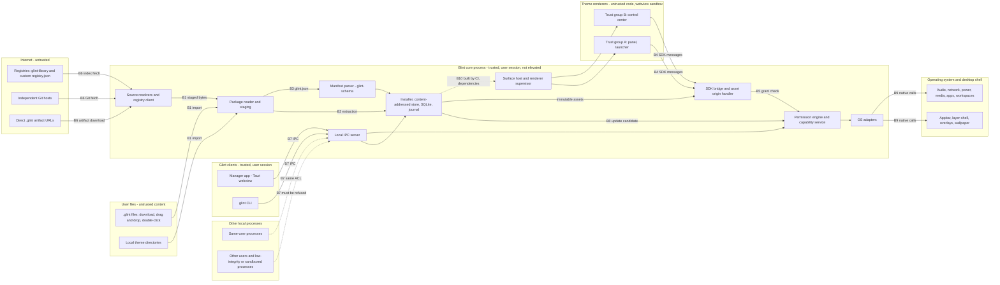

# Glint threat model

| Field | Value |
|---|---|
| Ticket | SEC-001 (epic SEC-EPIC, milestone M0) |
| Revision | 1, 2026-11-23, against `main` at `e4e1460` |
| Method | Data-flow diagram, trust boundaries, STRIDE per boundary, hazard register with owner tickets |
| Review state | Draft for maintainer review. Not yet reviewed by anyone other than its author |
| Next review | See [review triggers](#review-triggers) |

## Read this first

Glint is in its planning and foundation stage. **Almost every control in this
document is planned, not built.** What exists today:

- the strict `glint.json` v1 manifest parser in
  [`crates/glint-schema`](../../crates/glint-schema/src/lib.rs) (SCH-001);
- two throwaway spikes that are never shipped: a bounded `.glint` validator
  swept against 91 hostile archives
  ([package security spike](../research/spikes/package-security.md), SPK-007)
  and a Win32 appbar + WebView2 host with a locked-down webview
  ([Windows appbar spike](../research/spikes/windows-appbar.md), SPK-001);
- repository and CI hygiene (private vulnerability reporting, read-only
  workflow tokens, pinned actions) from PRJ-001.

A library-level installer exists (`glint-installer`: content-addressed
store, journal and crash recovery, INS-003; apply journal and rollback,
INS-005) but nothing calls it yet. There
is no daemon, shell, renderer bridge, source fetcher, registry client,
permission engine or IPC server. Where this document says
"Glint does X", read it as "Glint must do X before the owning ticket closes".

Ticket IDs (for example `PKG-001`) refer to the local project backlog. That
backlog is not published yet, so IDs are plain text, not links. The design
sources are the documents under [`docs/plan/`](../plan/README.md), which are
RECOMMENDED proposals, not frozen specifications.

### Status legend

| Status | Meaning |
|---|---|
| **Implemented** | Product code on `main` enforces it and a named test or check proves it |
| **Prototyped** | Throwaway spike code demonstrated it on the Windows 11 host; product code must still be written and tested |
| **Planned** | Only a design statement and an owner ticket exist |
| **Gap** | No ticket owns it yet; see [backlog gaps](#backlog-gaps) |

## Scope

In scope: everything Glint will run or read on a user's machine, and the
distribution paths that feed it.

- The Glint core (daemon and shell; one process for the MVP), the theme
  renderers, the `@glint/sdk` bridge, the manager app and the `glint` CLI.
- `.glint` packages, local theme directories, the official `glint-library`
  registry, custom registries, independent Git repositories and direct
  artifact URLs.
- OS adapters on Windows, Linux and macOS, through their capability model.
- This repository's build and CI pipeline, as far as it produces Glint.

Out of scope: see [non-goals](#non-goals). The `glint-library` repository
has its own CI and review process (LIB/LQA epics); this model covers only how
Glint *consumes* it.

Hands-on evidence comes from one Windows 11 machine. Linux and macOS
behaviour in this document is design intent and has not been run.

## System description

### Components

| Component | Role | Trust | Exists today |
|---|---|---|---|
| Core process (`glint-daemon` + `glint-shell`) | Owns installed state, grants, profiles and the event bus; talks to OS adapters; hosts surfaces and supervises renderers. One process in the MVP (COR-001); split later (COR-007) | Trusted native code, runs as the logged-in user, never elevated (COR-008) | No |
| Theme renderer | A webview (WebView2, WKWebView, WebKitGTK) running a package's compiled HTML/CSS/JS for one surface or trust group | **Untrusted** | Spike only (SPK-001) |
| Declarative theme content | Tokens, layouts and assets rendered by Glint's own default surfaces | Untrusted data | No |
| SDK bridge | Allow-listed message protocol between a renderer and the core, checked against grants and capabilities | Boundary | Spike only (fixed-string messages) |
| Package reader | Reads and validates `.glint` ZIP archives into staging | Parses untrusted input | Spike only (SPK-007) |
| Manifest parser | Parses `glint.json` | Parses untrusted input | **Yes** (SCH-001) |
| Source resolvers | Local file/directory, Git, artifact URL and registry sources | Fetch untrusted input | No |
| Registry client | Fetches and caches `registry.json` indexes | Fetches untrusted metadata | No |
| Installer and store | Staging, content-addressed immutable store, SQLite state, journal, rollback | Trusted | Partly (`glint-storage`, `glint-installer`; INS-001 to INS-003) |
| Permission engine | Per-package grants and authorization checks | Trusted | No |
| Local IPC server | Typed, versioned requests from the manager and CLI | Boundary | No |
| Manager app (Tauri + UI SDK) | Gallery, install and permission dialogs, profile editor | Trusted UI that displays untrusted metadata | No |
| `glint` CLI | User and creator commands | Trusted, user-invoked | Version command only (PRJ-002) |
| OS adapters | Appbars, layer-shell, overlays, wallpaper, audio, network, power, app launch, hotkeys | Trusted; act on the real desktop | No (appbar spike only) |

### Data-flow diagram

Dashed boxes are trust zones. Labels `B1` to `B10` are the trust boundaries
analysed in [STRIDE per boundary](#stride-per-boundary).

B10 (build and release supply chain) covers how the Glint binaries themselves
are produced; it is drawn as a dashed edge because it is not a runtime flow.

### Trust boundaries

| ID | Boundary | Crosses from | Into | Design source |
|---|---|---|---|---|
| B1 | Package import | User files, staged downloads | Package reader | [Import behavior](../plan/04-themes/manifest-and-glint-package-spec.md#import-behavior) |
| B2 | Archive extraction | ZIP entries | Staging directory and package store | [Manifest validation rules](../plan/04-themes/manifest-and-glint-package-spec.md#manifest-validation-rules) |
| B3 | Manifest | `glint.json` text | Typed manifest used by installer, capability and surface code | [Example root manifest](../plan/04-themes/manifest-and-glint-package-spec.md#example-root-manifest) |
| B4 | Renderer and SDK bridge | Theme JS in a webview | Core bridge and asset origin | [Theme SDK access bridge](../plan/02-architecture/process-model-and-ipc.md#theme-sdk-access-bridge), [renderer isolation](../plan/02-architecture/renderer-and-state.md#renderer-isolation-and-asset-origin) |
| B5 | Capability grants | Package declarations and requests | Permission engine decisions | [User trust](../plan/02-architecture/capabilities-permissions-and-errors.md#user-trust) |
| B6 | Sources and registry fetch | Network hosts | Source resolvers and registry cache | [Git download approach](../plan/05-distribution/sources-and-download-strategies.md#git-download-approach) |
| B7 | Local IPC | Manager, CLI, any local process | Core IPC server | [IPC design](../plan/02-architecture/process-model-and-ipc.md#ipc-design) |
| B8 | Update path | New versions from any source | Installed store, grants and active profile | [Update lifecycle](../plan/05-distribution/installer-lifecycle-and-updates.md#update-lifecycle) |
| B9 | Native shell adapters | Core decisions driven by theme content | Real desktop: work area, z-order, input, OS settings | [Windows backend](../plan/03-platforms/windows-architecture.md), [Linux](../plan/03-platforms/linux-architecture.md), [macOS](../plan/03-platforms/macos-architecture.md) |
| B10 | Build and release supply chain | Dependencies, contributors, CI | Glint binaries and SDK packages | [Release checklist](../plan/06-engineering/testing-and-quality-gates.md#release-checklist) |

**MVP process note.** In the MVP, the daemon and shell share one process
(COR-001). Theme JavaScript still runs in the webview engine's own renderer
processes, so B4 is a process boundary on WebView2 and WKWebView. On
WebKitGTK the strength of that boundary depends on the distribution's
WebKitGTK build and sandbox settings, which is exactly what RND-008 must
decide. A renderer escape in the MVP lands next to the core's state and OS
access rather than in a separate low-privilege shell; COR-007 removes that
shared failure domain later.

## Assets

| ID | Asset | Why it matters | Main boundaries |
|---|---|---|---|
| A1 | User files and app-private data (documents, browser profiles, SSH keys, Glint's own SQLite and config) | Theme code must never read or write the filesystem | B2, B4 |
| A2 | Sensitive desktop data: window titles, foreground app names, SSIDs, media metadata, calendar content, notification text | Readable through SDK providers; privacy controls apply (CAP-006) | B4, B5 |
| A3 | Desktop integrity and availability: work area, z-order, keyboard focus, taskbar, wallpaper, OS settings | A hostile or buggy theme can lock the user out of their own desktop | B9 |
| A4 | Permission grants and capability state | The authorization source of truth; tampering equals escalation | B5, B7, B8 |
| A5 | Installed package store and active profile, including known-good fallback and journal | Corruption breaks recovery and rollback | B2, B8 |
| A6 | Package provenance and identity (source, commit or digest, registry, signing status) | Basis for every trust decision and for honest UI badges | B1, B6, B8 |
| A7 | Credentials: private Git tokens in the OS credential manager, any future registry auth | Must never leave the credential store or enter an export | B6, B7 |
| A8 | Network identity and privacy: installed-theme list, IP address, request timing | Leaks to registries or theme authors profile the user | B4, B6 |
| A9 | User trust in Glint UI: permission dialogs, "official" badges, recovery controls | Spoofing them turns Glint into a phishing surface | B4, B9 |
| A10 | Machine resources: CPU, GPU, memory, battery, disk | Abuse makes Glint unusable as an always-on desktop app | B4, B6 |
| A11 | Glint binaries, SDK packages and release artifacts | A compromised build compromises every user | B10 |

## Actors

| ID | Actor | Capabilities assumed | Goal |
|---|---|---|---|
| ACT1 | Malicious theme author | Full control of a package's manifest, files and compiled JS/CSS; can publish anywhere, including a PR to `glint-library` or a custom registry | Read A1/A2, exfiltrate, run native code, phish (A9), persist, mine, lock the desktop |
| ACT2 | Compromised Git source or registry | Controls a repository, branch, tag, registry index or artifact host that users already trust; can rewrite history and serve different content per request | Push a malicious update to existing users (B8), impersonate a known package, downgrade |
| ACT3 | Network attacker | Observes or modifies traffic between Glint and registries or hosts; captive portals, hostile proxies | Tamper with indexes or downloads, learn the installed-theme list |
| ACT4 | Local unprivileged process | (a) Another OS user or a low-integrity / sandboxed process on the same machine; (b) any process running as the same user | (a) Drive the core over IPC, read another user's state, squat on IPC names. (b) Treated as equal to the user; see non-goals |
| ACT5 | Curious theme | A legitimate, granted theme that reads more than it needs, or two packages colluding | Collect A2 and send it out through any channel it can find |
| ACT6 | Supply-chain attacker | Compromises a crates.io or npm dependency, a GitHub Action, or a contributor account | Ship code inside Glint itself (A11) |

ACT1, ACT2 and ACT5 are the primary design adversaries: Glint's whole value
is running third-party themes, so "the theme is hostile" is the default
assumption, not an edge case.

## Hazard register

This is the list the SEC-001 ticket and the plan's
[security design review](../plan/04-themes/widgets-extensions-and-safe-execution.md#security-design-review)
name. Every hazard has a **primary owner** (the ticket that must deliver the
control) and supporting tickets. The **stop condition** is the observable
result that blocks a release or forces a redesign; none is waivable under a
"beta" label ([SECURITY.md](../../SECURITY.md)).

| ID | Hazard | Primary owner | Supporting tickets | Status | Stop condition |
|---|---|---|---|---|---|
| H01 | Theme JS reaches local files or native IPC | RND-003 | RND-001, RND-002, RND-006, RND-008, CAP-004, COR-003 | Prototyped (SPK-001 webview lockdown); bridge Planned | Any RND-006 fixture reaches an unallowed core method, a file, or a host object. If an engine cannot enforce origin and IPC isolation, untrusted JS moves to a sandboxed subprocess (RND-008); the bridge is never widened to keep a renderer choice |
| H02 | Archive path traversal and extraction escape | PKG-001 | PKG-002, INS-003, QA-004 | Prototyped (SPK-007, 91 fixtures) | Any write outside the staging root, or any write at all before both validation passes succeed |
| H03 | Git history, symlink, submodule, hook and LFS tricks | SRC-004 | SRC-002, SRC-003, SRC-006, INS-007 | Planned | Fetching a source runs any program, initializes a submodule, follows a symlink out of the subpath, or installs content that would fail the archive rules |
| H04 | Remote script injection | RND-002 | PKG-004, RND-001, RND-006, CRT-003 | Import scan **Implemented** (PKG-004: remote `<script src>`, stylesheets, CSS `@import`/`url()`/`image-set()`, JS imports and network APIs, `file://` and UNC references refused; [`references.rs`](../../crates/glint-package/tests/references.rs)); CSP Prototyped (SPK-001) | A packaged entrypoint loads or executes any byte not served from the package's own immutable assets |
| H05 | Manipulated registry metadata | REG-001 | REG-003, REG-005, SEC-005, SCH-004, INS-004, MGR-005 | Planned | Registry data alone (without the package's own validated `glint.json` and digest) changes what is installed, its identity, or a trust badge |
| H06 | Malicious CSS visual spoofing | SEC-003 | MGR-004, RND-007, A11Y-004, DOC-002 | Planned | A theme can render a surface that Glint's own permission, recovery or install UI cannot be distinguished from, or any grant can be obtained through theme-rendered UI |
| H07 | Overlay phishing and lock-screen imitation | SEC-003 | WIN-005, WIN-013, SRF-005, MAC-002, LNX-003 | Planned | A theme gets full-screen, always-on-top or keyboard-capturing UI without an explicit grant, or the recovery hotkey stops working while it is shown |
| H08 | Infinite render loops and CPU miners | SEC-004 | RND-004, PERF-002, QA-006 | Planned | A renderer can hold CPU or memory above budget without being throttled, suspended or killed, or a crash loop does not end in safe mode |
| H09 | API request floods | SEC-004 | SDK-004, COR-004, RND-006 | Planned | Bridge calls, subscriptions or permission prompts from one renderer can starve the core, other surfaces or the OS adapter |
| H10 | Native integration abuse | CAP-004 | CAP-003, CAP-006, SEC-003, SRF-005, WIN-011, MAC-005, LNX-008, LNX-009 | Planned | A theme triggers an OS-level change (power, launch, wallpaper, taskbar, system theme) without a matching grant, or an OS change cannot be reverted or reported exactly |
| H11 | Credentials or private data in exported packages and profiles | PKG-005 | PRF-006, SRC-007, CLI-003 | Planned | An export, diagnostic bundle or profile package contains a token, a credential, a private path or user data the user did not choose to include |

The plan's general
[stop conditions for any deep integration](../plan/06-engineering/risks-feasibility-and-tradeoffs.md#stop-conditions-for-any-deep-integration)
also apply to every adapter: stop and redesign if a feature needs kernel or
root changes, disabling OS protections, injecting into other apps, breaking
OS update paths, unreviewed native theme binaries, or credentials collected
by a Glint-themed login screen.

## STRIDE per boundary

Each table lists the threats that matter for that boundary, not every cell
of STRIDE. Letters: **S**poofing, **T**ampering, **R**epudiation,
**I**nformation disclosure, **D**enial of service, **E**levation of
privilege.

### B1 Package import

Covers `.glint` files opened by drag and drop, double-click, file picker or
CLI, local theme directories, and bytes handed over by a source resolver.

| ID | STRIDE | Threat | Mitigation | Owner | Status |
|---|---|---|---|---|---|
| B1.1 | S | A non-ZIP file (executable, polyglot with a prepended EXE stub) named `.glint` | Identify by magic bytes `PK\x03\x04` at offset 0; open with a fixed archive offset so a shifted archive is refused | PKG-001 | Prototyped: SPK-007 fixtures `not_a_zip_text`, `polyglot_prepended_executable` in [`hostile_fixtures.rs`](../../spikes/package-security/tests/hostile_fixtures.rs) |
| B1.2 | T | The file changes between validation and staging (TOCTOU) | Copy into a Glint-owned staging file while hashing, then validate that copy; the spike's `FILE_SHARE_READ` lock is Windows-only | PKG-001, INS-003 | Prototyped on Windows only; the copy-first design is Planned ([spike gap 2](../research/spikes/package-security.md#gaps-and-recommendations-for-pkg-001)) |
| B1.3 | T | Another local process swaps a junction or symlink into the staging parent | Staging under a Glint-owned directory with a restrictive ACL or mode; handle-relative creation (`openat`, `NtCreateFile` with a root handle, or `cap-std`) | INS-003, PKG-001 | Partly **Implemented**: the installer stages only under `<data>/staging` resolved by `glint-storage` (`0700` on Unix; per-user `%LOCALAPPDATA%` ACL on Windows), refuses candidates staged anywhere else (`candidates_staged_elsewhere_are_refused` in [`transaction.rs`](../../crates/glint-installer/tests/transaction.rs)) and refuses a file, symlink or junction where a Glint-owned directory belongs (`ensure_dirs_refuses_*` in [`paths.rs`](../../crates/glint-storage/tests/paths.rs)). Handle-relative creation is still Planned ([spike gap 3](../research/spikes/package-security.md#gaps-and-recommendations-for-pkg-001)) |
| B1.4 | E | Import activates a theme, or grants permissions, without the user seeing it | Import only installs; activation and grants need an explicit step showing author, origin, permissions and signing status | CLI-002, MGR-002, MGR-004 | Planned |
| B1.5 | T | Same `id` imported from a different origin silently replaces an installed package | Provenance per install; refuse silent same-ID overwrite; ask for explicit disambiguation | INS-004, SCH-004 | Planned |
| B1.6 | E | A local theme directory triggers a build or runs `npm` scripts | Consumer import never builds; directories go through the same validation as archives. `glint theme dev` is a creator tool that runs the author's own toolchain and is documented as such | SRC-001, CRT-005 | Planned |
| B1.7 | D | Huge or slow input (multi-GB file, network share that stalls) | Size checked before parsing (256 MiB default); bounded, cancellable reads | PKG-001 | Prototyped: `archive_file_too_large` |

### B2 Archive extraction

| ID | STRIDE | Threat | Mitigation | Owner | Status |
|---|---|---|---|---|---|
| B2.1 | T, E | `../`, absolute, drive, UNC, device-namespace or verbatim paths write outside staging | Reject (never rewrite) unsafe names with host-independent rules; never use the `zip` crate's `enclosed_name`, `mangled_name` or `extract` helpers | PKG-001, PKG-002 | Prototyped: traversal, absolute, UNC and device fixtures; crate behaviour pinned in [`zip_crate_behaviour.rs`](../../spikes/package-security/tests/zip_crate_behaviour.rs) |
| B2.2 | T, E | Symlinks, hardlinks or device entries, including symlink bits hidden on MS-DOS host entries | Read raw external attributes; only regular files and directories; forbid unknown extra fields (PKWARE Unix `0x000d`, Unicode Path `0x7075`) | PKG-001 | Prototyped: `symlink_bits_on_dos_host`, `pkware_unix_extra_field`, `unicode_path_extra_field` |
| B2.3 | T | Duplicate names, case-fold collisions, file-versus-directory clashes and local/central header disagreement make different tools see different files | Reject exact and case-folded duplicates; ASCII-only names by default; check header consistency and overlapping entries | PKG-001 | Prototyped: `case_fold_manifest_shadow`, `local_and_central_names_differ`, `overlapping_entries_share_data` |
| B2.4 | D | Compression bombs, understated sizes, too many entries, deep trees | Limits on archive size, entry count (checked on the EOCD before the crate parses), per-file and total size, ratio, depth and path length; bounded inflate that compares actual and declared size | PKG-001 | Prototyped: [recommended `PackageLimits`](../research/spikes/package-security.md#recommended-packagelimits-defaults) and 10 bomb fixtures |
| B2.5 | E | Executables or scripts in the package are run later by something | Reject executable extensions and magic (`MZ`, ELF, Mach-O, `#!`); nothing in Glint ever executes package files; SVG images must be inert (no script, `foreignObject`, event handlers, `javascript:` or entity declarations) | PKG-001, PKG-004 | **Implemented**: `pe_magic_disguised_as_png`, `script_extension`, `shell_script_extension` in [`security.rs`](../../crates/glint-package/tests/security.rs); `missing_entrypoint_remote_script_and_executables_have_distinct_codes`, `svg_script`, `install_script_field` in [`references.rs`](../../crates/glint-package/tests/references.rs). `.wasm` is refused; font hinting programs remain open (spike gap 9) |
| B2.6 | T | Paths valid in the archive exceed Windows `MAX_PATH` once joined to the staging root | Long-path-aware APIs or a combined length cap with a typed error | PKG-001, INS-003 | Partly **Implemented**: store entries longer than 260 characters install and remove through the Rust standard library's long-path handling (`installs_store_entries_longer_than_max_path` in [`transaction.rs`](../../crates/glint-installer/tests/transaction.rs)). Gap: bundled SQLite cannot open a database path over 260 characters on Windows (`SQLITE_CANTOPEN`), so a very long `GLINT_HOME` fails at open with `GLINT_STORAGE_DATABASE`; the reader's combined length cap is Planned (spike gap 4) |
| B2.7 | T | Unexercised ZIP features: data descriptors, ZIP64, comments, trailing data, multiple EOCDs | Add fixtures or refuse explicitly | PKG-001, PKG-002 | Planned (spike gap 7; ZIP64 is refused in the spike) |
| B2.8 | T | Installed files modified after install | Content-addressed immutable store; assets served from the store by digest; hash check at boot | INS-003, COR-005, RND-001 | Partly **Implemented**: entries live at `store/<sha256>` with read-only files, appear by one rename from staging and are never written again; re-indexing after database loss re-hashes each archive and discards entries that do not match their address (`a_tampered_store_entry_is_not_reindexed` in [`transaction.rs`](../../crates/glint-installer/tests/transaction.rs)). Serving by digest (RND-001) and a hash check at boot (COR-005) are Planned. A same-user process can still edit the store; see non-goals |

### B3 Manifest

| ID | STRIDE | Threat | Mitigation | Owner | Status |
|---|---|---|---|---|---|
| B3.1 | T | Parser differentials: duplicate keys, unknown or security-sensitive fields ignored by one consumer | Strict parser: duplicate keys refused, unknown fields refused at every defined object, one `schemaVersion` | SCH-001 | **Implemented**: `duplicate_keys_are_rejected`, `unknown_top_level_field_is_rejected`, `unknown_security_sensitive_nested_fields_are_rejected` in [`crates/glint-schema/tests/manifest.rs`](../../crates/glint-schema/tests/manifest.rs) |
| B3.2 | T | Rust parser and TypeScript tooling (creator CLI, manager) disagree | Shared fixture corpus with Rust and TypeScript parity | SCH-002 | Planned |
| B3.3 | T, E | Manifest paths that escape the package or name devices | Relative `/`-separated paths only; no `..`, `\`, `:`, reserved characters or device names; surface entries must be HTML | SCH-001 | **Implemented** (syntax): `unsafe_package_paths_are_rejected`, `surface_entry_must_be_html`. **Implemented** (existence, PKG-004): every token, asset, layout and surface entrypoint must be a file in the archive, and surfaces pass `glint-surfaces` validation (`GLINT_PACKAGE_INVALID_SURFACE`): `missing_surface_entrypoint`, `surface_entrypoint_is_a_directory`, `file_url_entrypoint`, `surface_placement_kind_not_allowed` in [`references.rs`](../../crates/glint-package/tests/references.rs) |
| B3.4 | D | Oversized or deeply nested manifest | 1 MiB limit; per-field length limits; JSON nesting bounded by `serde_json`'s recursion limit | SCH-001 | **Implemented**: `oversized_manifest_is_rejected`, `malformed_json_and_non_object_root_are_rejected` |
| B3.5 | E | Unknown capability IDs slip past checks | Parser accepts only `<namespace>.<name>` IDs in five known namespaces, no duplicates, not both required and optional. The **registry of known IDs** and fail-closed handling of unknown ones are not implemented | SCH-001, CAP-005, CAP-003 | Partly **Implemented** (`invalid_capabilities_are_rejected`); the package reader refuses unknown IDs, fail closed, against a provisional set derived from the surface catalog plus `PROVIDER_CAPABILITIES` (PKG-004: `unknown_surface_capability`, `surface_catalog_capabilities_are_accepted`); the frozen registry (CAP-005) is Planned |
| B3.6 | S | Misleading metadata: author "Glint Team", homoglyph names, a name that copies an official theme | Display identity from provenance, not from `author`; define what `official` means; do not show "verified" until signing exists | SCH-004, MGR-004, MGR-005, SEC-005 | Planned |
| B3.7 | T | `$schema` or URL fields cause network fetches | `$schema` is accepted as an editor hint and never dereferenced; `author.url` is display-only | SCH-001 | **Implemented** for `$schema` (documented in [`lib.rs`](../../crates/glint-schema/src/lib.rs)); display rules Planned (MGR-004) |
| B3.8 | E | Future fields (`integrations`, `variants`, `dependencies`) add permissions sideways | Rejected in v1; when added, variants cannot add permissions and integrations are requests that trusted adapters apply after approval | SCH-001, SCH-005, PRF-008 | **Implemented** (rejection in v1); variant rules Planned |

### B4 Renderer and SDK bridge

| ID | STRIDE | Threat | Mitigation | Owner | Status |
|---|---|---|---|---|---|
| B4.1 | E | Theme JS calls core methods it was not granted, or reaches host objects | Small allow-listed, typed, versioned message protocol; no host objects; core re-checks every call against current grants, capabilities, surface identity and rate limits | RND-003, SDK-001 | Prototyped: SPK-001 disables host objects and accepts only fixed strings from the bundled origin ([policy table](../research/spikes/windows-appbar.md#policy-applied-to-both-webviews)); bridge Planned |
| B4.2 | S | A frame or another renderer impersonates a surface, or replays a token after unload or revocation | Short-lived token per package version and surface instance; check message source origin; rotate on unload, update and revocation | RND-003, RND-006 | Planned. SPK-001 checks message `Source` origin |
| B4.3 | E, I | Loading remote script, `eval`, navigation to other origins, new windows, `file://` | Strict CSP sent as a response header (`default-src 'none'`, `script-src 'self'`, `connect-src 'none'`, `frame-src 'none'`); cancel navigations and refuse the request in the resource handler as a second layer; handle `NewWindowRequested`; deny all webview permission requests | RND-002, WIN-004, MAC-002, LNX-003 | Prototyped on WebView2: SPK-001 [findings 3 to 5](../research/spikes/windows-appbar.md#findings). Not run on WKWebView or WebKitGTK |
| B4.4 | I | Asset handler serves files outside the package (path tricks, other packages, store internals) | Per-package origin; path-normalized handler that serves only validated immutable assets of that package version, from memory or the store | RND-001 | Prototyped: SPK-001 serves from memory and answers 403/404 for everything else |
| B4.5 | I | Exfiltration channels CSP does not cover: external-link hand-off to the default browser, app launch with a URL or arguments, WebRTC ICE/STUN, DNS prefetch and preconnect | No external-link hand-off by default (or a trusted confirmation that shows the full URL); app launch only by enumerated app ID with no theme-supplied arguments; disable WebRTC and prefetch where the engine allows; RND-006 must test each channel | RND-002, RND-006, WIN-011 | **Gap** in acceptance criteria: no ticket names these channels yet (see [backlog gaps](#backlog-gaps)). SPK-007 allows `<a href>` to remote sites by design (`anchor_links_to_remote_sites_are_allowed`), so the renderer must handle the click |
| B4.6 | I | Themes read each other's storage (localStorage, IndexedDB, cookies, cache) through a shared webview profile | One webview profile or partition per trust group; `theme.storage` namespaced to package ID through the core | RND-005, SDK-005 | Planned. SPK-001 uses one fixed profile under `%TEMP%`, which is wrong for the product |
| B4.7 | E | Webview engine vulnerability escapes the renderer sandbox | Keep the engine patched (Evergreen WebView2; supported WebKitGTK versions); in the MVP a full escape reaches the core process; later split (COR-007); fall back to a sandboxed subprocess where the engine is weak (RND-008) | RND-008, COR-007, REL-003 | Planned; runtime version floor is a **Gap** |
| B4.8 | D | Render loops, memory growth, crash loops | Per-renderer timeouts, memory limits, crash counters, safe mode, suspension of hidden surfaces | SEC-004, RND-004, PERF-002 | Planned |
| B4.9 | S | Safe preview leaks real data or performs real actions | Preview host with mock data and no native actions | RND-007, SDK-003 | Planned |
| B4.10 | R | No record of which package performed which action | Trace ID with package, surface, capability and error code on every bridge call; redacted by default | COR-003, CLI-003 | Planned |

### B5 Capability grants

| ID | STRIDE | Threat | Mitigation | Owner | Status |
|---|---|---|---|---|---|
| B5.1 | E | Declaring a capability is treated as having it | Declarations never grant; runtime enforcement by the permission engine | CAP-003, CAP-004 | Partly **Implemented**: the CAP-003 activation gate checks every declared capability against host availability and never treats a declaration as available (`crates/glint-platform/tests/capability_gate.rs`, mock adapter only); grant enforcement (CAP-004) Planned |
| B5.2 | S, E | A package inherits another package's grants by reusing its `id` | Grants bound to package identity **and** provenance (origin, digest) plus version and profile, not to `id` alone | CAP-004, SCH-004, INS-004 | Planned |
| B5.3 | E | Privilege expansion through update, variant, profile override or widget bundling | Re-request on any expansion with a permission diff; variants cannot add permissions; overrides never import executable source | INS-008, MGR-006, SCH-005, PRF-008, PRF-001 | Planned |
| B5.4 | I | Read grants expose more than needed (SSID, window titles, calendar, notification text) | Separate read data from actions; filter event payloads per grant; privacy controls | CAP-006 | Planned |
| B5.5 | E | Confused deputy: OS permissions granted to Glint (macOS Accessibility and Automation, Linux portals) become available to every theme | Each OS-level permission is mapped to a Glint grant and checked per package; Glint's own OS permission is never a theme permission | CAP-004, MAC-005, CAP-007 | Planned |
| B5.6 | E | Unknown capability or namespace silently allowed | Frozen v1 namespace registry; unknown IDs fail closed (warn or reject, never grant) | CAP-005, CAP-003 | Partly **Implemented**: syntax-level check in SCH-001; at activation an ID the host adapter does not advertise is `unknown-capability`, blocking when required and disabled when optional (CAP-003). Frozen registry (CAP-005) Planned |
| B5.7 | D, S | Prompt flooding or consent fatigue pushes the user to "allow all" | Grants asked at install or activation in trusted manager UI; rate-limit runtime requests; no "allow all" | MGR-004, SEC-004 | Planned |
| B5.8 | E | Revocation does not take effect until restart | Revocation event tears down subscriptions and rotates bridge tokens immediately | CAP-004, RND-003 | Planned |

### B6 Sources and registry fetch

| ID | STRIDE | Threat | Mitigation | Owner | Status |
|---|---|---|---|---|---|
| B6.1 | S, T | Plain HTTP, `file:`, `ssh:`, `ext::` or option-like URLs (leading `-`) reach a fetcher | HTTPS only for remote sources; strict parser for `registry/name[@version]`, Git URL `#ref:subpath`, local paths and artifact URLs; never pass a URL to a shell | SRC-002 | **Implemented** (parser): `dangerous_schemes_are_rejected`, `ssh_tricks_are_rejected`, `credentials_are_rejected`, `local_and_ip_hosts_are_rejected` in [`crates/glint-sources/tests/url_parse.rs`](../../crates/glint-sources/tests/url_parse.rs). No fetcher exists yet; post-DNS private-address refusal is SRC-005 (Planned) |
| B6.2 | T | Network attacker or compromised host alters a download | TLS with platform certificate validation; streaming SHA-256; optional `sha256` and registry `integrity` verified before unpacking; pinned commit SHA for Git | SRC-005, SRC-003, REG-001 | Planned |
| B6.3 | E | Git fetch runs code: hooks, submodules, filters, LFS smudge, `core.*` config | Use an in-process Git implementation or a locked-down invocation; never run hooks or init submodules; LFS resolved deliberately or rejected | SRC-004, SRC-003 | Planned |
| B6.4 | T | Checked-out tree contains symlinks out of the subpath, case collisions or hostile names | Treat every Git tree like an archive: build a canonical package and run the PKG-001/PKG-004 rules on it (one pipeline for every source) | INS-007, SRC-004, PKG-003 | Planned |
| B6.5 | S | Registry index lies: wrong path, wrong version, an `id` belonging to someone else | Index is not runtime truth: the installed package's own `glint.json` and digest must validate and match; provenance recorded; registries distinguished from direct sources | REG-001, REG-003, INS-004 | Planned |
| B6.6 | S | Third-party registry or repo impersonates the official library | Bundled official registry config is read-only; "official" shown only for packages from that registry; until signing exists, UI says "unsigned" | REG-002, REG-005, MGR-005, SEC-005 | Planned |
| B6.7 | T | Rollback or freeze: a source serves an older vulnerable version or a stale index forever | Version monotonicity per installed lineage; index TTL; signing and revocation design | SEC-005, INS-008, REG-001 | Planned (decision in SEC-005) |
| B6.8 | I | Registries learn the installed-theme list or user identity | Request only needed metadata and downloads; no installed list; offline mode | SRC-007 | Planned |
| B6.9 | I | Private Git credentials stored in config, logs or exports | System credential manager only; never embedded in `.glint` exports | SRC-007, PKG-005 | Planned |
| B6.10 | D | Huge indexes, slow hosts, full clones of a multi-GB library | Index-first, bounded sizes and timeouts, sparse or partial fetch, cache with locks and cleanup | REG-001, REG-004, SRC-006, SPK-011 | Planned |

### B7 Local IPC

| ID | STRIDE | Threat | Mitigation | Owner | Status |
|---|---|---|---|---|---|
| B7.1 | S, E | Another OS user, a remote client, or a low-integrity or AppContainer process connects to the core | Windows: named pipe with an explicit DACL for the current user SID only, `PIPE_REJECT_REMOTE_CLIENTS`, default medium integrity label kept, client token checked. Unix: socket in a per-user `0700` runtime directory, peer credentials checked | SEC-002, COR-003 | Planned |
| B7.2 | S | Pipe or socket name squatting by a process that starts first | Create the first instance exclusively (`FILE_FLAG_FIRST_PIPE_INSTANCE`); clients verify the server's owner before sending | SEC-002, COR-002 | Planned |
| B7.3 | T, E | Arbitrary command names or shell invocations through IPC | Typed, versioned enum of requests; no generic "run" or path-taking execution | COR-003, CLI-006 | Planned |
| B7.4 | E | Theme webviews reach the IPC or the manager's Tauri commands | Theme content is never loaded in the manager's privileged webview; previews use the restricted preview host; renderers talk only to the bridge | RND-007, MGR-001, MGR-003 | Planned. Manager webview hardening (Tauri capabilities, CSP, rendering untrusted metadata) is a **Gap** |
| B7.5 | D | Oversized messages, slow clients, subscription storms | Bounded frames and queues, timeouts, coalescing with sequence IDs and snapshots | COR-003, COR-004 | Planned |
| B7.6 | I | Diagnostics (`glint doctor`, `status`) leak SSIDs, paths or tokens | Redaction by default | CLI-003 | Planned |

### B8 Update path

Covers theme updates from every source and registry refreshes. Glint has no
application self-update design; the Windows installer (REL-003) and signed
artifacts (REL-007) are the only planned binary distribution path.

| ID | STRIDE | Threat | Mitigation | Owner | Status |
|---|---|---|---|---|---|
| B8.1 | E | Silent remote code replacement | Manual or opt-in updates by default (`auto_update = false`); metadata refresh is not upgrade | INS-008, CLI-005 | Planned |
| B8.2 | E | Update adds permissions or capabilities | Permission diff shown; explicit approval before activation | INS-008, MGR-006, CAP-004 | Planned |
| B8.3 | T | Update mutates the known-good package in place or breaks rollback | Stage a new version beside the old one; never overwrite the only known-good package; journal and crash rollback | INS-008, INS-005, INS-009 | Partly **Implemented** (INS-003, INS-005): releases are stored side by side by digest and never overwritten; an apply journals the prior active profile and every planned native change with its snapshot, and an interruption at any step leaves the previous theme active and is rolled back at the next start (`an_interruption_at_every_step_leaves_the_previous_theme_active` in [`rollback.rs`](../../crates/glint-installer/tests/rollback.rs)); settings that cannot be restored are reported as `GLINT_APPLY_ROLLBACK_INCOMPLETE` (`a_partial_restore_is_reported_as_rollback_incomplete`). Update staging (INS-008) and real native adapters are Planned |
| B8.4 | S | Git branch head moves and is treated as the installed version | Pin commit; checking the head never changes the installed version | SRC-003, PRF-002 | Planned |
| B8.5 | S | Same `id`, new origin: an update arrives from a different source | Updates only from the recorded origin; a different origin is a new package that needs explicit disambiguation | INS-004, SCH-004 | Planned |
| B8.6 | T | Downgrade to an older, vulnerable version | Refuse lower versions per lineage without an explicit user action; signing and revocation policy | SEC-005, INS-008 | Planned |

### B9 Native shell adapters

| ID | STRIDE | Threat | Mitigation | Owner | Status |
|---|---|---|---|---|---|
| B9.1 | D | Theme placement reserves most of the work area, or a crash leaves the reservation behind | Bound placements in the layout engine; idempotent appbar unregister on every exit path; remove stale registrations at start | SRF-003, WIN-003, SRF-005 | Prototyped: SPK-001 unregisters on destroy, console control, panic and drop; forced kill observed to free the area on one Explorer build ([termination paths](../research/spikes/windows-appbar.md#termination-paths)) |
| B9.2 | S, D | Always-on-top or full-screen overlay imitates OS dialogs (UAC, login, Wi-Fi) or captures the keyboard | Explicit opt-in grants for always-on-top and keyboard capture; full-screen secure-looking prompts blocked; Glint overlays visually distinct; Glint never asks for OS credentials | SEC-003, WIN-005 | Planned |
| B9.3 | D | Theme hangs or covers the screen and the user cannot recover | OS-wide recovery hotkey into safe mode; CLI `glint safe-mode` and `glint theme use default`; built-in default theme | WIN-013, CLI-002, THM-001, RND-004 | Planned |
| B9.4 | T | OS taskbar hidden, system theme or wallpaper changed and not restored | Never hide the taskbar without explicit reversible permission; snapshot and restore per adapter with honest `canRestore` reporting | SRF-005, WIN-002, WIN-010, COR-006 | Planned |
| B9.5 | E | App launch used to run arbitrary programs, paths, URLs or arguments | Launch only applications enumerated by the adapter, by ID, through documented shell APIs, behind a launch grant | WIN-011 | Planned |
| B9.6 | E | Power or system actions (shutdown, network toggle) triggered by theme code without user intent | Separate action grants; confirmation for destructive actions in the power menu | CAP-004, SRF-001 | Planned |
| B9.7 | E | Theme installs a GNOME extension, KDE global theme or other native component | Never installed implicitly by a `.glint`; separately versioned, opt-in, project-maintained | LNX-008, LNX-009 | Planned |
| B9.8 | E | Autostart or adapters require elevation | Autostart at user login without elevation; no privileged service | COR-008 | Planned |
| B9.9 | T | Adapter reports success for an action the OS refused | Typed results that distinguish unsupported, permission-denied, unavailable, timeout and failure; confirm the final OS state | CAP-001, SDK-004 | Partly **Implemented**: typed `CapabilityError` codes and categories in `glint-platform` (CAP-001); no native adapter or final-state confirmation yet |

### B10 Build and release supply chain

| ID | STRIDE | Threat | Mitigation | Owner | Status |
|---|---|---|---|---|---|
| B10.1 | E | Untrusted pull requests reach secrets or write tokens | Workflows use `permissions: contents: read`, `persist-credentials: false`, no `pull_request_target` | PRJ-001 | **Implemented**: [`security-analysis.yml`](../../.github/workflows/security-analysis.yml), [`repository-checks.yml`](../../.github/workflows/repository-checks.yml) |
| B10.2 | T | A moved tag in a GitHub Action | Actions pinned to full commit SHAs; Dependabot for Actions | PRJ-001, REL-009 | **Implemented** (pins and [`dependabot.yml`](../../.github/dependabot.yml) for Actions and pip) |
| B10.3 | T | Vulnerable or malicious Rust or npm dependency | Exact pins for security-critical crates (`zip = "=9.8.1"` with a reduced feature set, re-run the behaviour tests on upgrade); advisory and license gate | PKG-001, REL-002, REL-009 | Partly mitigated (REL-002). Dependabot has `cargo` and `npm` entries, and the "Dependency policy" CI job runs `cargo deny` (RustSec advisories, licenses, bans, sources) on pull requests and weekly; there is no npm vulnerability audit yet: **Gap (npm advisories)** |
| B10.4 | S | Users cannot tell a real Glint binary from a repackaged one | Signed artifacts and SBOMs; macOS notarization | REL-007, REL-005, MAC-007 | Planned |
| B10.5 | R | Vulnerability reports go to public issues | Private reporting route | PRJ-001 | **Implemented**: [SECURITY.md](../../SECURITY.md) |
| B10.6 | T | Parsers miss malformed input that unit fixtures do not cover | Fuzz the manifest parser and archive reader | none | **Gap**: SECURITY.md lists fuzzing as a planned release gate, but no ticket owns it |

## Evidence index

What is actually built or measured today. Everything not listed here is
Planned.

| Control | Status | Evidence | Verified by |
|---|---|---|---|
| Strict manifest parsing: size, duplicate keys, unknown fields, ID, SemVer, path syntax, capability syntax, renderer kind | Implemented | [`crates/glint-schema/src/parse.rs`](../../crates/glint-schema/src/parse.rs), [`tests/manifest.rs`](../../crates/glint-schema/tests/manifest.rs) | `cargo test -p glint-schema` |
| Bounded two-pass `.glint` validator, typed errors, no writes on rejection, 91 hostile fixtures | Prototyped | [package security spike](../research/spikes/package-security.md) | `cargo test -p glint-spike-package-security` (125 tests on the Windows 11 host) |
| `zip` 9.8.1 unsafe helpers documented and pinned by tests | Prototyped | [`zip_crate_behaviour.rs`](../../spikes/package-security/tests/zip_crate_behaviour.rs) | same |
| WebView2 lockdown: in-memory origin, CSP header, navigation cancel plus request refusal, new windows blocked, permissions denied, host objects off, origin-checked fixed messages | Prototyped | [Windows appbar spike](../research/spikes/windows-appbar.md) | `cargo run -p spike-windows-appbar --release -- --smoke 9` (10 of 10 checks on one machine; no visual check, SPK-002) |
| Appbar unregister on every exit path | Prototyped | same | same; Explorer restart and fullscreen not exercised |
| Capability contracts fail closed: typed availability and error codes, undiscovered/unadvertised/stale capabilities never usable, required capabilities block activation before any state change | Implemented (mock adapter only; no native adapter) | [`crates/glint-platform`](../../crates/glint-platform/src/lib.rs) | `cargo test -p glint-platform` |
| CI least privilege and pinned actions | Implemented | [`security-analysis.yml`](../../.github/workflows/security-analysis.yml) | by inspection; no automated check enforces these settings |
| Private vulnerability reporting | Implemented | [SECURITY.md](../../SECURITY.md) | inspection |

## Non-goals

Glint does not defend against these. Each is a deliberate boundary, consistent
with [SECURITY.md](../../SECURITY.md) and the plan's
[anti-goals](../plan/00-history/decisions-and-open-questions.md#anti-goals--forbidden-assumptions).

1. **A compromised OS, administrator, driver or modified Glint binary.**
2. **Same-user malware (ACT4b).** A process running as the user can already
   read the user's files, edit Glint's SQLite database, config and package
   store, and inject into Glint. Glint's goal is to add no escalation path:
   it never runs elevated and never exposes anything to other users. It does
   not try to protect its own state from the user's own processes.
3. **OS-owned secure surfaces.** Login, lock screen, UAC and Secure Desktop
   are not Glint surfaces; Glint never asks for OS credentials and never
   replaces them.
4. **Pixel-perfect anti-spoofing inside a theme's own surface.** A theme
   decides every pixel of its panel or launcher. Glint limits what that UI
   can *do* (no grants through theme UI, no network by default, no
   full-screen secure prompts), not what it can *draw*.
5. **Theme quality and honesty review.** Official-library review and scanning
   are extra defence for that one registry, never a substitute for the
   runtime sandbox, and say nothing about independent sources.
6. **Creator-side builds.** `glint theme dev` and `build` run the author's
   own Node toolchain and dependencies on the author's machine. Building an
   untrusted repository is the author's risk, as with any `npm install`.
7. **Arbitrary native code from themes.** There is no native extension API in
   v1, so there is nothing to sandbox there. Approved native integrations are
   project-maintained code shipped with Glint.
8. **Anonymity against registries and Git hosts.** Glint minimizes what it
   sends (B6.8) but a host always sees the requesting IP address.

## Residual risks

Risks that remain after every planned mitigation, in priority order. These
are the input to SEC-006's pre-1.0 audit.

| # | Risk | Why it remains | Watch |
|---|---|---|---|
| R1 | Webview engine zero-day escapes the renderer | Engines are large and outside Glint's control; in the MVP an escape reaches the core process directly | Engine version floor, COR-007, RND-008 |
| R2 | Bridge design or implementation bug exposes a method or data beyond a grant | The bridge is new code and the most attractive target | RND-006 hostile suite on every release |
| R3 | Covert exfiltration through channels the CSP does not govern | Engines add features; WebRTC, prefetch and link hand-off differ per engine | RND-006 per engine, B4.5 |
| R4 | Visual phishing inside a granted theme surface | See non-goal 4; a convincing fake Wi-Fi or account prompt can still be drawn | SEC-003, DOC-006 user guidance |
| R5 | Unsigned ecosystem until SEC-005 ships | Provenance can be recorded but not proven; a compromised Git host can push a convincing update | SEC-005, INS-008 permission diff |
| R6 | Colluding packages from the same publisher in one trust group share data | Trust groups trade isolation for memory (about 175 MiB private for two surfaces on WebView2) | RND-005, PERF-001 |
| R7 | WebKitGTK sandbox strength varies by distribution | Linux isolation depends on the distribution's build and settings | RND-008, LNX-006 |
| R8 | OS settings not fully restorable | Some native preferences are not atomic or reversible | `canRestore` reporting, COR-006 |
| R9 | Remote-reference scan at import is heuristic | It cannot see string-built URLs; the CSP is the real control | Keep both layers |
| R10 | Same-user tampering of the package store or grants | Non-goal 2 | Integrity check at boot (COR-005) detects accidents, not attackers |

## Top risks

The ten risks that most deserve engineering attention now, combining impact
and how much of the control is still unbuilt:

1. **Bridge over-exposure** (H01, B4.1, B4.2). Owner RND-003; proven by
   RND-006. Nothing beyond fixed strings exists yet.
2. **Single-process MVP plus weak engine isolation** (B4.7, R1, R7). A
   renderer escape or Linux sandbox gap lands in the trusted core. Owners
   RND-008, COR-007.
3. **Exfiltration outside the CSP** (B4.5). External links, app launch with
   URLs, WebRTC and prefetch are not named in any acceptance criteria yet.
4. **Archive staging races** (B1.2, B1.3, B2.6). The validator is prototyped;
   copy-first staging, handle-relative writes and long paths are not.
   Owners PKG-001, INS-003.
5. **Git sources bypassing archive rules** (H03, B6.3, B6.4). Owners SRC-004,
   INS-007.
6. **Identity and "official" spoofing without signing** (H05, B3.6, B6.6,
   R5). Owners SCH-004, SEC-005, MGR-005.
7. **Privilege expansion through update, variant, profile or reused `id`**
   (B5.2, B5.3, B8.2, B8.5). Owners CAP-004, INS-008, SCH-005.
8. **Overlay phishing and desktop lockout** (H06, H07, B9.2, B9.3). Owners
   SEC-003, WIN-013, SRF-005.
9. **Resource abuse and prompt floods** (H08, H09, B5.7). Owners SEC-004,
   RND-004.
10. **IPC exposure to other users and squatting** (B7.1, B7.2). Owner
    SEC-002.

## Backlog gaps

Controls this model needs that no existing ticket clearly owns. These are
proposals for the maintainer; no ticket has been created.

| Proposed ticket | Covers | Suggested home |
|---|---|---|
| Fuzz the manifest parser and `.glint` reader in CI | B10.6; SECURITY.md already promises fuzzing | SEC epic, M1 (alongside PKG-002) |
| npm advisory gate (the Rust side is the `cargo deny` "Dependency policy" job) | B10.3; no npm vulnerability audit runs yet | REL-009 scope extension or a new SEC ticket, M0 |
| Name and test non-CSP exfiltration channels: external link hand-off, app launch arguments and URLs, WebRTC, DNS prefetch and preconnect | B4.5, R3 | Extend RND-002 and RND-006 acceptance criteria; WIN-011 for launch arguments |
| Webview runtime version floor and update policy (Evergreen WebView2, minimum WebKitGTK and WKWebView) | B4.7, R1 | RND epic or REL-003, M2 |
| Per-trust-group webview profile and storage partition | B4.6 | Extend RND-005 acceptance criteria |
| Harden the manager webview: Tauri capability allow-list, CSP, safe rendering of untrusted registry metadata and preview images | B7.4, B3.6 | MGR epic security ticket, M1 |
| Package and registry revocation delivery (how a removed malicious theme is flagged on installed machines) | B6.7, R5 | SEC-005 decides; implementation ticket needed after the ADR |
| Staging directory ACLs and handle-relative writes, long-path policy | B1.3, B2.6 | Make explicit in PKG-001 and INS-003 acceptance criteria |

## Review triggers

Revisit this document, and bump its revision, when any of these happens:

- A spike or ticket changes a boundary: the renderer backend decision
  (SPK-012, RND-008), the IPC transport (COR-003), the process split (COR-007)
  or the signing model (SEC-005).
- A new capability namespace, SDK method, bridge message, network capability
  or native integration is proposed (CAP-005, any SDK ticket, SCH-005).
- A new package `kind`, manifest field or source type is added.
- A new platform host or packaging mode ships (for example Flatpak or the
  Mac App Store), or a webview engine changes its security model.
- An application self-update mechanism is proposed (none exists today).
- Any H01 to H11 stop condition is hit, or a vulnerability report is
  received.
- Before each milestone gate (QA-M1 to QA-M5) and before the SEC-006 release
  audit.

When a control moves from Planned to Implemented, update its row with the
evidence path and the test that proves it, and add it to the
[evidence index](#evidence-index).
